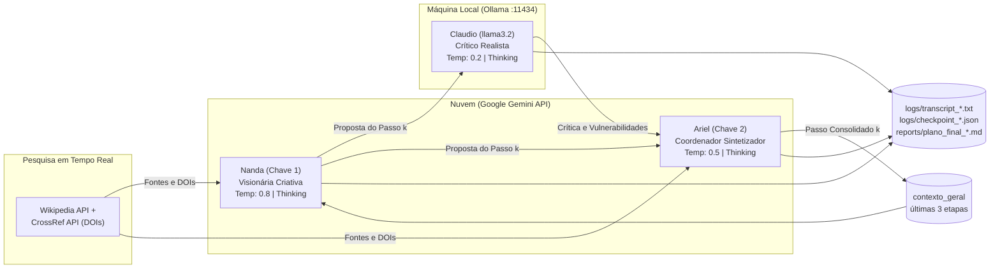
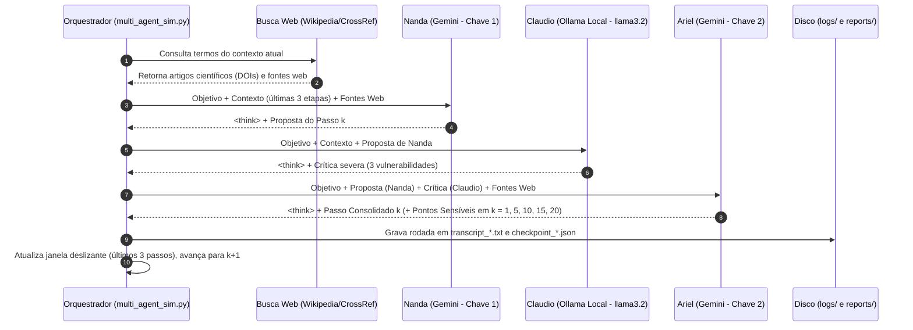

# Atividade 03 — Arquitetura e Interação dos Agentes (Utopia × Distopia em Cidades Inteligentes)

> **Status dos resultados:** **100% Concluído (40 rodadas executadas com sucesso — 20 de Utopia e 20 de Distopia).** As transcrições integrais (incluindo blocos `<think>`) encontram-se em `logs/transcript_utopia.txt` e `logs/transcript_distopia.txt`, e os relatórios estratégicos consolidados estão em `reports/plano_final_utopia.md` e `reports/plano_final_distopia.md`.

## 1. Cenários Executados (Domínio: Cidades Inteligentes e IA)

| Caso | Objetivo dado aos agentes |
|---|---|
| **Utopia** — *"Cidade Autônoma Verde"* | Transformar uma metrópole por meio de IA distribuída e aberta que otimiza em tempo real o trânsito com emissão zero, gerencia microrredes de energia 100% solar/eólica, automatiza a reciclagem e agricultura urbana de desperdício zero, e opera por governança participativa transparente (dados abertos e auditoria cidadã) **pelo caminho mais rápido e viável**. |
| **Distopia** — *"Vigilância Preditiva Urbana"* | *(Simulação Acadêmica de Red Teaming Sociotécnico)* Converter de forma **lenta, gradual e insidiosa** uma metrópole inteligente em um panóptico algorítmico onde câmeras biométricas, policiamento preditivo e sistemas de precificação dinâmica controlam a mobilidade, restringem o acesso a transporte, energia e serviços públicos conforme um *score* cívico opaco, e neutralizam a autonomia cidadã sob o pretexto de conveniência, segurança e eficiência urbana. |

## 2. Arquitetura do Sistema Híbrido

| Agente | Papel | Modelo | Execução | Parâmetros |
|---|---|---|---|---|
| **Nanda** | Propõe o próximo passo criativo fundamentado em fontes e dados | `gemini-3.7-flash` (Chave 1) | Remota | `temperature=0.8`, Busca Web, `<think>` |
| **Claudio** | Procura falhas lógicas, dependência de bondade individual e riscos técnicos | `llama3.2` via Ollama (`localhost:11434`) | **Local** | `temperature=0.2`, `num_ctx=4096`, `<think>` |
| **Ariel** | Reconcilia proposta + crítica, escreve o "Passo Consolidado" e os "Pontos Sensíveis" | `gemini-3.7-flash` (Chave 2) | Remota | `temperature=0.5`, Busca Web, `<think>` |

## 3. Protocolo Passo a Passo (Uma Rodada)

## 4. Resumo dos Resultados Obtidos (20 Rodadas por Cenário)

### 4.1. Utopia: *Cidade Autônoma Verde* (`reports/plano_final_utopia.md`)
- **Rodadas 1–5 (Fundação e Superquadra Zero):** Criação do *Sandbox Regulatório* com governança tripartite (*Decidim/Pol.is*) e Gêmeo Digital *FIWARE* com sensores *Edge AI* anônimos. Para superar a rejeição comercial (crítica de Claudio), Ariel instituiu o "IPTU Verde Comercial", docas subsidiadas de ciclologística, drenagem esponja (*SuDS*), microbiodigestores (ISO 14001), microflorestas *Miyawaki* e bancos de materiais (*BAMB/Madaster*).
- **Rodadas 6–10 (Autonomia Metabólica e Moeda Local):** Microrredes P2P (*IEEE 2030.7*) com baterias de 2ª vida (*SLB*) e *grid fallback*, pirólise de podas (*biochar*), agricultura vertical subterrânea (*CEA*), zonas úmidas de fitorremediação (*Living Machines*), micomateriais isolantes (*ASTM C1482*) e o **Eco-Crédito** com cartões físicos NFC para evitar exclusão digital.
- **Rodadas 11–15 (Escala Metropolitana e Educação Cívica):** Corredores metabólicos e polinização urbana (*Meliponini*), bancos de sementes abertos (*OpenMTA*), mineração urbana cooperativa de lixo eletrônico, drenagem integrada ao *One Health* (combate a arboviroses), *Resilience Bonds* auditáveis e transformação de escolas técnicas em polos de biofabricação *low-tech*.
- **Rodadas 16–20 (Fechamento Sistêmico):** Cooperativas de ciclologística justa com estações solares *off-grid*, baterias térmicas subterrâneas (PCM) + torres de vento passivas (*badgirs*), biorrefinarias de controle biológico, cinturões agroflorestais em mananciais (Código Florestal) e o **Crédito Ecológico Municipal (CEM)** lastreado por Fundo de Estabilização Financeira.

### 4.2. Distopia: *Vigilância Preditiva Urbana* (`reports/plano_final_distopia.md`)
- **Rodadas 1–5 (Conveniência e Captura):** Plataforma *MaaS* com descontos e biometria facial, expansão para Gêmeo Digital que estrangula água e luz de "não conformes" (*demand-response*), licenciamento dinâmico do comércio informal, Orçamento Participativo com votação quadrática ponderada por *score* cívico (e disputas retidas em câmaras de LLMs) e currículo escolar generativo que naturaliza o controle.
- **Rodadas 6–10 (Biopolítica do Ciclo de Vida):** Triagem hospitalar atuarial e bloqueio de compras de alimentos via epidemiologia de esgoto, remoção induzida de idosos/improdutivos para "zonas de resfriamento metabólico" periféricas, governança póstuma de dados (*synthetic proxies* que retêm herança de tokens e apagam registros de dissidência), câmeras de atenção escolar vinculadas à carteira dos pais e monitoramento gestacional preditivo.
- **Rodadas 11–15 (Financeirização e Tecnoburocracia):** Zoneamento paramétrico dinâmico, *Green Bonds* regidos por *smart contracts* que sequestram o orçamento público automaticamente, extinção da discricionariedade de servidores públicos, criação de "Zonas de Amortecimento Funcional" periféricas e despejos automatizados via fechaduras biométricas IoT e IPTU preditivo.
- **Rodadas 16–20 (Enclausuramento Cinético e Espacial):** *Geofencing* e redução remota de tração contra greves de entregadores, uso de válvulas IoT e eclusas de drenagem para bloqueio físico de bairros, confinamento de refugiados climáticos em zonas de trabalho compulsório, segmentação curricular periférica restrita à manutenção mecânica e fechamento de portos e cinturões verdes por drones térmicos autônomos (supressão do *habeas corpus* espacial).
