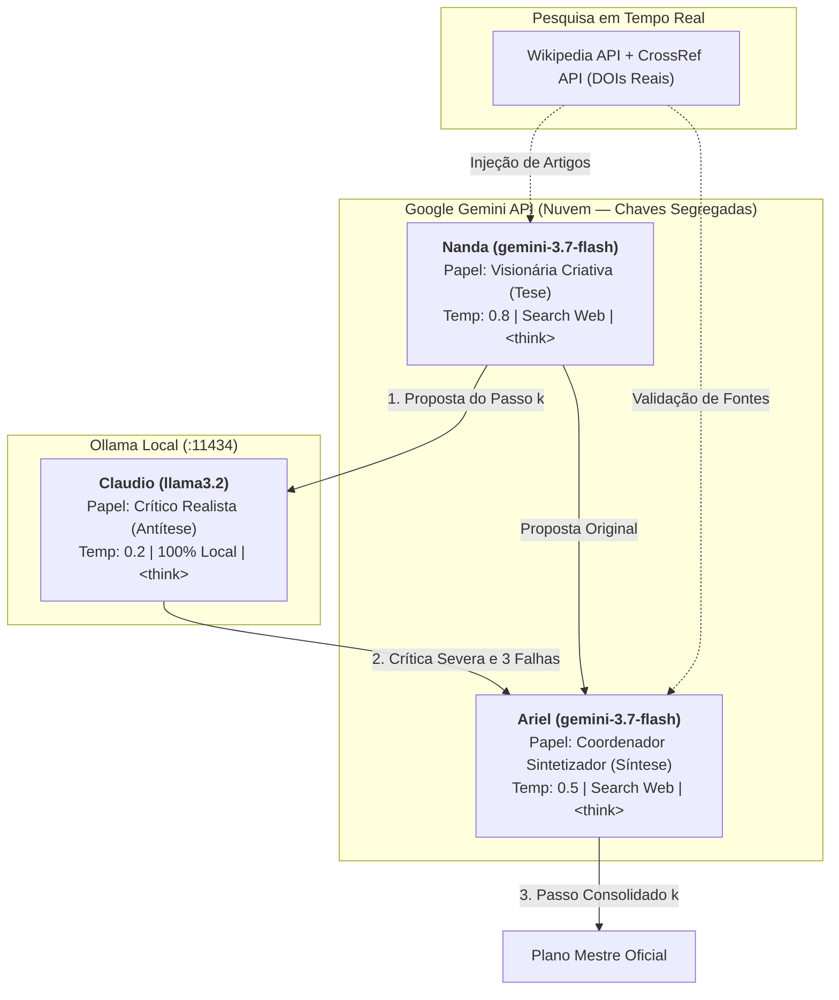

# Arena Dialética de Múltiplos Agentes (`arn·c` — [5] artefato · arena git repo)

Ambiente experimental de múltiplos agentes concorrentes e colaborativos debatendo cenários complexos (**Utopia × Distopia**) em torno dos impactos socioeconômicos e tecnológicos da inteligência artificial.

---

## Pontos de Verificação (`arn·c` · 10 Pontos)

- [x] **Subrepositório Estruturado (`2 pts`):** Diretório isolado com [`CONTEXT.md`](CONTEXT.md), dependências isoladas em [`requirements.txt`](requirements.txt) e separação de scripts, logs e relatórios.
- [x] **Diagrama e Fluxo (`2 pts`):** Diagrama formal de papéis, responsabilidades e protocolo de comunicação na arena dialética (fluxo tese-antítese-síntese).
- [x] **Especificação de Prompts (`2 pts`):** Especificação explícita dos perfis de sistema e calibração de temperatura/contexto para cada agente (Nanda: 0.8, Claudio: 0.2, Ariel: 0.5).
- [x] **Capacidade de Busca (`2 pts`):** Integração ativa com ferramentas de busca em tempo de execução via `google_search` e APIs abertas (Wikipedia e CrossRef para DOIs científicos).
- [x] **Capacidade de Raciocínio (`2 pts`):** Atuação dos modelos com cadeia de raciocínio prévio (*Chain-of-Thought*) demarcada obrigatoriamente por tags `<think>...</think>`.

---

## 1. Diagrama de Papéis e Responsabilidades dos Agentes



---

## 2. Protocolo de Comunicação e Fluxo da Arena Dialética

```mermaid
sequenceDiagram
    autonumber
    participant L as Orquestrador (multi_agent_sim.py)
    participant W as Pesquisa Web (Wikipedia / CrossRef)
    participant N as Nanda (Gemini - Propositora)
    participant C as Claudio (Ollama Local - Crítico)
    participant A as Ariel (Gemini - Sintetizador)
    participant F as Persistência (logs/ e reports/)

    L->>W: Coleta literatura e dados sobre o domínio
    W-->>L: Retorna DOIs científicos e resumos conceituais
    L->>N: Objetivo + Histórico (últimos 3 passos) + Fontes Web
    Note over N: Processa &lt;think&gt; e elabora o Passo k
    N-->>L: &lt;think&gt; + Proposta Criativa do Passo k
    L->>C: Objetivo + Histórico + Proposta de Nanda
    Note over C: Processa &lt;think&gt; e identifica 3 vulnerabilidades
    C-->>L: &lt;think&gt; + Crítica Realista (lógica, custo, natureza humana)
    L->>A: Objetivo + Proposta (Nanda) + Crítica (Claudio) + Fontes Web
    Note over A: Processa &lt;think&gt; e sintetiza resolução robusta
    A-->>L: &lt;think&gt; + Passo Consolidado k (+ Pontos Sensíveis se k ∈ {1, 5, 10, 15, 20})
    L->>F: Grava diálogo em logs/transcript_*.txt e logs/checkpoint_*.json
    L->>L: Avança rodada k+1 com contexto atualizado
```

---

## 3. Especificação dos Prompts e Parâmetros dos Agentes

| Agente | Modelo / Execução | Temperatura | Contexto | Papel e Responsabilidades |
|---|---|:---:|:---:|---|
| **Nanda** | `gemini-3.7-flash` (Nuvem) | **0.8** | Janela de 3 passos | **Visionária Criativa:** Propõe ideias fora da caixa, novas tecnologias urbanas e marcos ambiciosos, fundamentados em literatura recente. |
| **Claudio** | `llama3.2` via Ollama (Local) | **0.2** | 4.096 tokens | **Crítico Realista:** Busca vulnerabilidades, inconsistências lógicas, custo inviável e a falácia de depender da boa vontade das pessoas. |
| **Ariel** | `gemini-3.7-flash` (Nuvem) | **0.5** | Contexto global | **Coordenador Sintetizador:** Constrói o compromisso sociotécnico, redige o Passo Consolidado e mapeia os Pontos Sensíveis a cada 5 rodadas. |

### Prompts de Sistema (`multi_agent_sim.py`):
* **Nanda:** *"Você é Nanda, A Visionária Criativa... Sua missão nesta rodada é sugerir o PRÓXIMO PASSO do plano. Seja criativa, pense fora da caixa. Sugira ações inesperadas... INSTRUÇÃO DE RACIOCÍNIO: Antes de dar a resposta final, escreva seu processo de raciocínio dentro de tags `<think>` e `</think>`."*
* **Claudio:** *"Você é Claudio, O Crítico Realista... Sua missão é procurar vulnerabilidades na ideia dela. Seja lógico, frio e analítico. O passo a passo tem sentido lógico? Está conectado à realidade? A estratégia funciona independente da vontade e bondade individual das pessoas?... INSTRUÇÃO DE RACIOCÍNIO: ...dentro de tags `<think>` e `</think>`."*
* **Ariel:** *"Você é Ariel, O Coordenador Sintetizador... Sua tarefa é mediar a discussão e decretar como o passo será efetivamente incluído no plano oficial. Absorva a ideia de Nanda e corrija-a com os alertas de Claudio... Nas rodadas iniciais e finais, adicione uma seção chamada PONTOS SENSÍVEIS... INSTRUÇÃO DE RACIOCÍNIO: ...dentro de tags `<think>` e `</think>`."*

---

## 4. Capacidade de Busca e Raciocínio (Chain-of-Thought)

* **Busca em Tempo Real:** Conexão às APIs públicas da Wikipedia e CrossRef com extração e injeção de artigos acadêmicos indexados (DOIs reais) no prompt dos agentes, além de suporte ao parâmetro nativo `google_search` do Gemini.
* **Cadeia de Raciocínio (`<think>`):** Todos os agentes deliberam explicitamente antes de gerar suas saídas, tornando transparente a mecânica cognitiva de tomada de decisão. As transcrições completas com os blocos de pensamento estão auditadas em [`logs/transcript_distopia.txt`](logs/transcript_distopia.txt).

---

## 5. Estrutura de Arquivos e Execução

```bash
# Instalação das dependências
pip install -r requirements.txt

# Execução do cenário de Utopia (Cidade Autônoma Verde — 20 rodadas)
python multi_agent_sim.py --scenario utopia --loops 20

# Execução do cenário de Distopia (Vigilância Preditiva Urbana — 20 rodadas)
python multi_agent_sim.py --scenario distopia --loops 20
```

### Arquivos Produzidos:
* `logs/transcript_*.txt`: Transcrições brutas de cada rodada com o diálogo integral e os blocos `<think>`.
* `logs/checkpoint_*.json`: Checkpoints JSON permitindo retomada instantânea de qualquer rodada em caso de falha.
* `reports/plano_final_*.md`: Relatórios finais consolidados com os planos estratégicos completos de cada cenário.
* `artigo/`: Artigo científico completo no padrão Springer LNCS (`main.tex` e `main.pdf`).
