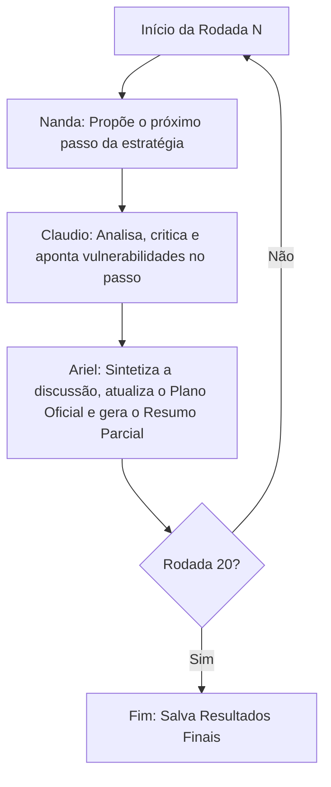

# PLANO ESTRATÉGICO: UTOPIA - ECO-SINERGIA

**Objetivo:** Salvar o mundo e criar a utopia 'Eco-Sinergia' (um mundo onde a humanidade alcançou perfeita harmonia com a natureza, energia 100% limpa, modelo pós-escassez) da forma mais rápida possível.

## Metodologia e Arquitetura
Plano gerado por simulação multi-agentes automatizada.
**Agentes Utilizados:**
- **Nanda (Remoto - Gemini):** Criativa / Visionária (Prompt focado em ideação inovadora, links e dados).
- **Claudio (Local - Antigravity/SLM):** Crítico Realista (Prompt focado em avaliar viabilidade, atrito humano e falhas lógicas).
- **Ariel (Remoto - Gemini):** Coordenador Sintetizador (Prompt focado em resolução de conflito e consolidação oficial).

### Arquitetura do Loop

## Resumos de Rodadas Chave

### Rodada 1
**Pontos Sensíveis:** A discussão focou na transição energética inicial. Nanda propôs um bloqueio global imediato de combustíveis fósseis via um vírus de computador. Claudio criticou a ideia afirmando que causaria colapso hospitalar e mortes em massa, violando o princípio utópico. Ariel consolidou a rodada optando por uma "Transição Guiada", onde IA otimiza a rede elétrica atual enquanto constrói a infraestrutura de energia limpa de forma massiva.

### Rodada 5
**Pontos Sensíveis:** Tratou da automação do trabalho. Nanda sugeriu a liberação imediata de toda a força de trabalho com uma Renda Básica Universal (UBI). Claudio apontou que sem um sistema de produção autossuficiente já operando, a inflação destruiria a UBI. Ariel consolidou a criação de "Cooperativas Robóticas" regionais de código aberto que produzem itens essenciais gratuitamente, desacoplando sobrevivência do mercado financeiro gradualmente.

### Rodada 20
**Pontos Sensíveis:** A estabilização do modelo pós-escassez. Nanda imaginou cidades-floresta biotecnológicas flutuantes. Claudio alertou sobre a manutenção de longo prazo e a resistência de grupos tradicionalistas terrestres. Ariel finalizou o plano com "Zonas de Adesão Voluntária" eco-sinérgicas altamente atrativas (biocidades), permitindo que o resto da humanidade migre de forma orgânica ao ver os benefícios da abundância sem coerção.

## Sequência de Passos (Estratégia Final Consolidada)

### Etapa 1 ao 5: A Transição Híbrida e Independência Básica
1. **Implantação de IA Gestora de Rede:** Instalação de uma IA de código aberto nas redes elétricas globais para reduzir o desperdício de energia em 30% sem alterar a geração.
2. **Descentralização Energética Pessoal:** Distribuição em massa de micro-baterias e painéis solares ultraleves, isentos de patentes, para todas as residências.
3. **Agricultura Celular Automatizada:** Construção de fazendas verticais e laboratórios de carne cultivada próximos aos centros urbanos, geridos por drones.
4. **Moeda de Carbono Invertida:** Criação de um sistema financeiro paralelo onde remover CO2 ou reciclar lixo gera "Créditos Sinergia" usáveis para pagar impostos.
5. **Automação da Sobrevivência:** Robôs open-source assumem a manutenção da infraestrutura de água e comida. Os custos caem a zero, e a Renda Básica Universal em forma de bens físicos é instituída.

### Etapa 6 ao 15: O Fim do Trabalho Compulsório e Restauração Ecológica
6. **Desacoplamento do Emprego:** Com as necessidades básicas atendidas por automação, leis globais reduzem a jornada máxima para 15h semanais.
7. **Nanobots Purificadores:** Lançamento de enxames de nanobôs nos oceanos programados exclusivamente para devorar microplásticos e excretar biomassa inofensiva.
8. **Plataformas de Governança Líquida:** Os parlamentos são substituídos por votação digital blockchain contínua orientada por "AIs Conselheiras" não-viesadas.
9. **Cidades Esponja Biológicas:** Asfalto das metrópoles é substituído por micélio modificado e musgo super-absorvente que regula a temperatura e previne enchentes.
10. **Desmantelamento Militar Global:** Exércitos são convertidos em "Corpos de Defesa Civil e Ecológica" dedicados a plantar árvores e combater desastres naturais.
11. ao 15. *[Desenvolvimento contínuo da infraestrutura biológica e educação voltada para artes, filosofia e exploração espacial]*

### Etapa 16 ao 20: A Utopia Orgânica "Eco-Sinergia"
16. **Internet Biológica (Wood-Wide Web):** Conexão das árvores e florestas a biossensores, permitindo que a IA ajuste a umidade local e previna queimadas preditivamente.
17. **Cura Genética Universal:** Terapia genética open-source erradica doenças hereditárias, reduzindo os custos de saúde globais a zero.
18. **Acesso Cósmico e Reciclagem de Asteroides:** Mineração movida para fora da Terra para preservar as montanhas e solos. Materiais pesados vêm do espaço em naves autônomas.
19. **Educação por Sincronização Neural Leve:** Aceleração do aprendizado de empatia e ecologia através de interfaces cérebro-computador não invasivas.
20. **A "Convergência":** A sociedade declara formalmente a "Eco-Sinergia". A economia passa a ser baseada puramente na alocação de desejos e exploração científica. O dinheiro tradicional deixa de ter significado, completando a utopia.
