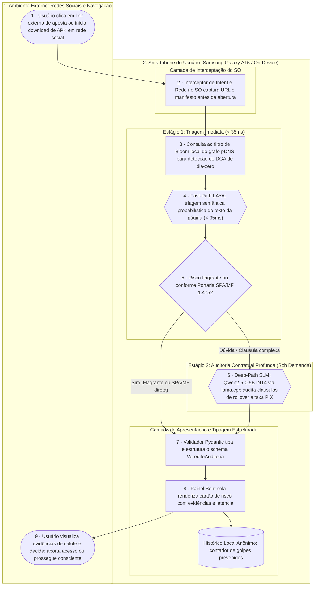

# Sentinela Clandestino · Fluxograma e Arquitetura

O caminho completo da proteção, do clique do apostador no link até o alerta de evidências que volta para ele.  
Artefato **fluxograma e arquitetura** (`flx`) da disciplina de Tópicos Avançados de IA (UFRPE 2026.2).

Formas do diagrama:
- **Pessoa**: `([ ])` (estádio)
- **IA**: `{{ }}` (hexágono)
- **Regra**: `[ ]` (retângulo)
- **Armazenamento Local**: `[( )]` (cilindro)

---

## 1 · Diagrama do Fluxo Completo na Borda

---

## 2 · Ciclo de Vida dos Dados Pessoais

| Dado Pessoal | De quem é | Onde fica | Quem vê | Por quanto tempo | Quando é apagado |
|:--|:--|:--|:--|:--|:--|
| **URL / Link de aposta clicado** | Usuário | Memória volátil (RAM) do app | Ninguém além do processo local do Sentinela | Menos de 1 segundo (tempo da inferência) | Imediatamente após a emissão do veredito |
| **Texto de termos de serviço / saque** | Da plataforma de apostas | Memória volátil (RAM) | Apenas o usuário ao ler o painel | Durante a exibição do alerta na tela | Ao fechar o painel de alerta |
| **Decisão do usuário (abortar / prosseguir)** | Usuário | Banco SQLite local seguro no aparelho | Apenas o usuário no seu resumo de proteção | Até a desinstalação do aplicativo | Sob demanda do usuário nas configurações do app |

> [!IMPORTANT]
> **Soberania Absoluta e Zero Telemetria:**  
> **Nenhum dado pessoal, URL ou texto de navegação sai do smartphone do usuário.** Não há tráfego de dados para servidores externos ou provedores de nuvem (zero dependência de rede para a auditoria semântica).
