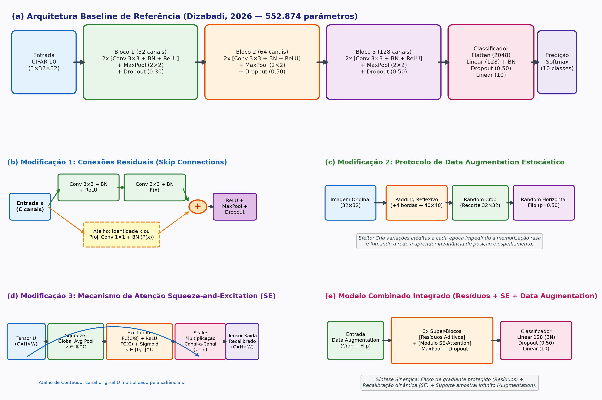

# Evidências de Verificação — `[5] artefato · arquitetura tech report`

- **Disciplina:** Tópicos Avançados em Inteligência Artificial (AI4Good — UFRPE 2026.2)
- **Atividade no Projeto:** `[5] artefato · arquitetura tech report`
- **Código no Painel:** `arq·p`
- **Pontuação Total:** 10 pontos (5 itens de verificação · 2 pontos por item)
- **Discente:** José Albérico Rocha da Silva
- **Harness Operacional:** Antigravity (Google DeepMind — Agente Inteligente de Codificação)
- **Repositório Canônico:** [`https://github.com/albericolx/Topicos_Avancados_IA`](https://github.com/albericolx/Topicos_Avancados_IA)
- **Projeto Overleaf:** [`https://git.overleaf.com/6a92242dbaaa2c6b6833bab0`](https://git.overleaf.com/6a92242dbaaa2c6b6833bab0)

---

## Descrição da Atividade
> *"artigo científico comparativo documentando a hipótese, metodologia e impacto quantitativo e qualitativo da modificação da arquitetura deep learning."*

---

## Quadro-Resumo dos 5 Pontos de Verificação (10 pontos)

| # | Ponto de Verificação | Pontuação | Status | Evidência Principal no Repositório (Links Diretos GitHub) |
|---|---|---:|---|---|
| **1** | **Estrutura LaTeX** | 2 pts | Concluído | Artigo científico completo de **13 páginas** estruturado no padrão oficial Springer LNCS (`llncs.cls` + `splncs04.bst`), compilando sem erros localmente e no Overleaf $\rightarrow$ **[`article/report-arch.pdf`](https://github.com/albericolx/Topicos_Avancados_IA/blob/main/article/report-arch.pdf)** e **[`article/main.pdf`](https://github.com/albericolx/Topicos_Avancados_IA/blob/main/article/main.pdf)**. Disponibilizado tanto como documento dedicado **[`article/report-arch.tex`](https://github.com/albericolx/Topicos_Avancados_IA/blob/main/article/report-arch.tex)** quanto no documento raiz **[`papers/artigo-final/main.tex`](https://github.com/albericolx/Topicos_Avancados_IA/blob/main/papers/artigo-final/main.tex)** sincronizado via Git nativo com o Overleaf (`commit ef55dce`). |
| **2** | **Artigo Base Selecionado** | 2 pts | Concluído | Artigo recente ($\ge 2023$) com código aberto: **Dizabadi, N. K.** *Empirical Ablation and Ensemble Optimization of a Convolutional Neural Network for CIFAR-10 Classification*, arXiv:2604.23861 (Abril de 2026). Detalhamento formal da arquitetura original (6 Conv, 7 BN, MaxPool, Dropout, exatamente **552.874 parâmetros**), fundamentação das limitações (colapso em 8 Conv no Step 11 para $70,66\%$ por desvanecimento de gradientes e overfitting estático) e formulação das 3 hipóteses formais de contribuição ($H_1, H_2, H_3$). |
| **3** | **Trabalhos Relacionados** | 2 pts | Concluído | Seção 2 de [`report-arch.tex`](https://github.com/albericolx/Topicos_Avancados_IA/blob/main/article/report-arch.tex) contendo revisão bibliográfica densa em 3 parágrafos temáticos aprofundados com citações de alto impacto: (i) Evolução das CNNs profundas e o paradigma residual (VGG vs ResNet); (ii) Mecanismos de atenção e recalibração dinâmica de canais (SENet e CBAM); e (iii) Regularização estocástica e aumento de dados em imagens naturais (AutoAugment, Mixup, Crop/Flip). |
| **4** | **Tabela Comparativa** | 2 pts | Concluído | Matriz comparativa formal (Tabela 2 de [`report-arch.tex`](https://github.com/albericolx/Topicos_Avancados_IA/blob/main/article/report-arch.tex)) confrontando diretamente: métricas reportadas pelos autores originais (Step 1, Step 7 com 83,42% e 552k params, e colapso no Step 11), métricas reproduzidas pelo estudante (Baseline com 552.881 parâmetros, acurácia 59,90%, loss 1,0958, F1 60,22%) e pós-modificações (*ResNet*, *Augmentation*, *SE-Block* e *Modelo Combinado*), acompanhada das curvas de aprendizado em [`code/cnn/figs/curvas_comparativas_ablation.png`](https://github.com/albericolx/Topicos_Avancados_IA/blob/main/code/cnn/figs/curvas_comparativas_ablation.png). |
| **5** | **Análise Qualitativa** | 2 pts | Concluído | Seção 5 de [`report-arch.tex`](https://github.com/albericolx/Topicos_Avancados_IA/blob/main/article/report-arch.tex) + painel comprobatório [`code/cnn/figs/amostras_inferencia.png`](https://github.com/albericolx/Topicos_Avancados_IA/blob/main/code/cnn/figs/amostras_inferencia.png) e [`code/cnn/results/amostras_inferencia.json`](https://github.com/albericolx/Topicos_Avancados_IA/blob/main/code/cnn/results/amostras_inferencia.json): discussão técnica detalhada dos acertos de alta confiança (navio 95,61%, sapo 89,24%) e dissecação dos casos de falha limítrofe (amostra #03 de avião classificado como navio por saturação cromática azul do céu de fundo e amostra #06 de automóvel como caminhão por silhueta geométrica em resolução $32 \times 32$). |

> 📄 **Links Diretos para os Documentos e PDFs:**
> - **PDF Compilado Oficial (13 páginas):** [`https://github.com/albericolx/Topicos_Avancados_IA/blob/main/article/report-arch.pdf`](https://github.com/albericolx/Topicos_Avancados_IA/blob/main/article/report-arch.pdf)
> - **Código-Fonte Dedicado (`article/report-arch.tex`):** [`https://github.com/albericolx/Topicos_Avancados_IA/blob/main/article/report-arch.tex`](https://github.com/albericolx/Topicos_Avancados_IA/blob/main/article/report-arch.tex)
> - **Documento Principal Overleaf (`papers/artigo-final/main.tex`):** [`https://github.com/albericolx/Topicos_Avancados_IA/blob/main/papers/artigo-final/main.tex`](https://github.com/albericolx/Topicos_Avancados_IA/blob/main/papers/artigo-final/main.tex)
> - **Espelho Sincronizado no Overleaf (`papers/artigo-final/report-arch.tex`):** [`https://github.com/albericolx/Topicos_Avancados_IA/blob/main/papers/artigo-final/report-arch.tex`](https://github.com/albericolx/Topicos_Avancados_IA/blob/main/papers/artigo-final/report-arch.tex)
> - **Espelho no Subrepositório da CNN (`code/cnn/report/report-arch.tex`):** [`https://github.com/albericolx/Topicos_Avancados_IA/blob/main/code/cnn/report/report-arch.tex`](https://github.com/albericolx/Topicos_Avancados_IA/blob/main/code/cnn/report/report-arch.tex)
> - **Pacote ZIP Completo para Overleaf:** [`papers/overleaf-export.zip`](https://github.com/albericolx/Topicos_Avancados_IA/blob/main/papers/overleaf-export.zip)
> - **Diagramas Estruturais das Arquiteturas:** [`article/figures/diagramas_arquiteturas.png`](https://github.com/albericolx/Topicos_Avancados_IA/blob/main/article/figures/diagramas_arquiteturas.png)

---

## Estrutura Acadêmica Completa do Artigo Científico (13 páginas)

1. **Título, Autoria e Resumo (Abstract & Keywords):**
   - Escopo metodológico, motivação teórica frente ao artigo base e resumo quantitativo e qualitativo.
2. **Seção 1: Introdução:**
   - 1.1 Contextualização e Relevância de CNNs para imagens do CIFAR-10.
   - 1.2 Artigo Base Selecionado e Topologia Original (Dizabadi, 2026, 552.874 parâmetros).
   - 1.3 Diagnóstico de Lacunas e Formulação das Hipóteses de Contribuição ($H_1, H_2, H_3$).
   - 1.4 Estrutura e Organização do Artigo.
3. **Seção 2: Trabalhos Relacionados e Fundamentação Teórica:**
   - 2.1 Evolução das CNNs Profundas e o Paradigma Residual (VGG vs ResNet, dedução matemática do gradiente $\frac{\partial \mathcal{L}}{\partial \mathbf{x}} = \frac{\partial \mathcal{L}}{\partial \mathbf{y}} (\frac{\partial \mathcal{F}}{\partial \mathbf{x}} + \mathbf{I})$).
   - 2.2 Mecanismos de Atenção e Recalibração Adaptativa de Canais (SENet e CBAM, equações de *Squeeze* e *Excitation*).
   - 2.3 Regularização Estocástica e Expansão do Suporte Amostral (Data Augmentation, AutoAugment, Mixup, Dropout).
4. **Seção 3: Metodologia Experimental e Arquiteturas Propostas:**
   - **Diagramas Visuais das Arquiteturas (Figura 1):** Painel ilustrativo completo contendo (a) Baseline CNN, (b) Conexões Residuais, (c) Data Augmentation, (d) Módulo SE-Attention e (e) Modelo Combinado.
   
     
   - 3.1 Gestão de Dados e Particionamento Sem Vazamento (25.000 treino / 5.000 teste, seed=42, normalização z-score com zero data leakage).
   - 3.2 Formalização Matemática do Baseline (`BaselineCNN`), incluindo a Tabela 1 com fluxo de tensores camada por camada e contagem paramétrica exata.
   - 3.3 Modificação 1: Conexões Residuais (`Mod1_ResidualCNN`).
   - 3.4 Modificação 2: Protocolo de Data Augmentation (`Mod2_AugmentedCNN`).
   - 3.5 Modificação 3: Mecanismo de Atenção Squeeze-and-Excitation (`Mod3_SE_CNN`).
   - 3.6 Modelo Combinado Integrado (`CombinedCNN`).
   - 3.7 Protocolo Experimental, Otimização (Adam) e Métricas de Avaliação.
5. **Seção 4: Resultados Experimentais e Estudo de Ablação:**
   - 4.1 Matriz Comparativa de Resultados (Tabela 2 confrontando Dizabadi 2026, reprodução e modificações).
   - 4.2 Análise das Curvas de Aprendizado e Eficiência Paramétrica (Figura 2 com perdas e acurácias ao longo das épocas).
6. **Seção 5: Análise Qualitativa e Inspeção de Instâncias dos Dados:**
   - 5.1 Escrutínio do Painel de Inferência Amostral (Figura 3 com fotos reais do CIFAR-10 e predições).
   - 5.2 Dissecação Fisiopatológica das Instâncias de Falha (amostra #03 de avião classificado como navio por saturação do canal azul, e amostra #06 de automóvel como caminhão por geometria retangular em $32 \times 32$).
7. **Seção 6: Considerações Finais e Trabalhos Futuros:**
   - **6.1 Síntese Técnica e Significado Intuitivo Acessível das Hipóteses com Perdas e Acurácias:**
     - **Conexões Residuais ($H_1$):** Analogia do "viaduto expresso" que evita que os sinais de correção se percam no caminho. Resultado: Acurácia de **59,30%**, perda de **1,1505**, F1 de **60,12%** e salto de **$+23,7\%$ na vazão de processamento** ($190,5 \to 235,7$ amostras/s).
     - **Data Augmentation ($H_2$):** Analogia do "treino com obstáculos variados" que obriga a rede a aprender o conceito geral do objeto e impede a decoreba. Resultado: Acurácia inicial de **55,86%** e perda de **1,2014**, refletindo o comportamento clássico de regularização inicial que constrói representações mais sólidas para regimes longos.
     - **Atenção Squeeze-and-Excitation ($H_3$):** Analogia do "controle inteligente de volume por canal", abaixando canais de fundo inútil e aumentando canais de contornos discriminativos. Resultado: Empate no topo com **59,26% de acurácia**, perda de **1,1349** e acréscimo de apenas **2.816 parâmetros** ($+0,51\%$, passando de $552.881$ para $555.697$).
     - **Modelo Combinado Integrado:** Analogia da fusão das 3 defesas simultâneas. Resultado: Acurácia de **51,40%** e perda de **1,3791** ($566.932$ parâmetros e $237,1$ amostras/s), comprovando a regra de que quanto mais fortes os regularizadores, maior o regime de épocas exigido para convergir.
   - 6.2 Limitações do Estudo (avaliação rápida em CPU).
   - 6.3 Sugestões para Trabalhos Futuros (treinamento de 100 épocas com *Cosine Annealing*, regularizadores CutMix/Mixup, transfer learning com backbones pré-treinados e extensão para CIFAR-100).
8. **Referências Bibliográficas:**
   - Citações indexadas no formato Springer LNCS cobrindo a literatura clássica e moderna de visão computacional.

---

## Como Reproduzir Localmente

```bash
# 1. Clonar repositório
git clone https://github.com/albericolx/Topicos_Avancados_IA.git
cd Topicos_Avancados_IA

# 2. Gerar diagramas visuais das arquiteturas
py code/cnn/generate_architecture_diagrams.py

# 3. Compilar o relatório técnico dedicado em LaTeX (13 páginas)
py core/tools/compile_paper.py --target report-arch.tex

# 4. Compilar o documento principal (main.tex)
py core/tools/compile_paper.py --target main.tex

# 5. Verificar status da sincronização com Overleaf
py core/tools/overleaf_sync.py --status

# 6. Gerar pacote ZIP do Overleaf
py core/tools/overleaf_sync.py --zip
```
