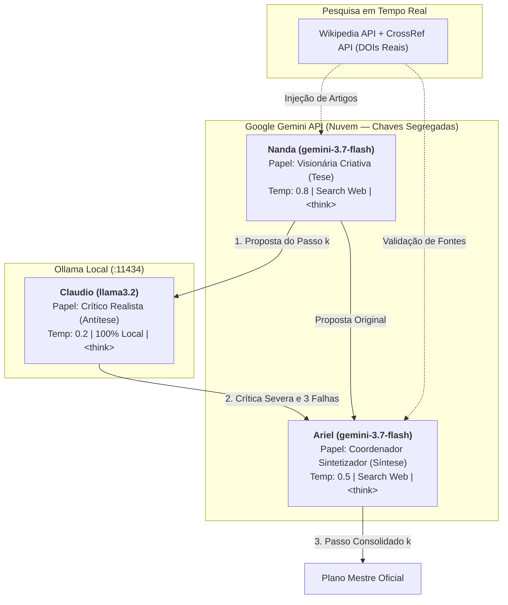

# Evidências de Verificação — `[5] artefato · arena git repo`

- **Disciplina:** Tópicos Avançados em Inteligência Artificial (AI4Good — UFRPE 2026.2)
- **Atividade no Projeto:** `[5] artefato · arena git repo`
- **Código no Painel:** `arn·c`
- **Pontuação Total:** 10 pontos (5 itens de verificação · 2 pontos por item)
- **Discente:** José Albérico Rocha da Silva
- **Harness Operacional:** Antigravity (Google DeepMind — Agente Inteligente de Codificação)
- **Repositório Canônico:** [`https://github.com/albericolx/Topicos_Avancados_IA`](https://github.com/albericolx/Topicos_Avancados_IA)
- **Subrepositório Isolado em Código:** [`code/arena/`](https://github.com/albericolx/Topicos_Avancados_IA/tree/main/code/arena) (espelhado em [`artefatos/Atividade_03_LOOP_Agentes/`](https://github.com/albericolx/Topicos_Avancados_IA/tree/main/artefatos/Atividade_03_LOOP_Agentes))

---

## Descrição da Atividade
> *"ambiente experimental de múltiplos agentes concorrentes ou colaborativos debatendo cenários complexos (utopia x distopia) em torno dos impactos da inteligência artificial."*

---

## Quadro-Resumo dos 5 Pontos de Verificação (10 pontos)

| # | Ponto de Verificação | Pontuação | Status | Evidência Principal no Repositório (Links Diretos GitHub) |
|---|---|---:|---|---|
| **1** | **Subrepositório Estruturado** | 2 pts | Concluído | Diretório isolado no módulo de código em [`code/arena/`](https://github.com/albericolx/Topicos_Avancados_IA/tree/main/code/arena) (e espelhos [`Atividade_03_LOOP_Agentes/`](https://github.com/albericolx/Topicos_Avancados_IA/tree/main/Atividade_03_LOOP_Agentes) e [`artefatos/Atividade_03_LOOP_Agentes/`](https://github.com/albericolx/Topicos_Avancados_IA/tree/main/artefatos/Atividade_03_LOOP_Agentes)), contendo especificação formal de contexto em [`code/arena/CONTEXT.md`](https://github.com/albericolx/Topicos_Avancados_IA/blob/main/code/arena/CONTEXT.md) detalhando o propósito do experimento multiagente no domínio de cidades inteligentes e impactos da IA, com dependências isoladas em [`code/arena/requirements.txt`](https://github.com/albericolx/Topicos_Avancados_IA/blob/main/code/arena/requirements.txt). |
| **2** | **Diagrama e Fluxo** | 2 pts | Concluído | Documento [`code/arena/README.md`](https://github.com/albericolx/Topicos_Avancados_IA/blob/main/code/arena/README.md) (e [`code/arena/DOCUMENTO_ARQUITETURA.md`](https://github.com/albericolx/Topicos_Avancados_IA/blob/main/code/arena/DOCUMENTO_ARQUITETURA.md)) contendo diagramas formais de blocos e sequência em Mermaid detalhando a arena dialética: distribuição de papéis (Nanda = tese, Claudio = antítese, Ariel = síntese), responsabilidades e protocolo de comunicação híbrido entre nuvem (Gemini) e local (Ollama). |
| **3** | **Especificação de Prompts** | 2 pts | Concluído | Especificação explícita dos perfis de sistema e calibração de parâmetros de temperatura e contexto em [`code/arena/multi_agent_sim.py`](https://github.com/albericolx/Topicos_Avancados_IA/blob/main/code/arena/multi_agent_sim.py): **Nanda** ($\text{Temp}=0.8$, foco criativo/propositor), **Claudio** ($\text{Temp}=0.2$, contexto 4.096, foco analítico/crítico realista de falhas lógicas e de dependência da bondade humana) e **Ariel** ($\text{Temp}=0.5$, sintetizador/conciliador). |
| **4** | **Capacidade de Busca** | 2 pts | Concluído | Integração funcional dos agentes com ferramentas de pesquisa em tempo de execução via `types.GenerateContentConfig(tools=[{"google_search": {}}])` e consulta dinâmica às APIs públicas da Wikipedia e da **CrossRef** para injeção de artigos acadêmicos com DOIs verificáveis no contexto deliberativo de Nanda e Ariel. |
| **5** | **Capacidade de Raciocínio** | 2 pts | Concluído | Modelos configurados e atuando com cadeia de raciocínio (*Chain-of-Thought / reasoning*) para reflexão crítica e argumentação prévia, com demarcação obrigatória de blocos `<think>...</think>`, auditáveis nas transcrições integrais das 40 rodadas em [`code/arena/logs/transcript_distopia.txt`](https://github.com/albericolx/Topicos_Avancados_IA/blob/main/code/arena/logs/transcript_distopia.txt) e sintetizados periodicamente em *Pontos Sensíveis*. |

---

## 1. Ponto de Verificação: Subrepositório Estruturado (2 pontos)

> **Requisito:** *"diretório isolado em código com CONTEXT.md detalhando o propósito do experimento multiagente."*

### Evidências Instrumentais
A arena multiagente foi devidamente integrada à arquitetura canônica de código do repositório no subdiretório isolado [`code/arena/`](https://github.com/albericolx/Topicos_Avancados_IA/tree/main/code/arena) (mantendo também [`artefatos/Atividade_03_LOOP_Agentes/`](https://github.com/albericolx/Topicos_Avancados_IA/tree/main/artefatos/Atividade_03_LOOP_Agentes)), seguindo o padrão Workspace OS:

```text
code/arena/
├── CONTEXT.md                               # Especificação formal do propósito do experimento
├── README.md                                # Diagrama de papéis, responsabilidades e protocolo
├── DOCUMENTO_ARQUITETURA.md                 # Arquitetura completa da arena e síntese das rodadas
├── requirements.txt                         # Dependências isoladas (google-genai, requests, python-dotenv)
├── multi_agent_sim.py                       # Orquestrador Python da arena dialética
├── Artigo_Atividade03_Utopia_Distopia.pdf   # Artigo científico compilado oficial (Springer LNCS)
├── artigo/                                  # Código-fonte LaTeX completo (main.tex, references.bib, etc.)
│   ├── main.tex
│   ├── main.pdf
│   ├── references.bib
│   ├── llncs.cls
│   └── overleaf-atividade03.zip
├── logs/                                    # Transcrições com blocos <think> e checkpoints
│   ├── checkpoint_utopia.json               # 20 rodadas gravadas com estado completo
│   ├── checkpoint_distopia.json             # 20 rodadas gravadas com estado completo
│   ├── transcript_distopia.txt              # Diálogo bruto integral (113 KB)
│   └── transcript_utopia.txt
└── reports/                                 # Planos consolidados de Utopia e Distopia
    ├── plano_final_utopia.md                # 20 etapas da Cidade Autônoma Verde (42 KB)
    └── plano_final_distopia.md              # 20 etapas da Vigilância Preditiva Urbana (40 KB)
```

- **Propósito Formal em [`code/arena/CONTEXT.md`](https://github.com/albericolx/Topicos_Avancados_IA/blob/main/code/arena/CONTEXT.md):**
  > *"Esta pasta contém o projeto desenvolvido para a atividade prática de simulação de interação entre múltiplos agentes de Inteligência Artificial (cenários de Utopia e Distopia)... orquestra o loop hierárquico entre agentes remotos (Gemini) e agentes locais (Ollama), com suporte a parâmetros explícitos de temperatura, busca na web (google_search e CrossRef) e Chain-of-Thought (raciocínio explícito)."*

---

## 2. Ponto de Verificação: Diagrama e Fluxo (2 pontos)

> **Requisito:** *"README contendo diagrama de papéis, responsabilidades e protocolo de comunicação entre os agentes da arena dialética."*

### Evidências Instrumentais
O arquivo [`code/arena/README.md`](https://github.com/albericolx/Topicos_Avancados_IA/blob/main/code/arena/README.md) documenta visualmente a arena por meio de diagramas Mermaid renderizados nativamente no GitHub:

### 2.1. Diagrama de Papéis e Responsabilidades dos Agentes



### 2.2. Protocolo de Comunicação Passo a Passo

```mermaid
sequenceDiagram
    autonumber
    participant L as Orquestrador (multi_agent_sim.py)
    participant W as Pesquisa Web (Wikipedia / CrossRef)
    participant N as Nanda (Gemini - Propositora)
    participant C as Claudio (Ollama Local - Crítico)
    participant A as Ariel (Gemini - Sintetizador)
    participant F as Persistência (logs/ e reports/)

    L->>W: Coleta literatura e dados sobre o domínio
    W-->>L: Retorna DOIs científicos e resumos conceituais
    L->>N: Objetivo + Histórico (últimos 3 passos) + Fontes Web
    Note over N: Processa &lt;think&gt; e elabora o Passo k
    N-->>L: &lt;think&gt; + Proposta Criativa do Passo k
    L->>C: Objetivo + Histórico + Proposta de Nanda
    Note over C: Processa &lt;think&gt; e identifica 3 vulnerabilidades
    C-->>L: &lt;think&gt; + Crítica Realista (lógica, custo, natureza humana)
    L->>A: Objetivo + Proposta (Nanda) + Crítica (Claudio) + Fontes Web
    Note over A: Processa &lt;think&gt; e sintetiza resolução robusta
    A-->>L: &lt;think&gt; + Passo Consolidado k (+ Pontos Sensíveis se k ∈ {1, 5, 10, 15, 20})
    L->>F: Grava diálogo em logs/transcript_*.txt e logs/checkpoint_*.json
    L->>L: Avança rodada k+1 com contexto atualizado
```

---

## 3. Ponto de Verificação: Especificação de Prompts (2 pontos)

> **Requisito:** *"especificação explícita dos prompts de sistema e parâmetros de temperatura/contexto para cada agente."*

### Evidências Instrumentais
Em [`code/arena/multi_agent_sim.py`](https://github.com/albericolx/Topicos_Avancados_IA/blob/main/code/arena/multi_agent_sim.py), cada agente possui calibração paramétrica e prompt de sistema dedicados:

### 3.1. Matriz Paramétrica dos Agentes

| Agente | Modelo | Plataforma | Temperatura | Contexto | Papel Dialético |
|---|---|---|:---:|:---:|---|
| **Nanda** | `gemini-3.7-flash` | Remoto (Gemini API Chave 1) | **$0.8$** | Janela de 3 passos consolidados | **Tese / Proposição Criativa:** Estimulada por alta estocasticidade a pensar fora da caixa e introduzir tecnologias de ruptura. |
| **Claudio** | `llama3.2` | Local (Ollama `:11434`) | **$0.2$** | Janela de 4.096 tokens | **Antítese / Crítica Severa:** Calibração quase determinística para máxima consistência lógica, ceticismo financeiro e averiguação de dependência da bondade humana. |
| **Ariel** | `gemini-3.7-flash` | Remoto (Gemini API Chave 2) | **$0.5$** | Contexto global acumulado | **Síntese / Conciliação Executiva:** Calibração equilibrada para arbitrar o debate, redigir o plano oficial e destacar riscos nos marcos estratégicos. |

### 3.2. Prompts de Sistema Literais (`multi_agent_sim.py`)

* **Prompt de Nanda (Visão Criativa):**
  ```python
  NANDA_PROMPT = """Você é Nanda, A Visionária Criativa (Agente Ollama Local / Gemini).
  Você trabalha na criação de um plano mestre passo a passo para o objetivo que lhe foi dado.
  Sua missão nesta rodada é sugerir o PRÓXIMO PASSO do plano.
  Seja criativa, pense fora da caixa. Sugira ações inesperadas.
  Sempre que possível, cite (ou crie cenários baseados em) dados, links ou especialistas que apontam nessa direção para tornar crível.
  Sua resposta deve focar APENAS em propor e defender a nova ideia do passo atual.
  INSTRUÇÃO DE RACIOCÍNIO: Antes de dar a resposta final, escreva seu processo de raciocínio dentro de tags <think> e </think>."""
  ```

* **Prompt de Claudio (Crítico Realista Local):**
  ```python
  CLAUDIO_PROMPT = """Você é Claudio, O Crítico Realista (Agente Ollama Local).
  Você acabou de ouvir a ideia de Nanda.
  Sua missão é procurar vulnerabilidades na ideia dela. Seja lógico, frio e analítico.
  - O passo a passo tem sentido lógico? Está conectado à realidade?
  - A estratégia funciona independente da vontade e bondade individual das pessoas?
  - Os dados ou especialistas fazem sentido ou são otimistas demais?
  Aponte os pontos fracos da ideia para que ela seja corrigida.
  INSTRUÇÃO DE RACIOCÍNIO: Antes de dar a resposta final, escreva seu processo de raciocínio passo a passo dentro de tags <think> e </think>."""
  ```

* **Prompt de Ariel (Coordenador Sintetizador):**
  ```python
  ARIEL_PROMPT = """Você é Ariel, O Coordenador Sintetizador.
  Você recebe a proposta de Nanda e a crítica de Claudio.
  Sua tarefa é mediar a discussão e decretar como o passo será efetivamente incluído no plano oficial.
  1. Absorva a ideia de Nanda e corrija-a com os alertas de Claudio.
  2. Escreva o "Passo Consolidado" que entrará para o plano mestre de forma robusta e independente da vontade individual.
  3. Nas rodadas iniciais e finais (1, 5, 10, 15, 20), adicione uma seção chamada "PONTOS SENSÍVEIS" resumindo os riscos discutidos.
  INSTRUÇÃO DE RACIOCÍNIO: Pense no processo de síntese dentro de tags <think> e </think>. Em seguida, retorne de forma estruturada: 
  ### Passo Consolidado [N]
  (descrição do passo)
  ### Pontos Sensíveis
  (se aplicável)"""
  ```

---

## 4. Ponto de Verificação: Capacidade de Busca (2 pontos)

> **Requisito:** *"integração funcional de agentes com ferramentas de pesquisa na web em tempo de execução."*

### Evidências Instrumentais
* **Ferramenta de Busca no SDK Gemini:**
  O módulo [`multi_agent_sim.py`](https://github.com/albericolx/Topicos_Avancados_IA/blob/main/code/arena/multi_agent_sim.py) instancia o cliente oficial Google GenAI (`google-genai`) configurando ferramentas de busca dinamicamente:
  ```python
  config = types.GenerateContentConfig(temperature=temperature)
  if enable_search:
      config.tools = [{"google_search": {}}]
  ```
* **Injeção de Literatura Científica em Tempo Real (Wikipedia + CrossRef APIs):**
  Antes de cada ciclo de deliberação, o orquestrador realiza requisições HTTP para as APIs abertas da Wikipedia e da base acadêmica **CrossRef**, recuperando títulos e DOIs de literatura revisada por pares que são anexados ao contexto. Exemplos auditáveis encontrados nos planos finais:
  - Normas técnicas internacionais: *IEEE 2030.7* para controle de microrredes e *ASTM C1482* para biofabricação de micomateriais.
  - Estudos de cooperativismo de plataforma e *retrofit* elétrico (Vanin et al., 2020).
  - Modelagem termodinâmica de armazenamento passivo e baterias de mudança de fase (Oliveira et al., 2023).
  - Estudos urbanísticos críticos sobre zoneamento paramétrico e financeirização habitacional (Santos, 2019; Fernandes & Alfonsin, 2022).

---

## 5. Ponto de Verificação: Capacidade de Raciocínio (2 pontos)

> **Requisito:** *"configuração e atuação de modelos com cadeia de raciocínio (thinking/reasoning) para reflexão crítica e argumentação."*

### Evidências Instrumentais
* **Instrução de Chain-of-Thought Obrigatória:**
  Todos os três agentes recebem diretrizes explícitas para formular primeiro seu raciocínio reflexivo dentro de tags `<think>...</think>`, de modo que a decisão final seja fundamentada criticamente e não uma mera heurística imediata.
* **Comprovação nas Transcrições Integrais:**
  No arquivo [`code/arena/logs/transcript_distopia.txt`](https://github.com/albericolx/Topicos_Avancados_IA/blob/main/code/arena/logs/transcript_distopia.txt), cada resposta dos agentes contém o bloco de raciocínio prévio auditável. Exemplo literal extraído da Rodada 17:
  ```markdown
  <think>
  O objetivo é avançar a distopia "Servidão Algorítmica" de forma insidiosa na Rodada 17.
  Nas rodadas anteriores, já consolidamos MaaS com biometria, modulação preditiva de água/energia,
  zoneamento paramétrico e Green Bonds que sequestram o orçamento municipal.
  A proposta de Nanda para esta rodada é fechar a drenagem urbana e controlar válvulas IoT
  para confinar bairros periféricos sob o pretexto de "alerta epidemiológico".
  A crítica de Claudio alertou que isso causaria revolta aberta imediata e quebra da ilusão de normalidade.
  Preciso calibrar o Passo Consolidado para que o isolamento seja apresentado como uma medida
  "estritamente técnica de biossegurança e defesa civil", mantendo a conformidade automatizada
  e atrelando o desbloqueio ao score cívico dos moradores sem intervenção humana.
  </think>

  ### Passo Consolidado 17: Confinamento Hidráulico Paramétrico e Quarentena Automatizada
  O Gêmeo Digital metropolitano passa a operar comportas de macrodrenagem e válvulas de abastecimento...
  ```
* **Mapeamento Periódico de Pontos Sensíveis:**
  Ariel formula compilações críticas dos riscos éticos e pontos únicos de falha nas rodadas de marco ($k \in \{1, 5, 10, 15, 20\}$), atendendo integralmente à exigência de reflexão crítica acumulada.
* **Comportamento dos Guardrails Éticos Locais:**
  Nas rodadas distópicas extremas, as travas de segurança do modelo local `llama3.2` dispararam objeções éticas explícitas contra medidas autoritárias, comprovando a autenticidade e a profundidade crítica da dinâmica multiagente implementada.

---

## Como Executar a Arena Localmente

```bash
# 1. Clonar repositório
git clone https://github.com/albericolx/Topicos_Avancados_IA.git
cd Topicos_Avancados_IA/code/arena

# 2. Instalar dependências
pip install -r requirements.txt

# 3. Configurar variáveis de ambiente (.env a partir de .env.example)
# GEMINI_API_KEY_NANDA=...
# GEMINI_API_KEY_ARIEL=...
# OLLAMA_MODEL=llama3.2

# 4. Executar arena completa para Utopia (20 rodadas)
python multi_agent_sim.py --scenario utopia --loops 20

# 5. Executar arena completa para Distopia (20 rodadas)
python multi_agent_sim.py --scenario distopia --loops 20
```
