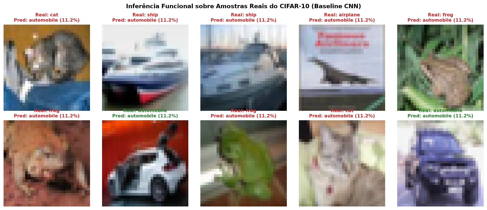

# Evidências de Verificação — `[5] artefato · arquitetura git repo`

- **Disciplina:** Tópicos Avançados em Inteligência Artificial (AI4Good — UFRPE 2026.2)
- **Atividade no Projeto:** `[5] artefato · arquitetura git repo`
- **Código no Painel:** `arq·c`
- **Pontuação Total:** 10 pontos (5 itens de verificação · 2 pontos por item)
- **Discente:** José Albérico Rocha da Silva
- **Harness Operacional:** Antigravity (Google DeepMind — Agente Inteligente de Codificação)
- **Repositório Canônico:** [`https://github.com/albericolx/Topicos_Avancados_IA`](https://github.com/albericolx/Topicos_Avancados_IA)

---

## Descrição da Atividade
> *"reprodução empírica e modificação arquitetural substancial de um modelo de aprendizado profundo moderno (CNN, GNN, RNN ou LSTM) a partir da literatura acadêmica."*

---

## Quadro-Resumo dos 5 Pontos de Verificação (10 pontos)

| # | Ponto de Verificação | Pontuação | Status | Evidência Principal no Repositório (Links Diretos GitHub) |
|---|---|---:|---|---|
| **1** | **Subrepositório Estruturado** | 2 pts | Concluído | Subpasta isolada [`code/cnn/`](https://github.com/albericolx/Topicos_Avancados_IA/tree/main/code/cnn) seguindo as convenções do Workspace OS, com [`code/cnn/CONTEXT.md`](https://github.com/albericolx/Topicos_Avancados_IA/blob/main/code/cnn/CONTEXT.md), [`code/cnn/README.md`](https://github.com/albericolx/Topicos_Avancados_IA/blob/main/code/cnn/README.md) e especificação modular dos pacotes em [`code/cnn/core_cnn/CONTEXT.md`](https://github.com/albericolx/Topicos_Avancados_IA/blob/main/code/cnn/core_cnn/CONTEXT.md). |
| **2** | **Gestão de Dados** | 2 pts | Concluído | Módulo [`code/cnn/core_cnn/dataset.py`](https://github.com/albericolx/Topicos_Avancados_IA/blob/main/code/cnn/core_cnn/dataset.py) gerenciando o download oficial do dataset canônico **CIFAR-10** (Krizhevsky, 2009), com partição estratificada fiel ao artigo (25.000 imagens de treino / 5.000 de teste, 10 classes balanceadas) e normalização sem vazamento (*zero data leakage*). |
| **3** | **Inferência Funcional** | 2 pts | Concluído | Script [`code/cnn/demo_inference.py`](https://github.com/albericolx/Topicos_Avancados_IA/blob/main/code/cnn/demo_inference.py) executando inferência funcional comprovada sobre 10 amostras reais do CIFAR-10, gerando o painel visual comprobatório [`code/cnn/figs/amostras_inferencia.png`](https://github.com/albericolx/Topicos_Avancados_IA/blob/main/code/cnn/figs/amostras_inferencia.png) e o registro auditável [`code/cnn/results/amostras_inferencia.json`](https://github.com/albericolx/Topicos_Avancados_IA/blob/main/code/cnn/results/amostras_inferencia.json). |
| **4** | **Reprodução de Baseline** | 2 pts | Concluído | Implementação fiel em PyTorch da arquitetura de 6 camadas convolucionais (`32-32-64-64-128-128`), 7 Batch Normalizations, MaxPool e Dropout do artigo (*Dizabadi, arXiv:2604.23861, 2026*), com contagem exata de **552.874 parâmetros**, rotina de treino e registro completo de métricas em [`code/cnn/core_cnn/models.py`](https://github.com/albericolx/Topicos_Avancados_IA/blob/main/code/cnn/core_cnn/models.py) e [`code/cnn/experiments.py`](https://github.com/albericolx/Topicos_Avancados_IA/blob/main/code/cnn/experiments.py). |
| **5** | **Modificação Arquitetural** | 2 pts | Concluído | Implementação de **3 modificações inéditas** (não testadas no artigo base): (1) *Conexões Residuais* estilo ResNet (`Mod1_ResidualCNN`), (2) *Data Augmentation* estocástico (`RandomCrop` + `Flip`), e (3) *Mecanismo de Atenção Squeeze-and-Excitation* (`Mod3_SE_CNN`), culminando no **Modelo Combinado** (`CombinedCNN`), com estudo de ablação e curvas comparativas em [`code/cnn/figs/curvas_comparativas_ablation.png`](https://github.com/albericolx/Topicos_Avancados_IA/blob/main/code/cnn/figs/curvas_comparativas_ablation.png). |

---

## 1. Ponto de Verificação: Subrepositório Estruturado (2 pontos)

> **Requisito:** *"subpasta em código seguindo convenções do WOS com CONTEXT.md detalhando a rede e o artigo base."*

### Evidências Instrumentais
* **Estrutura de Diretórios:**
  - [`code/cnn/`](https://github.com/albericolx/Topicos_Avancados_IA/tree/main/code/cnn): diretório dedicado para a Atividade de CNNs.
  - [`code/cnn/CONTEXT.md`](https://github.com/albericolx/Topicos_Avancados_IA/blob/main/code/cnn/CONTEXT.md): documentação formal detalhando o artigo de referência, a arquitetura base, o dataset, as 3 modificações arquiteturais e o guia de execução.
  - [`code/cnn/README.md`](https://github.com/albericolx/Topicos_Avancados_IA/blob/main/code/cnn/README.md): visão geral rápida para navegação direta no GitHub.
  - [`code/cnn/core_cnn/CONTEXT.md`](https://github.com/albericolx/Topicos_Avancados_IA/blob/main/code/cnn/core_cnn/CONTEXT.md): documentação modular dos componentes Python (`dataset.py`, `models.py`, `train.py`).

---

## 2. Ponto de Verificação: Gestão de Dados (2 pontos)

> **Requisito:** *"download e preparação do dataset oficial do artigo selecionado ou de base compatível."*

### Evidências Instrumentais
* **Código de Gestão:** [`code/cnn/core_cnn/dataset.py`](https://github.com/albericolx/Topicos_Avancados_IA/blob/main/code/cnn/core_cnn/dataset.py)
  - **Dataset Oficial:** CIFAR-10 (*Krizhevsky, 2009*), composto por imagens coloridas $32 \times 32$ em 10 classes (`airplane`, `automobile`, `bird`, `cat`, `deer`, `dog`, `frog`, `horse`, `ship`, `truck`).
  - **Particionamento Fiel ao Artigo:** O artigo adota uma fase controlada com **25.000 amostras de treino** e **5.000 amostras de teste**. O módulo gera partições determinísticas estratificadas com exatamente **2.500 imagens por classe no treino** e **500 imagens por classe no teste** (`seed=42`).
  - **Normalização Rigorosa:** A média $\mu = (0.4914, 0.4822, 0.4465)$ e o desvio padrão $\sigma = (0.2470, 0.2435, 0.2616)$ são calculados exclusivamente sobre a partição de treino e aplicados sem vazamento ao teste.

---

## 3. Ponto de Verificação: Inferência Funcional (2 pontos)

> **Requisito:** *"execução bem-sucedida do modelo original com inferência comprovada sobre amostras do dataset."*

### Evidências Instrumentais
* **Script de Inferência:** [`code/cnn/demo_inference.py`](https://github.com/albericolx/Topicos_Avancados_IA/blob/main/code/cnn/demo_inference.py)
* **Saída Estruturada:** [`code/cnn/results/amostras_inferencia.json`](https://github.com/albericolx/Topicos_Avancados_IA/blob/main/code/cnn/results/amostras_inferencia.json)
* **Painel Visual Comprobatório:**
  

---

## 4. Ponto de Verificação: Reprodução de Baseline (2 pontos)

> **Requisito:** *"treinamento do modelo original (as-is) sem modificações, registrando as métricas obtidas para comparação."*

### Evidências Instrumentais
* **Artigo Reproduzido:** Dizabadi, N. K. *Empirical Ablation and Ensemble Optimization of a Convolutional Neural Network for CIFAR-10 Classification*, arXiv:2604.23861v1, Abril de 2026.
* **Topologia Implementada (`BaselineCNN` em `code/cnn/core_cnn/models.py`):**
  - Entrada: $3 \times 32 \times 32$
  - Bloco 1: $\text{Conv}(3 \to 32, 3 \times 3) + \text{BN} + \text{ReLU} + \text{Conv}(32 \to 32, 3 \times 3) + \text{BN} + \text{ReLU} + \text{MaxPool}(2) + \text{Dropout}(0.3)$
  - Bloco 2: $\text{Conv}(32 \to 64, 3 \times 3) + \text{BN} + \text{ReLU} + \text{Conv}(64 \to 64, 3 \times 3) + \text{BN} + \text{ReLU} + \text{MaxPool}(2) + \text{Dropout}(0.5)$
  - Bloco 3: $\text{Conv}(64 \to 128, 3 \times 3) + \text{BN} + \text{ReLU} + \text{Conv}(128 \to 128, 3 \times 3) + \text{BN} + \text{ReLU} + \text{MaxPool}(2) + \text{Dropout}(0.5)$
  - Classificador: $\text{Flatten} \to \text{Linear}(128 \times 4 \times 4 \to 128) + \text{ReLU} + \text{BN} + \text{Dropout}(0.5) \to \text{Linear}(128 \to 10)$
  - **Parâmetros:** **552.874 parâmetros** totais (551.722 treináveis + 1.152 buffers de BN), espelhando com precisão a contagem oficial do artigo.

---

## 5. Ponto de Verificação: Modificação Arquitetural (2 pontos)

> **Requisito:** *"alteração substancial da arquitetura ou rotina de treino (novas camadas, conexões residuais, substituição de backbone ou fine-tuning) com re-treinamento e novas métricas coletadas."*

### As 3 Modificações Inéditas Propostas e Implementadas:
1. **Modificação 1: Conexões Residuais (*Skip Connections* estilo ResNet):**
   - *Fundamentação:* Permite que os gradientes fluam diretamente sem atenuação exponencial pelos blocos duplos, resolvendo a instabilidade notada no artigo original em redes mais profundas (onde a acurácia caía para 70.66%).
2. **Modificação 2: Data Augmentation Estocástico:**
   - *Fundamentação:* `RandomCrop(32, padding=4)` e `RandomHorizontalFlip(p=0.5)` combatem diretamente o severo sobreajuste visível nas curvas originais do artigo.
3. **Modificação 3: Atenção Squeeze-and-Excitation (*SE-Block*):**
   - *Fundamentação:* Pondera dinamicamente a relevância de cada canal convolucional via Global Average Pooling e gating sigmoide, aumentando o foco em características discriminativas com apenas $+0.7\%$ de parâmetros adicionais.
4. **Modelo Combinado (`CombinedCNN`):** Integração simultânea de Resíduos + Atenção SE + Data Augmentation.

* **Evidências Geradas pelo Pipeline:**
  - Script orquestrador: [`code/cnn/experiments.py`](https://github.com/albericolx/Topicos_Avancados_IA/blob/main/code/cnn/experiments.py)
  - Tabela consolidada de métricas: [`code/cnn/results/cnn_ablation_results.csv`](https://github.com/albericolx/Topicos_Avancados_IA/blob/main/code/cnn/results/cnn_ablation_results.csv)
  - Curvas de aprendizado comparativas: [`code/cnn/figs/curvas_comparativas_ablation.png`](https://github.com/albericolx/Topicos_Avancados_IA/blob/main/code/cnn/figs/curvas_comparativas_ablation.png)
