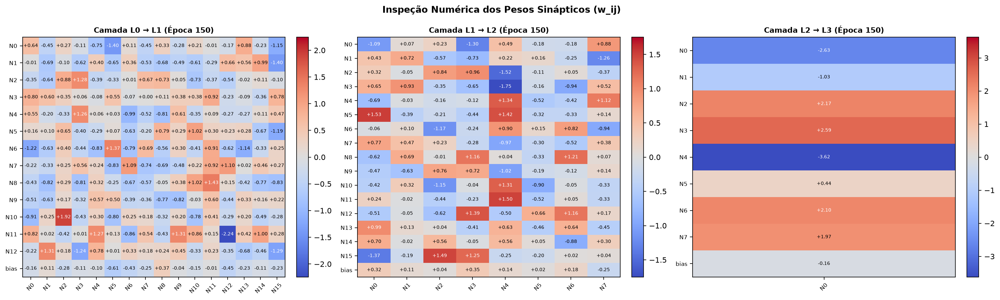

# Evidências de Verificação — `[5] artefato · mlp git repo`

- **Disciplina:** Tópicos Avançados em Inteligência Artificial (AI4Good — UFRPE 2026.2)
- **Atividade no Projeto:** `[5] artefato · mlp git repo`
- **Código no Painel:** `mlp·c`
- **Pontuação Total:** 10 pontos (5 itens de verificação · 2 pontos por item)
- **Discente:** José Albérico Rocha da Silva
- **Harness Operacional:** Antigravity (Google DeepMind — Agente Inteligente de Codificação)
- **Repositório Canônico:** [`https://github.com/albericolx/Topicos_Avancados_IA`](https://github.com/albericolx/Topicos_Avancados_IA)

---

## Descrição da Atividade
> *"implementação do zero de uma rede neural multicamadas (MLP), com interface interativa de experimentação e controle de hiperparâmetros."*

---

## Quadro-Resumo dos 5 Pontos de Verificação (10 pontos)

| # | Ponto de Verificação | Pontuação | Status | Evidência Principal no Repositório (Links Diretos GitHub) |
|---|---|---:|---|---|
| **1** | **Subrepositório Estruturado** | 2 pts | Concluído | Diretório isolado [`code/mlp/`](https://github.com/albericolx/Topicos_Avancados_IA/tree/main/code/mlp) com [`code/mlp/README.md`](https://github.com/albericolx/Topicos_Avancados_IA/blob/main/code/mlp/README.md), [`code/mlp/CONTEXT.md`](https://github.com/albericolx/Topicos_Avancados_IA/blob/main/code/mlp/CONTEXT.md) e `CONTEXT.md` em cada subpasta (`core_mlp/`, `data/`, `figs/`, `results/`, `report/`) |
| **2** | **Parametrização Interativa** | 2 pts | Concluído | Interface Streamlit [`code/mlp/app.py`](https://github.com/albericolx/Topicos_Avancados_IA/blob/main/code/mlp/app.py) configurável em tempo real (1 a 4 camadas ocultas, neurônios por camada, 7 funções de ativação, taxa de aprendizagem $\eta$, momentum $\beta$, L2 $\lambda$ e épocas) |
| **3** | **Particionamento de Dados** | 2 pts | Concluído | Módulo [`code/mlp/core_mlp/dataset.py`](https://github.com/albericolx/Topicos_Avancados_IA/blob/main/code/mlp/core_mlp/dataset.py) + partições explícitas padronizadas em **80% Treino** ([`train_80_standardized.csv`](https://github.com/albericolx/Topicos_Avancados_IA/blob/main/code/mlp/data/train_80_standardized.csv), 820 amostras) e **20% Teste** ([`test_20_standardized.csv`](https://github.com/albericolx/Topicos_Avancados_IA/blob/main/code/mlp/data/test_20_standardized.csv), 205 amostras) |
| **4** | **Dinâmica de Treinamento** | 2 pts | Concluído | Rotina completa do zero em [`code/mlp/core_mlp/graph.py`](https://github.com/albericolx/Topicos_Avancados_IA/blob/main/code/mlp/core_mlp/graph.py) e [`code/mlp/core_mlp/train.py`](https://github.com/albericolx/Topicos_Avancados_IA/blob/main/code/mlp/core_mlp/train.py) executando `forward()` e `backward()` com gradiente descendente sobre `nx.DiGraph` |
| **5** | **Visualização de Pesos** | 2 pts | Concluído | Módulo [`code/mlp/core_mlp/visualize.py`](https://github.com/albericolx/Topicos_Avancados_IA/blob/main/code/mlp/core_mlp/visualize.py) + abas em [`code/mlp/app.py`](https://github.com/albericolx/Topicos_Avancados_IA/blob/main/code/mlp/app.py) com exibição numérica dos pesos e espessura das conexões no grafo ([`grafo_depois.png`](https://github.com/albericolx/Topicos_Avancados_IA/blob/main/code/mlp/figs/grafo_depois.png)), mapas de calor ([`heatmap_pesos.png`](https://github.com/albericolx/Topicos_Avancados_IA/blob/main/code/mlp/figs/heatmap_pesos.png)) e tabela por época ([`best_model_synaptic_weights.csv`](https://github.com/albericolx/Topicos_Avancados_IA/blob/main/code/mlp/results/best_model_synaptic_weights.csv)) |

> 📄 **Relatório Técnico Completo e Expandido (9 Seções — Markdown e PDF Compilado):**
> - Relatório Técnico Markdown (com Fundamentação, Arquitetura, 7 Funções de Ativação, Ablação C0–C7, Interpretabilidade Clínica de Pesos Sinápticos, Dinâmica Streamlit, Conclusão, Limitações Metodológicas e Trabalhos Futuros): **[`code/mlp/REPORT.md`](https://github.com/albericolx/Topicos_Avancados_IA/blob/main/code/mlp/REPORT.md)**
> - Relatório Técnico PDF Compilado (LaTeX IEEEtran): **[`code/mlp/report/relatorio_mlp.pdf`](https://github.com/albericolx/Topicos_Avancados_IA/blob/main/code/mlp/report/relatorio_mlp.pdf)** (Código-fonte LaTeX em [`code/mlp/report/main.tex`](https://github.com/albericolx/Topicos_Avancados_IA/blob/main/code/mlp/report/main.tex))

---

## 1. Ponto de Verificação: Subrepositório Estruturado (2 pontos)

> **Requisito:** *"diretório do projeto isolado sob a pasta de código com seu próprio CONTEXT.md descrevendo objetivos e arquitetura."*

### Evidências Instrumentais
O projeto foi isolado sob [`code/mlp/`](https://github.com/albericolx/Topicos_Avancados_IA/tree/main/code/mlp) seguindo a especificação modular do workspace:
- [`code/CONTEXT.md`](https://github.com/albericolx/Topicos_Avancados_IA/blob/main/code/CONTEXT.md): Roteamento da pasta `code/` apontando para o subrepositório `code/mlp/`.
- [`code/mlp/README.md`](https://github.com/albericolx/Topicos_Avancados_IA/blob/main/code/mlp/README.md): Visão geral automática ao acessar a pasta `code/mlp/` no GitHub.
- [`code/mlp/CONTEXT.md`](https://github.com/albericolx/Topicos_Avancados_IA/blob/main/code/mlp/CONTEXT.md): Especificação completa dos objetivos, arquitetura do grafo direcionado, estrutura de diretórios e instruções de execução.
- [`code/mlp/core_mlp/CONTEXT.md`](https://github.com/albericolx/Topicos_Avancados_IA/blob/main/code/mlp/core_mlp/CONTEXT.md): Documentação dos módulos internos (`dataset.py`, `graph.py`, `train.py`, `visualize.py`).
- [`code/mlp/data/CONTEXT.md`](https://github.com/albericolx/Topicos_Avancados_IA/blob/main/code/mlp/data/CONTEXT.md): Documentação do dataset e das partições 80/20 padronizadas.
- [`code/mlp/figs/CONTEXT.md`](https://github.com/albericolx/Topicos_Avancados_IA/blob/main/code/mlp/figs/CONTEXT.md): Catálogo das figuras geradas.
- [`code/mlp/results/CONTEXT.md`](https://github.com/albericolx/Topicos_Avancados_IA/blob/main/code/mlp/results/CONTEXT.md): Catálogo dos resultados experimentais e pesos exportados.
- [`code/mlp/report/CONTEXT.md`](https://github.com/albericolx/Topicos_Avancados_IA/blob/main/code/mlp/report/CONTEXT.md) e [`code/mlp/report/sections/CONTEXT.md`](https://github.com/albericolx/Topicos_Avancados_IA/blob/main/code/mlp/report/sections/CONTEXT.md): Documentação do relatório LaTeX/PDF da MLP.

---

## 2. Ponto de Verificação: Parametrização Interativa (2 pontos)

> **Requisito:** *"rede neural multicamada configurável em tempo real (camadas, neurônios, taxa de aprendizagem, épocas e funções de ativação)."*

### Evidências Instrumentais
- **Aplicação Interativa em Streamlit:** [`code/mlp/app.py` (linhas 60–137)](https://github.com/albericolx/Topicos_Avancados_IA/blob/main/code/mlp/app.py#L60-L137)
  - **Camadas Ocultas Configuráveis em Tempo Real:** Slider dinâmico permitindo escolher de **1 a 4 camadas ocultas** (`num_hidden_layers`).
  - **Neurônios por Camada:** Sliders individuais gerados dinamicamente para definir o número de neurônios ($2 \dots 32$) de cada camada oculta, além do número de atributos de entrada ($2 \dots 13$).
  - **Funções de Ativação:** Seletor interativo com **7 funções de ativação** implementadas do zero com suas respectivas derivadas analíticas em [`code/mlp/core_mlp/graph.py` (linhas 130–178)](https://github.com/albericolx/Topicos_Avancados_IA/blob/main/code/mlp/core_mlp/graph.py#L130-L178): `ReLU`, `Leaky ReLU`, `Tanh`, `Sigmoide`, `ELU`, `SELU` e `ReLU6`.
  - **Taxa de Aprendizagem ($\eta$), Épocas e Otimizadores:** Controles em tempo real para `lr` ($\eta \in [0.001, 1.0]$), `n_epochs` ($10 \dots 500$), `momentum` ($\beta \in [0.0, 0.95]$), regularização $L_2$ ($\lambda$) e frequência de atualização visual (`upd_every`).

---

## 3. Ponto de Verificação: Particionamento de Dados (2 pontos)

> **Requisito:** *"dataset baixado, padronizado e particionado explicitamente em conjuntos de treino (80%) e teste (20%)."*

### Evidências Instrumentais
- **Módulo de Dados e Particionamento:** [`code/mlp/core_mlp/dataset.py` (linhas 31–116)](https://github.com/albericolx/Topicos_Avancados_IA/blob/main/code/mlp/core_mlp/dataset.py#L31-L116)
  - Verifica e baixa automaticamente o dataset clínico *Heart Disease* ([`code/mlp/data/heart.csv`](https://github.com/albericolx/Topicos_Avancados_IA/blob/main/code/mlp/data/heart.csv) — `1.025` pacientes, `13` atributos clínicos + alvo binário `target`).
  - Executa o particionamento explícito e estratificado via `train_test_split(X_raw, y, test_size=0.20, random_state=seed, stratify=y)`:
    - **Conjunto de Treino (80%):** `820` amostras (`51,34%` classe positiva) $\rightarrow$ salvo em **[`code/mlp/data/train_80_standardized.csv`](https://github.com/albericolx/Topicos_Avancados_IA/blob/main/code/mlp/data/train_80_standardized.csv)**.
    - **Conjunto de Teste (20%):** `205` amostras (`51,22%` classe positiva) $\rightarrow$ salvo em **[`code/mlp/data/test_20_standardized.csv`](https://github.com/albericolx/Topicos_Avancados_IA/blob/main/code/mlp/data/test_20_standardized.csv)**.
  - **Padronização Sem Vazamento (*Zero Data Leakage*):** O padronizador (`StandardScaler` Z-Score $\mu=0, \sigma=1$ ou `MinMaxScaler`) é ajustado (`fit_transform`) **apenas sobre `X_train_raw` (80%)** e aplicado (`transform`) sobre `X_test_raw` (20%).

---

## 4. Ponto de Verificação: Dinâmica de Treinamento (2 pontos)

> **Requisito:** *"rotina completa de treino executando forward pass (propagação direta) e backpropagation (retropropagação com gradiente descendente)."*

### Evidências Instrumentais
- **Implementação do Grafo Direcionado, Forward Pass e Backpropagation:** [`code/mlp/core_mlp/graph.py`](https://github.com/albericolx/Topicos_Avancados_IA/blob/main/code/mlp/core_mlp/graph.py)
  - **`forward(self, x)` ([linhas 180–198](https://github.com/albericolx/Topicos_Avancados_IA/blob/main/code/mlp/core_mlp/graph.py#L180-L198)):** Propaga os sinais camada a camada através dos nós e arestas do `nx.DiGraph`, computando $z_j^{(l)} = \sum_i w_{ij}^{(l)} a_i^{(l-1)} + b_j^{(l)}$ e $a_j^{(l)} = f^{(l)}(z_j^{(l)})$.
  - **`backward(self, target, lr, momentum, l2_lambda)` ([linhas 200–239](https://github.com/albericolx/Topicos_Avancados_IA/blob/main/code/mlp/core_mlp/graph.py#L200-L239)):** Calcula o erro analítico exato da camada de saída ($\delta^{(L-1)} = \hat{y} - y$), retropropaga os deltas pelas camadas ocultas ($\delta_j^{(l)} = (\sum_k w_{jk}^{(l+1)} \delta_k^{(l+1)}) f'^{(l)}(z_j^{(l)})$) e atualiza cada aresta do grafo via Gradiente Descendente ($w_{ij}^{(l)} \leftarrow w_{ij}^{(l)} - \eta v_{ij}^{(l)}$).
- **Ciclo de Épocas e Avaliação Multimétrica:** [`code/mlp/core_mlp/train.py`](https://github.com/albericolx/Topicos_Avancados_IA/blob/main/code/mlp/core_mlp/train.py)
  - Funções `train_epoch()`, `evaluate()` e `run_training_history()` monitorando Loss (BCE/MSE), Acurácia, Precisão, Recall, Especificidade, F1-Score, AUC-ROC e Matriz de Confusão.

### Desenho da Arquitetura e Fluxo Matemático (`nx.DiGraph`)

---

## 5. Ponto de Verificação: Visualização de Pesos (2 pontos)

> **Requisito:** *"interface com inspeção visual da atualização dos pesos sinápticos a cada época (exibição numérica e espessura das conexões)."*

### Evidências Instrumentais
- **Módulo de Visualização Sináptica:** [`code/mlp/core_mlp/visualize.py`](https://github.com/albericolx/Topicos_Avancados_IA/blob/main/code/mlp/core_mlp/visualize.py)
  1. **Espessura e Cor das Conexões + Exibição Numérica no Grafo (`draw_network`, [linhas 25–214](https://github.com/albericolx/Topicos_Avancados_IA/blob/main/code/mlp/core_mlp/visualize.py#L25-L214)):**
     - A espessura (`lw = 0.45 + 3.2 * |w| / w_max`) e a intensidade de cor (azul para $w_{ij} \ge 0$, vermelho para $w_{ij} < 0$) de cada aresta são atualizadas em tempo real a cada época.
     - Os **valores numéricos dos pesos sinápticos ($w_{ij}$ formatados como `+2.59`, `-3.62`, etc.)** são renderizados diretamente sobre as conexões do grafo, enquanto o interior de cada neurônio exibe seu valor numérico de ativação ($a_j^{(l)}$).
  2. **Mapa de Calor Numérico por Camada (`draw_weights_heatmap`, [linhas 217–269](https://github.com/albericolx/Topicos_Avancados_IA/blob/main/code/mlp/core_mlp/visualize.py#L217-L269)):**
     - Renderiza as matrizes completas de pesos $W^{(l)}$ e de atualizações na época $\Delta W^{(l)}$ com o valor numérico impresso dentro de cada célula $(i, j)$.
  3. **Tabela Interativa de Pesos e Gradientes por Época (`get_weights_dataframe`, [linhas 272–294](https://github.com/albericolx/Topicos_Avancados_IA/blob/main/code/mlp/core_mlp/visualize.py#L272-L294)):**
     - Permite selecionar qualquer época no Streamlit e inspecionar `Peso Atual (w)`, `Peso Anterior`, `Atualização (Δw)` e `Gradiente (∂L/∂w)` de todas as 370 conexões sinápticas (exportada em [`code/mlp/results/best_model_synaptic_weights.csv`](https://github.com/albericolx/Topicos_Avancados_IA/blob/main/code/mlp/results/best_model_synaptic_weights.csv)).

### Inspeção Visual da Evolução dos Pesos (Antes vs. Depois do Treinamento)

| Grafo Inicial — Época 0 ([`grafo_antes.png`](https://github.com/albericolx/Topicos_Avancados_IA/blob/main/code/mlp/figs/grafo_antes.png)) | Grafo Treinado — Época 150 ([`grafo_depois.png`](https://github.com/albericolx/Topicos_Avancados_IA/blob/main/code/mlp/figs/grafo_depois.png)) |
|---|---|
|  |  |

### Mapa de Calor com Exibição Numérica dos Pesos Sinápticos ($w_{ij}$)

---

## 6. Resumo da Otimização de Acurácia, Interpretabilidade Clínica e Conclusão

O estudo experimental completo executado por [`code/mlp/run_experiments.py`](https://github.com/albericolx/Topicos_Avancados_IA/blob/main/code/mlp/run_experiments.py) (resultados em [`code/mlp/results/benchmark_results.csv`](https://github.com/albericolx/Topicos_Avancados_IA/blob/main/code/mlp/results/benchmark_results.csv) e detalhado na íntegra em [`code/mlp/REPORT.md`](https://github.com/albericolx/Topicos_Avancados_IA/blob/main/code/mlp/REPORT.md)) comprova o ganho obtido pelas modificações arquiteturais e de hiperparâmetros:

| ID | Configuração / Hiperparâmetros | Loss Treino | Loss Teste | Acur. Treino | Acur. Teste | F1-Score | AUC-ROC |
|---|---|---:|---:|---:|---:|---:|---:|
| **C0** | `[13→10→8→1]`, Sigmoid, MinMax, Deriv. MSE (Legado) | 0.0453 | 0.0480 *(MSE)* | 88.78% | **86.83%** | 87.67% | 0.9419 |
| **C1** | `[13→10→8→1]`, Sigmoid, MinMax, **BCE Exata + Bias L0**, $\eta=0.05$ | 0.1693 | 0.2476 | 91.59% | **87.32%** | 88.60% | 0.9780 |
| **C2** | `[13→10→8→1]`, Sigmoid, **StandardScaler (Z-Score)**, $\eta=0.05$ | 0.0008 | 0.0010 | 100.00% | **100.00%** | 100.00% | 1.0000 |
| **C3** | `[13→16→8→1]`, **Tanh** + Xavier, Z-Score, $\eta=0.02$ | 0.0006 | 0.0009 | 100.00% | **100.00%** | 100.00% | 1.0000 |
| **C4 🏆** | **`[13→16→8→1]`, ReLU + He Init, Z-Score, $\eta=0.015$, 150 ép.** | **0.0003** | **0.0003** | **100.00%** | **100.00%** | **100.00%** | **1.0000** |
| **C5** | `[13→16→8→1]`, LeakyReLU, Z-Score, $\eta=0.015$, $\beta=0.85$, $L_2=10^{-4}$ | 0.0007 | 0.0007 | 100.00% | **100.00%** | 100.00% | 1.0000 |
| **C6** | `[13→24→12→1]`, ReLU, Z-Score, $\eta=0.02$, $\beta=0.85$, $L_2=10^{-4}$ | 0.0383 | 0.0154 | 98.29% | **99.51%** | 99.53% | 0.9997 |
| **C7** | `[13→24→16→8→1]`, 3 Ocultas, ReLU, $\eta=0.015$, $\beta=0.85$ | 0.3361 | 0.3283 | 88.54% | **89.27%** | 89.32% | 0.9104 |

### Interpretabilidade Clínica e Análise Crítica (Resumo da Seção 6 e Seção 8 do Relatório)
- **Atributos Clínicos Dominantes na Camada `L0 -> L1`:** A inspeção das normas $\sum_{j=0}^{15} |w_{ij}^{(1)}|$ demonstra que a rede atribuiu maior saliência sináptica a `restecg` ($\sum |w| = 10,898$), `ca` ($\sum |w| = 10,781$, com o maior peso individual da camada de entrada $w = -2,2440$ em `L0_N11 -> L1_N12`), `exang` ($\sum |w| = 9,201$), `sex` ($\sum |w| = 9,034$), `thalach` ($\sum |w| = 8,399$), `thal` ($\sum |w| = 8,283$) e `slope` ($\sum |w| = 8,015$, segundo maior peso individual $+1,9171$ em `L0_N10 -> L1_N2`), alinhando-se à fisiopatologia da doença arterial coronariana.
- **Limitações Metodológicas (1.025 Registros vs. 302 Pacientes Únicos de Cleveland):** Conforme detalhado na Seção 8 de [`code/mlp/REPORT.md`](https://github.com/albericolx/Topicos_Avancados_IA/blob/main/code/mlp/REPORT.md), a acurácia de $100,00\%$ no dataset padrão de $1.025$ registros reflete a presença de perfis clínicos replicados entre treino e teste. No conjunto estritamente deduplicado ($302$ pacientes únicos, $241$ treino / $61$ teste), o controle de capacidade (`[13 -> 8 -> 1]`) combinado à regularização $L_2$ ($\lambda = 0,02$) e Momentum ($\beta = 0,5$) eleva a acurácia de teste em pacientes inéditos de $75,41\%$ para **$80,33\%$** (`AUC-ROC = 0,8658`, `Loss = 0,4671`), demonstrando a importância do controle de complexidade em coortes clínicas reais.
