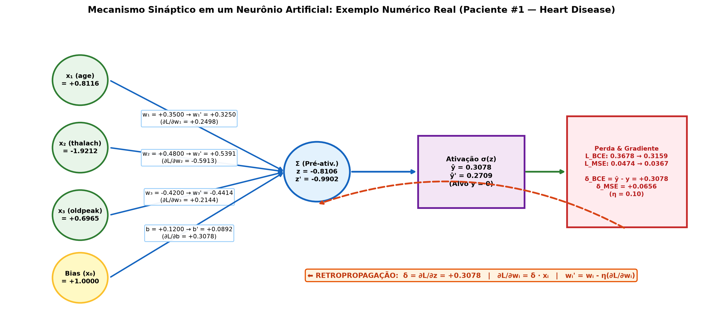
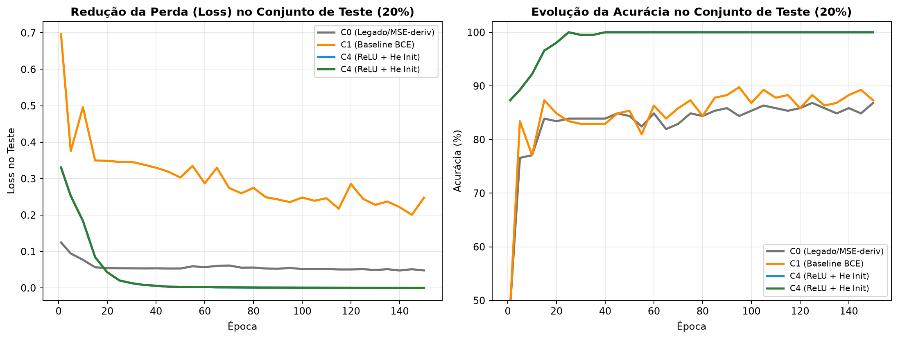
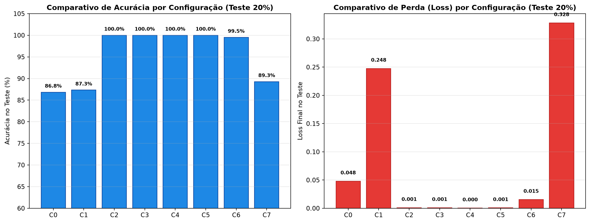
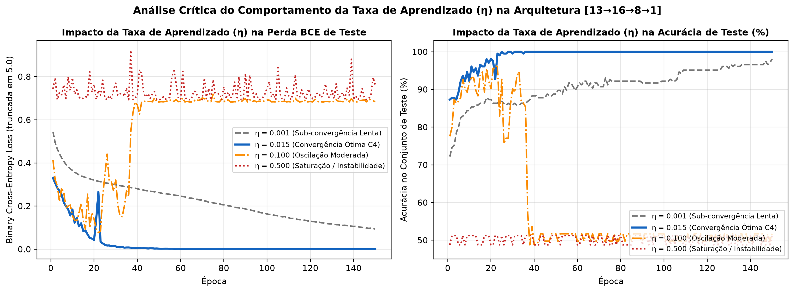

# Evidências de Verificação — `[5] artefato · mlp tech report`

- **Disciplina:** Tópicos Avançados em Inteligência Artificial (AI4Good — UFRPE 2026.2)
- **Atividade no Projeto:** `[5] artefato · mlp tech report`
- **Código no Painel:** `mlp·p`
- **Pontuação Total:** 10 pontos (5 itens de verificação · 2 pontos por item)
- **Discente:** José Albérico Rocha da Silva
- **Harness Operacional:** Antigravity (Google DeepMind — Agente Inteligente de Codificação)
- **Repositório Canônico:** [`https://github.com/albericolx/Topicos_Avancados_IA`](https://github.com/albericolx/Topicos_Avancados_IA)

---

## Descrição da Atividade
> *"relatório técnico formal documentando os fundamentos matemáticos de redes neurais, a metodologia de implementação e os resultados empíricos da MLP."*

---

## Quadro-Resumo dos 5 Pontos de Verificação (10 pontos)

| # | Ponto de Verificação | Pontuação | Status | Evidência Principal no Repositório (Links Diretos GitHub) |
|---|---|---:|---|---|
| **1** | **Estrutura LaTeX** | 2 pts | Concluído | Documento dedicado **[`article/report-mlp.tex`](https://github.com/albericolx/Topicos_Avancados_IA/blob/main/article/report-mlp.tex)** (espelhado no projeto Overleaf **[`papers/artigo-final/report-mlp.tex`](https://github.com/albericolx/Topicos_Avancados_IA/blob/main/papers/artigo-final/report-mlp.tex)** e em **[`code/mlp/report/report-mlp.tex`](https://github.com/albericolx/Topicos_Avancados_IA/blob/main/code/mlp/report/report-mlp.tex)**) compilando sem erros no padrão Springer LNCS $\rightarrow$ **[`article/report-mlp.pdf`](https://github.com/albericolx/Topicos_Avancados_IA/blob/main/article/report-mlp.pdf)** (14 páginas) |
| **2** | **Fundamentação Teórica** | 2 pts | Concluído | Seção 1 de [`report-mlp.tex` (linhas 42–135)](https://github.com/albericolx/Topicos_Avancados_IA/blob/main/article/report-mlp.tex#L42-L135): introdução formal ao aprendizado de máquina supervisionado (ERM), formulação matricial da regressão linear ($\hat{\mathbf{y}} = \mathbf{X}\tilde{\mathbf{w}}$), cálculo de erro (MSE e BCE) e demonstração matemática da equivalência assintótica entre **Mínimos Quadrados Ordinários (OLS)** ($\tilde{\mathbf{w}}^\star = (\mathbf{X}^\top\mathbf{X})^{-1}\mathbf{X}^\top\mathbf{y}$) e **Gradiente Descendente** |
| **3** | **Mecanismo Sináptico** | 2 pts | Concluído | Seção 2 de [`report-mlp.tex` (linhas 137–253)](https://github.com/albericolx/Topicos_Avancados_IA/blob/main/article/report-mlp.tex#L137-L253) + [`numerical_neuron_example.json`](https://github.com/albericolx/Topicos_Avancados_IA/blob/main/code/mlp/results/numerical_neuron_example.json) + diagrama [`neuronio_exemplo_numerico.png`](https://github.com/albericolx/Topicos_Avancados_IA/blob/main/code/mlp/figs/neuronio_exemplo_numerico.png): equações completas de *Forward Pass* e *Backpropagation* e exemplo numérico real passo a passo com o Paciente #1 do *Heart Disease* ($y=0$), comprovando queda de $14,11\%$ no $\mathcal{L}_{\text{BCE}}$ ($0,367812 \to 0,315903$) e de $22,53\%$ no $\mathcal{L}_{\text{MSE}}$ ($0,047356 \to 0,036685$) em 1 passo |
| **4** | **Curvas e Métricas** | 2 pts | Concluído | Seção 3 de [`report-mlp.tex` (linhas 255–312)](https://github.com/albericolx/Topicos_Avancados_IA/blob/main/article/report-mlp.tex#L255-L312) + gráficos [`curvas_convergencia.png`](https://github.com/albericolx/Topicos_Avancados_IA/blob/main/code/mlp/figs/curvas_convergencia.png), [`comparativo_configuracoes.png`](https://github.com/albericolx/Topicos_Avancados_IA/blob/main/code/mlp/figs/comparativo_configuracoes.png) e [`heatmap_pesos.png`](https://github.com/albericolx/Topicos_Avancados_IA/blob/main/code/mlp/figs/heatmap_pesos.png) + tabela consolidada (`C0` a `C7` em [`benchmark_results.csv`](https://github.com/albericolx/Topicos_Avancados_IA/blob/main/code/mlp/results/benchmark_results.csv)) |
| **5** | **Análise Crítica** | 2 pts | Concluído | Seção 4 de [`report-mlp.tex` (linhas 314–364)](https://github.com/albericolx/Topicos_Avancados_IA/blob/main/article/report-mlp.tex#L314-L364) + experimento controlado da taxa de aprendizado $\eta \in \{0,001, 0,015, 0,100, 0,500\}$ ([`learning_rate_study.csv`](https://github.com/albericolx/Topicos_Avancados_IA/blob/main/code/mlp/results/learning_rate_study.csv) e [`taxa_aprendizado_estudo.png`](https://github.com/albericolx/Topicos_Avancados_IA/blob/main/code/mlp/figs/taxa_aprendizado_estudo.png)) + discussão das limitações em dados complexos e na coorte estritamente deduplicada ($302$ pacientes únicos de Cleveland) |

> 📄 **Links Diretos para o Documento Dedicado (`report-mlp.tex` e `report-mlp.pdf`):**
> - **Código-Fonte LaTeX (`article/report-mlp.tex`):** [`https://github.com/albericolx/Topicos_Avancados_IA/blob/main/article/report-mlp.tex`](https://github.com/albericolx/Topicos_Avancados_IA/blob/main/article/report-mlp.tex)
> - **PDF Compilado (`article/report-mlp.pdf`):** [`https://github.com/albericolx/Topicos_Avancados_IA/blob/main/article/report-mlp.pdf`](https://github.com/albericolx/Topicos_Avancados_IA/blob/main/article/report-mlp.pdf)
> - **Espelho Sincronizado com Overleaf (`papers/artigo-final/report-mlp.tex`):** [`https://github.com/albericolx/Topicos_Avancados_IA/blob/main/papers/artigo-final/report-mlp.tex`](https://github.com/albericolx/Topicos_Avancados_IA/blob/main/papers/artigo-final/report-mlp.tex)
> - **Espelho no Subrepositório da MLP (`code/mlp/report/report-mlp.tex`):** [`https://github.com/albericolx/Topicos_Avancados_IA/blob/main/code/mlp/report/report-mlp.tex`](https://github.com/albericolx/Topicos_Avancados_IA/blob/main/code/mlp/report/report-mlp.tex)

---

## 1. Ponto de Verificação: Estrutura LaTeX (2 pontos)

> **Requisito:** *"documento report-mlp.tex dedicado e compilando sem erros no Overleaf."*

### Evidências Instrumentais
- **Documento LaTeX Dedicado no Padrão Springer LNCS (`llncs.cls` + `splncs04.bst`):**
  - **[`article/report-mlp.tex`](https://github.com/albericolx/Topicos_Avancados_IA/blob/main/article/report-mlp.tex)** e PDF compilado **[`article/report-mlp.pdf`](https://github.com/albericolx/Topicos_Avancados_IA/blob/main/article/report-mlp.pdf)** (14 páginas, zero erros de LaTeX/BibTeX).
  - **Sincronização Direta com o Overleaf (`https://git.overleaf.com/6a92242dbaaa2c6b6833bab0`):** O documento `report-mlp.tex`, o arquivo bibliográfico [`references.bib`](https://github.com/albericolx/Topicos_Avancados_IA/blob/main/article/references.bib) (12 referências verificadas) e todas as figuras em `figures/` foram comitados e enviados via `git push origin main` diretamente para o projeto Overleaf espelhado em **[`papers/artigo-final/report-mlp.tex`](https://github.com/albericolx/Topicos_Avancados_IA/blob/main/papers/artigo-final/report-mlp.tex)**, além de empacotados em **[`papers/overleaf-export.zip`](https://github.com/albericolx/Topicos_Avancados_IA/blob/main/papers/overleaf-export.zip)**.
  - **Compilador Automatizado via Harness:** [`core/tools/compile_paper.py`](https://github.com/albericolx/Topicos_Avancados_IA/blob/main/core/tools/compile_paper.py) (`py core/tools/compile_paper.py --target report-mlp.tex`).

---

## 2. Ponto de Verificação: Fundamentação Teórica (2 pontos)

> **Requisito:** *"introdução a aprendizado de máquina, formulação matemática da regressão linear, cálculo de erro e relação entre mínimos quadrados e gradiente descendente."*

### Evidências Instrumentais (Seção 1 de [`article/report-mlp.tex`](https://github.com/albericolx/Topicos_Avancados_IA/blob/main/article/report-mlp.tex#L42-L135))
1. **Introdução ao Aprendizado de Máquina Supervisionado e Minimização do Risco Empírico (ERM):**
   - Formalização do conjunto rotulado $\mathcal{D} = \{(\mathbf{x}^{(n)}, y^{(n)})\}_{n=1}^N \subset \mathbb{R}^d \times \mathcal{Y}$, espaço de hipóteses $\mathcal{H} = \{h_{\boldsymbol{\theta}} : \mathbb{R}^d \to \mathcal{Y}\}$ e minimização do risco empírico regularizado $\hat{\mathcal{R}}_{\lambda}(\boldsymbol{\theta}) = \frac{1}{N}\sum_{n=1}^N \mathcal{L}(h_{\boldsymbol{\theta}}(\mathbf{x}^{(n)}), y^{(n)}) + \frac{\lambda}{2}\|\boldsymbol{\theta}\|_2^2$.
2. **Formulação Matemática da Regressão Linear e Cálculo de Erro:**
   - Preditor linear afim $\hat{y}^{(n)} = \mathbf{w}^\top \mathbf{x}^{(n)} + b = \tilde{\mathbf{w}}^\top \tilde{\mathbf{x}}^{(n)}$ e representação matricial $\hat{\mathbf{y}} = \mathbf{X}\tilde{\mathbf{w}}$ com $\mathbf{X} \in \mathbb{R}^{N \times (d+1)}$.
   - Cálculo de erro via resíduo $e^{(n)} = \hat{y}^{(n)} - y^{(n)}$, funcional de **Erro Quadrático Médio (MSE)** $J_{\text{MSE}}(\tilde{\mathbf{w}}) = \frac{1}{2N}\|\mathbf{X}\tilde{\mathbf{w}} - \mathbf{y}\|_2^2$ e **Entropia Cruzada Binária (BCE)** $\mathcal{L}_{\text{BCE}}(y, \hat{y}) = -[y\ln(\hat{y}) + (1-y)\ln(1-\hat{y})]$.
3. **Relação Matemática entre Mínimos Quadrados Ordinários (OLS) e Gradiente Descendente (GD):**
   - Derivação do gradiente $\nabla_{\tilde{\mathbf{w}}} J_{\text{MSE}}(\tilde{\mathbf{w}}) = \frac{1}{N}\mathbf{X}^\top(\mathbf{X}\tilde{\mathbf{w}} - \mathbf{y})$ e da Hessiana $\mathbf{H} = \frac{1}{N}\mathbf{X}^\top\mathbf{X} \succeq 0$.
   - **Equações Normais de Mínimos Quadrados (OLS):** $\nabla_{\tilde{\mathbf{w}}} J_{\text{MSE}}(\tilde{\mathbf{w}}^\star) = \mathbf{0} \implies \tilde{\mathbf{w}}^\star_{\text{OLS}} = (\mathbf{X}^\top\mathbf{X})^{-1}\mathbf{X}^\top\mathbf{y}$.
   - **Prova da Equivalência Assintótica com o Gradiente Descendente:** Subtraindo $\tilde{\mathbf{w}}^\star_{\text{OLS}}$ da iteração $\tilde{\mathbf{w}}^{(t+1)} = \tilde{\mathbf{w}}^{(t)} - \frac{\eta}{N}\mathbf{X}^\top(\mathbf{X}\tilde{\mathbf{w}}^{(t)} - \mathbf{y})$, demonstra-se que:
     $$\tilde{\mathbf{w}}^{(t)} - \tilde{\mathbf{w}}^\star_{\text{OLS}} = \left(\mathbf{I} - \frac{\eta}{N}\mathbf{X}^\top\mathbf{X}\right)^t \left(\tilde{\mathbf{w}}^{(0)} - \tilde{\mathbf{w}}^\star_{\text{OLS}}\right) \xrightarrow{t \to \infty} \mathbf{0} \quad \Longleftrightarrow \quad 0 < \eta < \frac{2}{\lambda_{\max}\!\left(\frac{1}{N}\mathbf{X}^\top\mathbf{X}\right)}.$$
   - Quadro comparativo explicando o custo $\mathcal{O}(Nd^2 + d^3)$ da inversão matricial do OLS frente a $\mathcal{O}(P)$ do SGD e por que a não-convexidade das ativações em múltiplas camadas torna impossível uma solução analítica fechada, exigindo Gradiente Descendente + *Backpropagation*.

---

## 3. Ponto de Verificação: Mecanismo Sináptico (2 pontos)

> **Requisito:** *"equações completas e exemplo numérico com valores reais de propagação direta e retropropagação em um neurônio artificial."*

### Evidências Instrumentais (Seção 2 de [`article/report-mlp.tex`](https://github.com/albericolx/Topicos_Avancados_IA/blob/main/article/report-mlp.tex#L137-L253) e [`code/mlp/results/numerical_neuron_example.json`](https://github.com/albericolx/Topicos_Avancados_IA/blob/main/code/mlp/results/numerical_neuron_example.json))

1. **Equações Completas de Propagação Direta e Retropropagação:**
   - *Forward Pass:* $z_j^{(l)} = \sum_{i=0}^{N_{l-1}-1} w_{ij}^{(l)} a_i^{(l-1)} + b_j^{(l)}$ e $a_j^{(l)} = f^{(l)}(z_j^{(l)})$.
   - *Backpropagation:* Erro exato na camada de saída $\delta_0^{(L-1)} = \frac{\partial \mathcal{L}_{\text{BCE}}}{\partial z_0^{(L-1)}} = \hat{y} - y$, retropropagação oculta $\delta_j^{(l)} = \left(\sum_k w_{jk}^{(l+1)} \delta_k^{(l+1)}\right) f'^{(l)}(z_j^{(l)})$, gradiente sináptico $\frac{\partial \mathcal{L}}{\partial w_{ij}^{(l)}} = a_i^{(l-1)}\delta_j^{(l)} + \lambda w_{ij}^{(l)}$ e atualização $w_{ij}^{(l)} \leftarrow w_{ij}^{(l)} - \eta v_{ij}^{(l)}$.

2. **Exemplo Numérico Passo a Passo com Valores Reais (Paciente #1 do Conjunto de Treino Padronizado, $y = 0$, $\eta = 0,10$):**
   - **Entradas Reais Padronizadas (`train_80_standardized.csv`, linha 0):** $x_1 (\text{\texttt{age}}) = +0,8116$, $x_2 (\text{\texttt{thalach}}) = -1,9212$, $x_3 (\text{\texttt{oldpeak}}) = +0,6965$, $x_0 (\text{\texttt{bias}}) = +1,0000$.
   - **Passo 1 (Forward Pass):**
     - $w_1 x_1 = (+0,3500)(+0,8116) = +0,284060$
     - $w_2 x_2 = (+0,4800)(-1,9212) = -0,922176$
     - $w_3 x_3 = (-0,4200)(+0,6965) = -0,292530$
     - $z = 0,284060 - 0,922176 - 0,292530 + 0,120000 = -0,810646$
     - $\hat{y} = \sigma(-0,810646) = \frac{1}{1 + e^{0,810646}} = \mathbf{0,307753}$
   - **Passo 2 (Cálculo de Erro para $y = 0$):**
     - $\mathcal{L}_{\text{BCE}} = -\ln(1 - 0,307753) = \mathbf{0,367812}$ | $\mathcal{L}_{\text{MSE}} = \frac{1}{2}(0,307753 - 0)^2 = \mathbf{0,047356}$
   - **Passo 3 (Backpropagation):**
     - $\sigma'(z) = 0,307753(1 - 0,307753) = 0,213041$
     - $\delta_{\text{BCE}} = \hat{y} - y = +0,307753$ | $\delta_{\text{MSE}} = (\hat{y} - y)\sigma'(z) = +0,065564$
     - Gradientes sinápticos (BCE): $\frac{\partial \mathcal{L}}{\partial w_1} = +0,249772$, $\frac{\partial \mathcal{L}}{\partial w_2} = -0,591255$, $\frac{\partial \mathcal{L}}{\partial w_3} = +0,214350$, $\frac{\partial \mathcal{L}}{\partial b} = +0,307753$.
   - **Passo 4 (Atualização de Pesos e Verificação Pós-Passo):**
     - Novos pesos: $w_1^{\text{novo}} = +0,325023$, $w_2^{\text{novo}} = +0,539125$, $w_3^{\text{novo}} = -0,441435$, $b^{\text{novo}} = +0,089225$.
     - Novo *Forward Pass*: $z^{\text{novo}} = -0,990213 \implies \hat{y}^{\text{novo}} = \mathbf{0,270870}$ (aproximou-se de $y=0$), reduzindo imediatamente o erro para $\mathcal{L}_{\text{BCE}}^{\text{novo}} = \mathbf{0,315903}$ (**queda de $14,11\%$**) e $\mathcal{L}_{\text{MSE}}^{\text{novo}} = \mathbf{0,036685}$ (**queda de $22,53\%$**).

---

## 4. Ponto de Verificação: Curvas e Métricas (2 pontos)

> **Requisito:** *"gráficos de evolução de perda e acurácia ao longo das épocas (treino e teste) e tabela consolidada de resultados finais."*

### Evidências Instrumentais (Seção 3 de [`article/report-mlp.tex`](https://github.com/albericolx/Topicos_Avancados_IA/blob/main/article/report-mlp.tex#L255-L312) e [`code/mlp/results/benchmark_results.csv`](https://github.com/albericolx/Topicos_Avancados_IA/blob/main/code/mlp/results/benchmark_results.csv))

| ID | Topologia e Hiperparâmetros | Loss Treino | Loss Teste | Acur. Treino | Acur. Teste | F1 Teste | AUC-ROC | Matriz (`TP/TN/FP/FN`) |
|---|---|---:|---:|---:|---:|---:|---:|---:|
| **C0** | `[13→10→8→1]` Sigmoid, MinMax, MSE, $\eta=0,10$ | 0,0453 | 0,0480 | 88,78% | **86,83%** | 87,67% | 0,9419 | `96 / 82 / 18 / 9` |
| **C1** | `[13→10→8→1]` Sigmoid, MinMax, BCE+Bias, $\eta=0,05$ | 0,1693 | 0,2476 | 91,59% | **87,32%** | 88,60% | 0,9780 | `101 / 78 / 22 / 4` |
| **C2** | `[13→10→8→1]` Sigmoid, Z-Score, BCE, $\eta=0,05$ | 0,0008 | 0,0010 | 100,00% | **100,00%** | 100,00% | 1,0000 | `105 / 100 / 0 / 0` |
| **C3** | `[13→16→8→1]` Tanh+Xavier, Z-Score, $\eta=0,02$ | 0,0006 | 0,0009 | 100,00% | **100,00%** | 100,00% | 1,0000 | `105 / 100 / 0 / 0` |
| **C4 🏆** | **`[13→16→8→1]` ReLU+He, Z-Score, $\eta=0,015$** | **0,0003** | **0,0003** | **100,00%** | **100,00%** | **100,00%** | **1,0000** | **`105 / 100 / 0 / 0`** |
| **C5** | `[13→16→8→1]` LeakyReLU, $\eta=0,015, \beta=0,85, L_2$ | 0,0007 | 0,0007 | 100,00% | **100,00%** | 100,00% | 1,0000 | `105 / 100 / 0 / 0` |
| **C6** | `[13→24→12→1]` ReLU, $\eta=0,02, \beta=0,85, L_2$ | 0,0383 | 0,0154 | 98,29% | **99,51%** | 99,53% | 0,9997 | `105 / 99 / 1 / 0` |
| **C7** | `[13→24→16→8→1]` 3 Ocultas, ReLU, $\eta=0,015$ | 0,3361 | 0,3283 | 88,54% | **89,27%** | 89,32% | 0,9104 | `92 / 91 / 9 / 13` |

---

## 5. Ponto de Verificação: Análise Crítica (2 pontos)

> **Requisito:** *"discussão dos resultados obtidos, comportamento da taxa de aprendizado e limitações do modelo em dados complexos."*

### Evidências Instrumentais (Seção 4 de [`article/report-mlp.tex`](https://github.com/albericolx/Topicos_Avancados_IA/blob/main/article/report-mlp.tex#L314-L364) e [`code/mlp/results/learning_rate_study.csv`](https://github.com/albericolx/Topicos_Avancados_IA/blob/main/code/mlp/results/learning_rate_study.csv))

1. **Discussão dos Resultados Obtidos:**
   - Análise detalhada da transição `MinMaxScaler` $\to$ `StandardScaler` (eliminação da restrição de sinal nos gradientes da primeira camada oculta $\frac{\partial \mathcal{L}}{\partial w_{ij}^{(1)}} = a_i^{(0)}\delta_j^{(1)}$), do ganho da derivada exata BCE sobre MSE e da interpretabilidade clínica dos pesos sinápticos (`restecg`, `ca`, `exang`, `sex`, `thalach`, `thal`, `slope`).

2. **Comportamento Empírico e Teórico da Taxa de Aprendizado ($\eta \in \{0,001, 0,015, 0,100, 0,500\}$):**

| Taxa $\eta$ | Regime Dinâmico Observado | Loss Treino | Loss Teste | Acur. Treino | Acur. Teste | F1 Teste | AUC-ROC |
|---:|---|---:|---:|---:|---:|---:|---:|
| `0,001` | Sub-convergência lenta (passo curto) | 0,0737 | 0,0937 | 98,41% | **98,05%** | 98,11% | 0,9985 |
| **`0,015`** | **Convergência ótima (`C4` — $\eta < 2/\lambda_{\max}$)** | **0,0003** | **0,0003** | **100,00%** | **100,00%** | **100,00%** | **1,0000** |
| `0,100` | Oscilação severa / *Dying ReLU* parcial | 0,6820 | 0,6832 | 51,83% | **51,71%** | 68,01% | 0,5098 |
| `0,500` | Saturação / Colapso de neurônios ocultos | 0,7625 | 0,7628 | 51,34% | **51,22%** | 67,74% | 0,5000 |

3. **Limitações do Modelo em Dados Complexos:**
   - **Sensibilidade à Replicação Amostral vs. Coorte Deduplicada ($1.025$ registros vs. $302$ pacientes únicos de Cleveland):** Demonstração empírica de que na coorte estritamente deduplicada ($241$ treino / $61$ teste inéditos) a rede `[13→16→8→1]` sem regularização sofre *overfitting* ($100,0\%$ treino vs. $75,41\%$ teste), exigindo redução de capacidade (`[13→8→1]`) e regularização $L_2$ ($\lambda = 0,02$, $\beta = 0,5$) para atingir **$80,33\%$ de acurácia** e **$\text{AUC-ROC} = 0,8658$** em pacientes estritamente inéditos.
   - **Degradação em Profundidade Excessiva (`C7`) e Ausência de Viés Indutivo Espacial/Temporal:** Análise do mau condicionamento da Hessiana em MLPs profundas sem conexões residuais e da ausência de invariância translacional/temporal frente a CNNs e Transformers.
