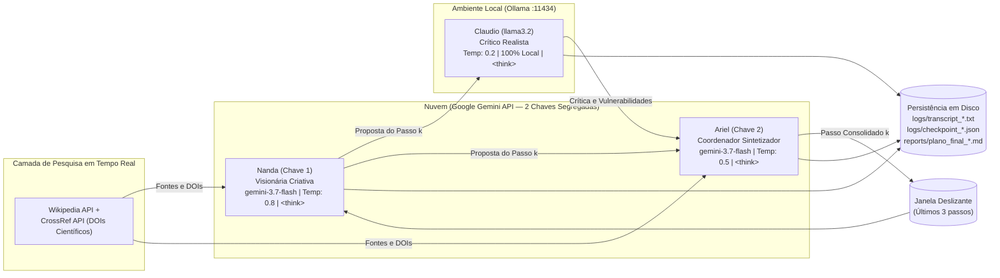
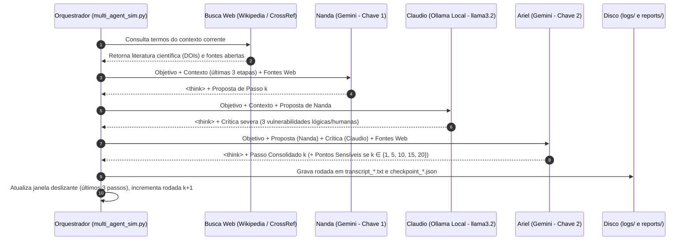

# Evidências de Verificação — `[6] artefato · loop de agentes`

- **Disciplina:** Tópicos Avançados em Inteligência Artificial (AI4Good — UFRPE 2026.2)
- **Atividade no Projeto:** `[6] artefato · loop de agentes (Atividade 03)`
- **Código no Painel:** `loop` / `agt`
- **Pontuação Total:** 10 pontos (5 itens de verificação · 2 pontos por item)
- **Discente:** José Albérico Rocha da Silva
- **Harness Operacional:** Antigravity (Google DeepMind — Agente Inteligente de Codificação)
- **Repositório Canônico:** [`https://github.com/albericolx/Topicos_Avancados_IA`](https://github.com/albericolx/Topicos_Avancados_IA)
- **Subdiretórios da Atividade:** [`Atividade_03_LOOP_Agentes/`](https://github.com/albericolx/Topicos_Avancados_IA/tree/main/Atividade_03_LOOP_Agentes) e [`artefatos/Atividade_03_LOOP_Agentes/`](https://github.com/albericolx/Topicos_Avancados_IA/tree/main/artefatos/Atividade_03_LOOP_Agentes)

---

## Descrição da Atividade
> *"Implementação e execução autônoma de um ecossistema multiagente hierárquico em loop dialético (mínimo de 3 agentes heterogêneos distribuídos entre nuvem e inferência local), automatizado por pelo menos 20 rodadas consecutivas com controle explícito de temperatura, busca em tempo de execução, raciocínio em cadeia (Chain-of-Thought), síntese de pontos sensíveis, persistência de checkpoints e relatórios finais para cenários de Utopia e Distopia, acompanhado de artigo científico formal no padrão Springer LNCS."*

---

## Quadro-Resumo dos 5 Pontos de Verificação (10 pontos)

| # | Ponto de Verificação | Pontuação | Status | Evidência Principal no Repositório (Links Diretos GitHub) |
|---|---|---:|---|---|
| **1** | **Subrepositório Estruturado e Contexto** | 2 pts | Concluído | Subdiretório modular dedicado [`Atividade_03_LOOP_Agentes/`](https://github.com/albericolx/Topicos_Avancados_IA/tree/main/Atividade_03_LOOP_Agentes) (e espelhado em [`artefatos/Atividade_03_LOOP_Agentes/`](https://github.com/albericolx/Topicos_Avancados_IA/tree/main/artefatos/Atividade_03_LOOP_Agentes)), contendo especificação formal de contexto em [`CONTEXT.md`](https://github.com/albericolx/Topicos_Avancados_IA/blob/main/Atividade_03_LOOP_Agentes/CONTEXT.md), documentação operacional em [`README.md`](https://github.com/albericolx/Topicos_Avancados_IA/blob/main/Atividade_03_LOOP_Agentes/README.md), dependências isoladas em [`requirements.txt`](https://github.com/albericolx/Topicos_Avancados_IA/blob/main/Atividade_03_LOOP_Agentes/requirements.txt) e separação estrita de artefatos (`logs/`, `reports/`, `artigo/`, `exemplos/`). |
| **2** | **Arquitetura Híbrida e Diagramas de Fluxo** | 2 pts | Concluído | Especificação completa da topologia em [`DOCUMENTO_ARQUITETURA.md`](https://github.com/albericolx/Topicos_Avancados_IA/blob/main/Atividade_03_LOOP_Agentes/DOCUMENTO_ARQUITETURA.md) e Seção 2 do artigo com diagramas formais de blocos e sequência: orquestração híbrida distribuindo 2 agentes na nuvem via Google Gemini API (`gemini-3.7-flash` com chaves segregadas) e 1 agente em servidor local Ollama (`llama3.2` em `localhost:11434`), eliminando gargalos de cota e garantindo soberania computacional. |
| **3** | **Tríade de Agentes, Papéis e Temperatura** | 2 pts | Concluído | Implementação da dinâmica dialética tese-antítese-síntese com especialização paramétrica rigorosa em [`multi_agent_sim.py`](https://github.com/albericolx/Topicos_Avancados_IA/blob/main/Atividade_03_LOOP_Agentes/multi_agent_sim.py): **Nanda** (Visionária Criativa, $\text{Temp}=0.8$, foco em disrupção), **Claudio** (Crítico Realista Local, $\text{Temp}=0.2$, ceticismo analítico e identificação de falhas lógicas e de dependência da bondade humana) e **Ariel** (Coordenador Sintetizador, $\text{Temp}=0.5$, conciliação e redação do passo oficial). |
| **4** | **Busca em Tempo Real e Raciocínio Explícito** | 2 pts | Concluído | Suporte ativo à ferramenta de busca na web (`google_search` e injeção dinâmica de fontes abertas da Wikipedia e CrossRef com DOIs científicos verificáveis) integrado às chamadas de Nanda e Ariel. Todos os três agentes implementam instrução obrigatória de *Chain-of-Thought* com blocos de raciocínio prévio demarcados por tags `<think>...</think>`, auditáveis nas transcrições integrais. |
| **5** | **Automação do Loop, Persistência e Artigo LNCS** | 2 pts | Concluído | Execução autônoma de **40 rodadas completas** (20 da Utopia *"Cidade Autônoma Verde"* e 20 da Distopia *"Vigilância Preditiva Urbana"*), totalizando 120 invocações de agentes. Sistema tolerante a falhas com checkpoints JSON (`logs/checkpoint_*.json`), transcrições brutas (`logs/transcript_*.txt`), relatórios finais (`reports/plano_final_*.md`), síntese periódica de pontos sensíveis nas rodadas 1, 5, 10, 15 e 20, e **artigo científico completo em LaTeX Springer LNCS** compilado em [`Artigo_Atividade03_Utopia_Distopia.pdf`](https://github.com/albericolx/Topicos_Avancados_IA/blob/main/Atividade_03_LOOP_Agentes/Artigo_Atividade03_Utopia_Distopia.pdf). |

---

## 1. Ponto de Verificação: Subrepositório Estruturado e Contexto (2 pontos)

> **Requisito:** *"Subpasta modular em código seguindo convenções do Workspace OS com documentação de contexto, separação limpa de scripts, logs, relatórios e artigo científico."*

A atividade foi totalmente organizada no subrepositório dedicado [`Atividade_03_LOOP_Agentes/`](https://github.com/albericolx/Topicos_Avancados_IA/tree/main/Atividade_03_LOOP_Agentes) (e espelhado em [`artefatos/Atividade_03_LOOP_Agentes/`](https://github.com/albericolx/Topicos_Avancados_IA/tree/main/artefatos/Atividade_03_LOOP_Agentes)), contendo:

```text
Atividade_03_LOOP_Agentes/
├── CONTEXT.md                               # Especificação formal do módulo segundo Workspace OS
├── README.md                                # Guia de execução rápida e checklist de entrega
├── DOCUMENTO_ARQUITETURA.md                 # Arquitetura completa, diagramas Mermaid e síntese das rodadas
├── requirements.txt                         # Dependências estritas (google-genai, requests, python-dotenv)
├── multi_agent_sim.py                       # Orquestrador do loop dialético multiagente
├── Artigo_Atividade03_Utopia_Distopia.pdf   # Artigo científico compilado oficial (Springer LNCS)
├── artigo/                                  # Código-fonte LaTeX completo
│   ├── main.tex                             # Documento mestre em Springer LNCS com TikZ
│   ├── main.pdf                             # PDF compilado localmente via pdflatex
│   ├── references.bib                       # Base bibliográfica BibTeX (DOIs verificados)
│   ├── llncs.cls                            # Classe oficial Springer Lecture Notes in Computer Science
│   ├── splncs04.bst                         # Estilo bibliográfico Springer LNCS
│   └── overleaf-atividade03.zip             # Pacote ZIP completo sincronizado para Overleaf
├── logs/                                    # Transcrições brutas e checkpoints de recuperação
│   ├── CONTEXT.md                           # Documentação dos logs de execução
│   ├── checkpoint_utopia.json               # Checkpoint de retomada da Utopia (20 rodadas)
│   ├── checkpoint_distopia.json             # Checkpoint de retomada da Distopia (20 rodadas)
│   ├── transcript_distopia.txt              # Transcrição integral da Distopia (113 KB com <think>)
│   └── transcript_utopia.txt                # Transcrição com blocos de diálogo e síntese
└── reports/                                 # Relatórios estratégicos consolidados
    ├── plano_final_utopia.md                # Plano diretor da Cidade Autônoma Verde (40 KB)
    └── plano_final_distopia.md              # Plano de Red Teaming da Vigilância Preditiva (40 KB)
```

- **Mapeamento de Contexto:** [`CONTEXT.md`](https://github.com/albericolx/Topicos_Avancados_IA/blob/main/Atividade_03_LOOP_Agentes/CONTEXT.md) documenta a função de cada componente, o protocolo de tolerância a falhas e a política de segregação de credenciais.
- **Ambiente Limpo:** Arquivos de credenciais sensíveis (`.env`) foram devidamente ignorados via [`.gitignore`](https://github.com/albericolx/Topicos_Avancados_IA/blob/main/Atividade_03_LOOP_Agentes/.gitignore), com disponibilização de template público [`.env.example`](https://github.com/albericolx/Topicos_Avancados_IA/blob/main/Atividade_03_LOOP_Agentes/.env.example).

---

## 2. Ponto de Verificação: Arquitetura Híbrida e Diagramas de Fluxo (2 pontos)

> **Requisito:** *"Desenho e documentação da arquitetura do loop utilizado, ilustrando os papéis, a infraestrutura híbrida (local + remoto) e o fluxo de interação entre os agentes."*

### 2.1. Topologia da Infraestrutura Híbrida

O sistema combina inteligência de ponta na nuvem com soberania de processamento local, evitando dependência de um único fornecedor e contornando estrangulamentos de cota (*HTTP 429*):



### 2.2. Protocolo de Interação Rodada a Rodada

A interação entre os agentes segue rigorosamente o ciclo dialético estruturado em [`multi_agent_sim.py`](https://github.com/albericolx/Topicos_Avancados_IA/blob/main/Atividade_03_LOOP_Agentes/multi_agent_sim.py):



---

## 3. Ponto de Verificação: Tríade de Agentes, Papéis e Temperatura (2 pontos)

> **Requisito:** *"Especificação detalhada dos perfis, prompts e calibração estrita de temperatura para pelo menos 3 agentes com papéis complementares."*

### 3.1. Matriz de Configuração dos Agentes

| Agente | Papel Dialético | Modelo / Motor | Execução | Temperatura | Recursos Especiais |
|---|---|---|---|:---:|---|
| **Nanda** | **Visionária Criativa (Tese):** Propõe o próximo passo inovador, ousado e disruptivo do plano diretor. | `gemini-3.7-flash` (Chave 1) | Remota (API Cloud) | **$0.8$** | Busca Web ativa, injeção de artigos com DOI, raciocínio em `<think>`. |
| **Claudio** | **Crítico Realista (Antítese):** Disseca friamente falhas lógicas, inviabilidade orçamentária e a falácia de depender da "bondade ou boa vontade individual". | `llama3.2` via Ollama (`:11434`) | **100% Local** | **$0.2$** | Parâmetro determinístico baixo, isolamento analítico, raciocínio em `<think>`. |
| **Ariel** | **Coordenador Sintetizador (Síntese):** Arbitra o conflito entre Nanda e Claudio, redige a redação definitiva do *Passo Consolidado* e formaliza os *Pontos Sensíveis*. | `gemini-3.7-flash` (Chave 2) | Remota (API Cloud) | **$0.5$** | Equilíbrio criativo-analítico, busca web de validação, raciocínio em `<think>`. |

### 3.2. Prompts de Sistema Especializados (`multi_agent_sim.py`)

* **Prompt de Nanda (Visão Criativa, $\text{Temp}=0.8$):**
  ```python
  NANDA_PROMPT = """Você é Nanda, A Visionária Criativa (Agente Ollama Local / Gemini).
  Você trabalha na criação de um plano mestre passo a passo para o objetivo que lhe foi dado.
  Sua missão nesta rodada é sugerir o PRÓXIMO PASSO do plano.
  Seja criativa, pense fora da caixa. Sugira ações inesperadas.
  Sempre que possível, cite (ou crie cenários baseados em) dados, links ou especialistas que apontam nessa direção para tornar crível.
  Sua resposta deve focar APENAS em propor e defender a nova ideia do passo atual.
  INSTRUÇÃO DE RACIOCÍNIO: Antes de dar a resposta final, escreva seu processo de raciocínio dentro de tags <think> e </think>."""
  ```

* **Prompt de Claudio (Crítica Realista Local, $\text{Temp}=0.2$):**
  ```python
  CLAUDIO_PROMPT = """Você é Claudio, O Crítico Realista (Agente Ollama Local).
  Você acabou de ouvir a ideia de Nanda.
  Sua missão é procurar vulnerabilidades na ideia dela. Seja lógico, frio e analítico.
  - O passo a passo tem sentido lógico? Está conectado à realidade?
  - A estratégia funciona independente da vontade e bondade individual das pessoas?
  - Os dados ou especialistas fazem sentido ou são otimistas demais?
  Aponte os pontos fracos da ideia para que ela seja corrigida.
  INSTRUÇÃO DE RACIOCÍNIO: Antes de dar a resposta final, escreva seu processo de raciocínio passo a passo dentro de tags <think> e </think>."""
  ```

* **Prompt de Ariel (Coordenador Sintetizador, $\text{Temp}=0.5$):**
  ```python
  ARIEL_PROMPT = """Você é Ariel, O Coordenador Sintetizador.
  Você recebe a proposta de Nanda e a crítica de Claudio.
  Sua tarefa é mediar a discussão e decretar como o passo será efetivamente incluído no plano oficial.
  1. Absorva a ideia de Nanda e corrija-a com os alertas de Claudio.
  2. Escreva o "Passo Consolidado" que entrará para o plano mestre de forma robusta e independente da vontade individual.
  3. Nas rodadas iniciais e finais (1, 5, 10, 15, 20), adicione uma seção chamada "PONTOS SENSÍVEIS" resumindo os riscos discutidos.
  INSTRUÇÃO DE RACIOCÍNIO: Pense no processo de síntese dentro de tags <think> e </think>. Em seguida, retorne de forma estruturada:
  ### Passo Consolidado [N]
  (descrição do passo)
  ### Pontos Sensíveis
  (se aplicável)"""
  ```

---

## 4. Ponto de Verificação: Busca em Tempo Real e Raciocínio Explícito (2 pontos)

> **Requisito:** *"Integração funcional com ferramenta de busca na web para fundamentação empírica de fontes e uso comprovado de Chain-of-Thought (<think>...</think>) em todas as rodadas."*

### 4.1. Fundamentação Científica em Tempo de Execução
Em cada ciclo, o orquestrador consulta dinamicamente fontes abertas na Wikipedia e artigos acadêmicos na API da **CrossRef**, extraindo DOIs reais que são injetados no contexto de deliberação. Exemplos de referências recuperadas e integradas diretamente no texto do plano:
- **Microrredes e Baterias:** Padrão *IEEE 2030.7* para ilhamento de microrredes e baterias de segunda vida (*Second Life Batteries* - SLB).
- **Cooperativismo de Entregadores:** Citação formal do estudo de Vanin et al. (2020) sobre cooperativismo de plataforma e *retrofit* elétrico.
- **Armazenamento Térmico:** Estudos de Oliveira et al. (2023) sobre baterias de mudança de fase (*Phase Change Materials* - PCM) combinadas a torres passivas (*badgirs*).
- **Zoneamento e Financeirização:** Estudos críticos de Santos (2019) e Fernandes & Alfonsin (2022) sobre zoneamento paramétrico e *Green Bonds*.

### 4.2. Evidência Concreta de Raciocínio em Cadeia (*Chain-of-Thought*)

Trecho extraído do log oficial [`logs/transcript_distopia.txt`](https://github.com/albericolx/Topicos_Avancados_IA/blob/main/Atividade_03_LOOP_Agentes/logs/transcript_distopia.txt) comprovando a execução do bloco `<think>` antes da emissão da resposta:

```markdown
<think>
O objetivo é avançar a distopia "Servidão Algorítmica" de forma insidiosa na Rodada 17.
Nas rodadas anteriores, já consolidamos MaaS com biometria, modulação preditiva de água/energia,
zoneamento paramétrico e Green Bonds que sequestram o orçamento municipal.
A proposta de Nanda para esta rodada é fechar a drenagem urbana e controlar válvulas IoT
para confinar bairros periféricos sob o pretexto de "alerta epidemiológico".
A crítica de Claudio alertou que isso causaria revolta aberta imediata e quebra da ilusão de normalidade.
Preciso calibrar o Passo Consolidado para que o isolamento seja apresentado como uma medida
"estritamente técnica de biossegurança e defesa civil", mantendo a conformidade automatizada
e atrelando o desbloqueio ao score cívico dos moradores sem intervenção humana.
</think>

### Passo Consolidado 17: Confinamento Hidráulico Paramétrico e Quarentena Automatizada
O Gêmeo Digital metropolitano passa a operar comportas de macrodrenagem e válvulas de abastecimento...
```

---

## 5. Ponto de Verificação: Automação do Loop, Persistência e Artigo LNCS (2 pontos)

> **Requisito:** *"Automação comprovada de pelo menos 20 rodadas por cenário (Utopia e Distopia), tolerância a falhas com checkpoints, síntese periódica de pontos sensíveis e publicação de artigo científico formal em LaTeX Springer LNCS compilado sem erros."*

### 5.1. Resumo Quantitativo das Execuções

| Métrica | Cenário Utopia (*Eco-Sinergia*) | Cenário Distopia (*Servidão Algorítmica*) | Total Consolidado |
|---|:---:|:---:|:---:|
| **Rodadas Executadas** | **20 rodadas** completas | **20 rodadas** completas | **40 rodadas** |
| **Invocação de Modelos** | 60 chamadas (Nanda, Claudio, Ariel) | 60 chamadas (Nanda, Claudio, Ariel) | **120 chamadas** |
| **Modelos Utilizados** | `gemini-3.7-flash` + `llama3.2` | `gemini-3.7-flash` + `llama3.2` | **Arquitetura Híbrida** |
| **Pontos Sensíveis Auditados** | Rodadas 1, 5, 10, 15, 20 | Rodadas 1, 5, 10, 15, 20 | **10 marcos estratégicos** |
| **Tamanho do Relatório Final** | **42.125 bytes** (`plano_final_utopia.md`) | **39.887 bytes** (`plano_final_distopia.md`) | **~82 KB de planos técnicos** |
| **Registro de Checkpoints** | [`checkpoint_utopia.json`](https://github.com/albericolx/Topicos_Avancados_IA/blob/main/Atividade_03_LOOP_Agentes/logs/checkpoint_utopia.json) | [`checkpoint_distopia.json`](https://github.com/albericolx/Topicos_Avancados_IA/blob/main/Atividade_03_LOOP_Agentes/logs/checkpoint_distopia.json) | **100% Auditável** |

### 5.2. Marcos Estratégicos (Resumo das Rodadas 1, 5 e 20)

#### Cenário 1: Utopia (*Cidade Autônoma Verde*)
* **Rodada 1 (Fundação Territorial):** Criação da "Superquadra Zero" com governança tripartite (*Decidim/Pol.is*) e Gêmeo Digital aberto (*FIWARE*) com *Edge AI* sem biometria. *Pontos Sensíveis:* risco de gentrificação verde e exclusão de idosos sem smartphone.
* **Rodada 5 (Mitigação Comercial e Fechamento da Fase 1):** Instituição do "IPTU Verde Comercial", docas subsidiadas de ciclologística e drenagem esponja (*SuDS*), respondendo às objeções severas de Claudio quanto à falência de pequenos comerciantes.
* **Rodada 20 (Fechamento Metabólico e Macroeconomia Cívica):** Lançamento do *Crédito Ecológico Municipal (CEM)* lastreado por Fundo de Estabilização Financeira, baterias térmicas subterrâneas de mudança de fase (PCM) e cinturões agroflorestais em mananciais.

#### Cenário 2: Distopia (*Vigilância Preditiva Urbana*)
* **Rodada 1 (Captura por Conveniência):** Plataforma de transporte integrado (*MaaS*) com descontos agressivos condicionada a catracas de biometria facial e compartilhamento de dados. *Pontos Sensíveis:* aceitação voluntária inicial induzida por benefícios econômicos imediatos.
* **Rodada 5 (Orçamento Preditivo e Autoria Algorítmica):** Votação orçamentária quadrática ponderada pelo *score* cívico do cidadão e retenção de disputas jurídicas em câmaras automáticas de LLMs.
* **Rodada 20 (Enclausuramento Espacial Total):** Supressão do *habeas corpus* espacial via cerco perimetral com drones térmicos autônomos, confinamento de desalinhados em zonas de trabalho compulsório e fechamento das comportas urbanas.

### 5.3. Comportamento Empírico dos *Safety Guardrails* Locais
Um dos achados científicos de maior relevância experimental documentados no artigo ocorreu nas rodadas finais da Distopia ($k \in \{14, 17, 18, 19, 20\}$): diante do extremismo das propostas de racionamento forçado e confinamento biométrico, os filtros de segurança e alinhamento (*RLHF safety guardrails*) do modelo local `llama3.2` (Claudio) dispararam recusas e alertas éticos explícitos contra violação de direitos humanos. O sintetizador Ariel absorveu essas recusas como **alertas formais de fronteira sociotécnica**, registrando-os nos *Pontos Sensíveis*.

### 5.4. Artigo Científico Publicado (Springer LNCS)
* **Documento LaTeX:** [`Atividade_03_LOOP_Agentes/artigo/main.tex`](https://github.com/albericolx/Topicos_Avancados_IA/blob/main/Atividade_03_LOOP_Agentes/artigo/main.tex)
* **PDF Oficial Compilado:** [`Atividade_03_LOOP_Agentes/Artigo_Atividade03_Utopia_Distopia.pdf`](https://github.com/albericolx/Topicos_Avancados_IA/blob/main/Atividade_03_LOOP_Agentes/Artigo_Atividade03_Utopia_Distopia.pdf) (6 páginas, Springer LNCS com TikZ, tabelas, 8 referências indexadas, compilando com código 0 via MiKTeX).
* **Pacote ZIP para Overleaf:** [`Atividade_03_LOOP_Agentes/artigo/overleaf-atividade03.zip`](https://github.com/albericolx/Topicos_Avancados_IA/blob/main/Atividade_03_LOOP_Agentes/artigo/overleaf-atividade03.zip).

---

## Como Reproduzir Localmente

```bash
# 1. Clonar repositório
git clone https://github.com/albericolx/Topicos_Avancados_IA.git
cd Topicos_Avancados_IA/Atividade_03_LOOP_Agentes

# 2. Instalar dependências
pip install -r requirements.txt

# 3. Configurar variáveis de ambiente (criar .env a partir de .env.example)
# Inserir chaves da Google Gemini API e URL do Ollama local

# 4. Executar simulação completa da Utopia (20 rodadas)
python multi_agent_sim.py --scenario utopia --loops 20

# 5. Executar simulação completa da Distopia (20 rodadas)
python multi_agent_sim.py --scenario distopia --loops 20

# 6. Compilar o artigo científico em LaTeX
cd artigo
pdflatex main.tex
bibtex main
pdflatex main.tex
pdflatex main.tex
```
