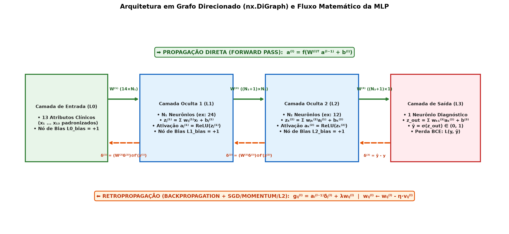
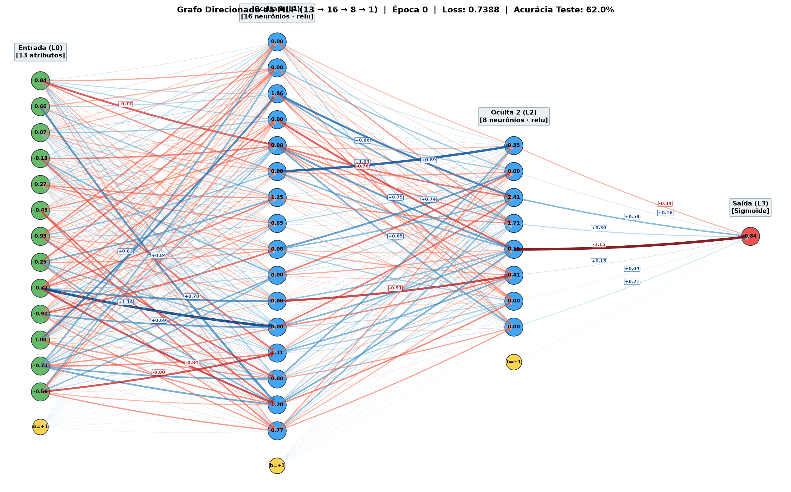
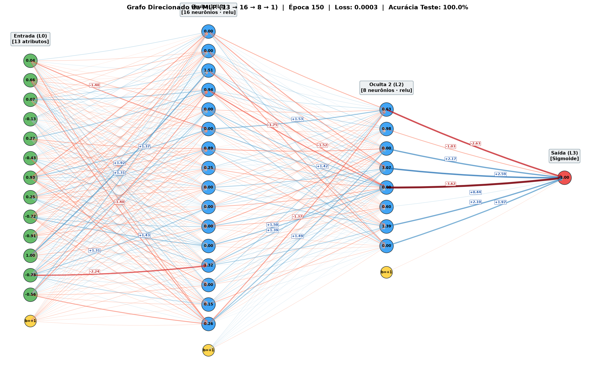

# 🧠 Subrepositório: Rede Neural Multicamadas (MLP) do Zero (`code/mlp/`)

> **`[5] artefato · mlp git repo` (`mlp·c` · 10 pontos)**  
> Implementação do zero (*from scratch*) de uma Rede Neural Multicamadas (MLP) representada como um **Grafo Direcionado Ponderado (`networkx.DiGraph` + `NumPy`)**, com interface interativa em **Streamlit**, particionamento explícito **80% Treino / 20% Teste** sem vazamento de dados, dinâmica completa de *Forward Pass* e *Backpropagation* e visualização numérica e topológica dos pesos sinápticos a cada época.

---

## 🔗 Navegação Rápida do Subrepositório (`code/mlp/`)

| Componente | Arquivo Principal | Descrição |
|---|---|---|
| **Especificação Contextual** | [`CONTEXT.md`](https://github.com/albericolx/Topicos_Avancados_IA/blob/main/code/mlp/CONTEXT.md) | Objetivos, arquitetura do grafo direcionado e roteamento modular do subrepositório |
| **Relatório Técnico (Markdown)** | [`REPORT.md`](https://github.com/albericolx/Topicos_Avancados_IA/blob/main/code/mlp/REPORT.md) | Relatório técnico completo com conceitos, desenho da arquitetura, equações, ablação (`C0`–`C7`), interpretabilidade clínica e conclusão |
| **Relatório Técnico (PDF LaTeX)** | [`report/relatorio_mlp.pdf`](https://github.com/albericolx/Topicos_Avancados_IA/blob/main/code/mlp/report/relatorio_mlp.pdf) | Versão acadêmica compilada em PDF via MiKTeX ([código-fonte `.tex`](https://github.com/albericolx/Topicos_Avancados_IA/tree/main/code/mlp/report)) |
| **App Interativo (Streamlit)** | [`app.py`](https://github.com/albericolx/Topicos_Avancados_IA/blob/main/code/mlp/app.py) | Painel interativo de hiperparâmetros em tempo real, curvas e animação de *Forward/Backward Pass* |
| **Grafo e Retropropagação** | [`core_mlp/graph.py`](https://github.com/albericolx/Topicos_Avancados_IA/blob/main/code/mlp/core_mlp/graph.py) | Classe `MLPGraph` (`nx.DiGraph`), 7 funções de ativação, `forward()` e `backward()` |
| **Treinamento e Métricas** | [`core_mlp/train.py`](https://github.com/albericolx/Topicos_Avancados_IA/blob/main/code/mlp/core_mlp/train.py) | Funções `bce_loss()`, `train_epoch()`, `evaluate()` e `run_training_history()` |
| **Particionamento 80/20** | [`core_mlp/dataset.py`](https://github.com/albericolx/Topicos_Avancados_IA/blob/main/code/mlp/core_mlp/dataset.py) | Split estratificado 80/20 ([`train_80_standardized.csv`](https://github.com/albericolx/Topicos_Avancados_IA/blob/main/code/mlp/data/train_80_standardized.csv) e [`test_20_standardized.csv`](https://github.com/albericolx/Topicos_Avancados_IA/blob/main/code/mlp/data/test_20_standardized.csv)) |
| **Visualização de Pesos** | [`core_mlp/visualize.py`](https://github.com/albericolx/Topicos_Avancados_IA/blob/main/code/mlp/core_mlp/visualize.py) | Renderização do grafo com pesos numéricos e espessura nas conexões + *heatmaps* $W^{(l)}$ e $\Delta W^{(l)}$ |
| **Benchmark Reprodutível** | [`run_experiments.py`](https://github.com/albericolx/Topicos_Avancados_IA/blob/main/code/mlp/run_experiments.py) | Executa as 8 configurações (`C0` a `C7`), exporta métricas em [`results/`](https://github.com/albericolx/Topicos_Avancados_IA/tree/main/code/mlp/results) e gera figuras em [`figs/`](https://github.com/albericolx/Topicos_Avancados_IA/tree/main/code/mlp/figs) |

---

## 🏗️ Desenho da Arquitetura em Grafo Direcionado (`nx.DiGraph`)



---

## 🔬 Visualização dos Pesos Sinápticos (Antes vs. Depois do Treinamento)

| Época 0 — Pesos Inicializados ([`grafo_antes.png`](https://github.com/albericolx/Topicos_Avancados_IA/blob/main/code/mlp/figs/grafo_antes.png)) | Época 150 — Pesos Otimizados ([`grafo_depois.png`](https://github.com/albericolx/Topicos_Avancados_IA/blob/main/code/mlp/figs/grafo_depois.png)) |
|---|---|
|  |  |

---

## 🚀 Como Executar Localmente

```bash
# 1. Instalar dependências
pip install -r code/mlp/requirements.txt

# 2. Executar a interface interativa Streamlit
streamlit run code/mlp/app.py

# 3. Reproduzir o estudo de ablação e gerar figuras/tabelas
py code/mlp/run_experiments.py
```
