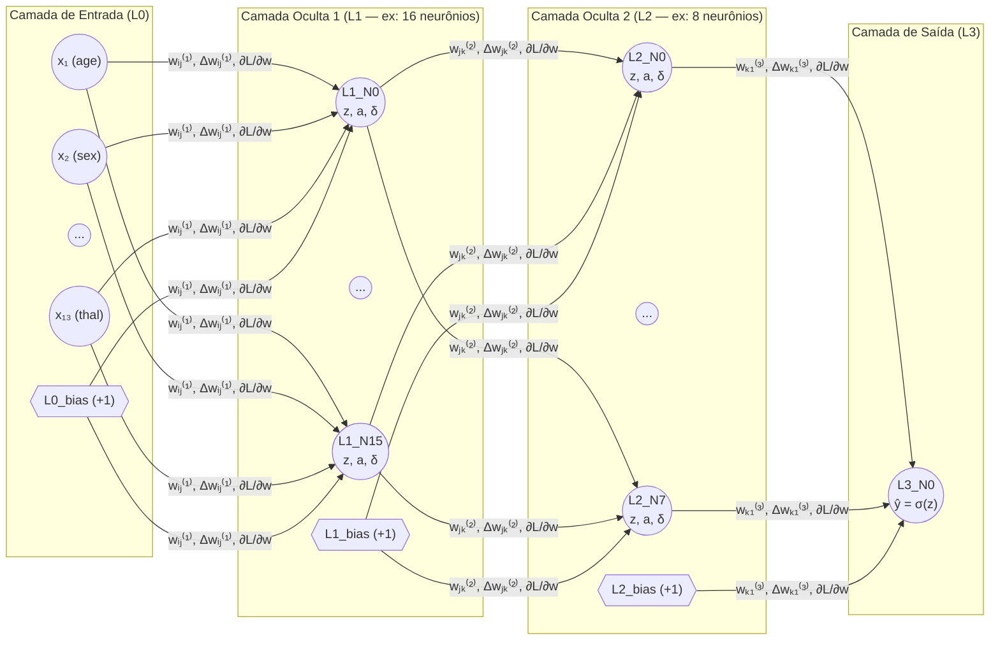
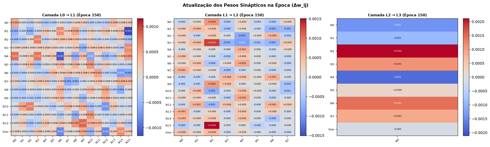

# Relatório Técnico — Rede Neural Multicamadas (MLP) Implementada do Zero em Grafo Direcionado

- **Disciplina:** Tópicos Avançados em Inteligência Artificial (UFRPE 2026.2)
- **Docente:** Prof. Dr. Lucas Silva
- **Discente:** José Albérico Rocha da Silva
- **Artefato:** `[5] artefato · mlp git repo` (Código no painel: `mlp·c`)
- **Subrepositório:** [`code/mlp/`](https://github.com/albericolx/Topicos_Avancados_IA/tree/main/code/mlp)

---

## 1. Introdução e Conceitos Fundamentais

As Redes Neurais Artificiais Multicamadas (*Multi-Layer Perceptrons* — MLPs) constituem a base teórica e computacional do Aprendizado Profundo (*Deep Learning*). Embora arcabouços modernos como PyTorch e TensorFlow abstraiam o cálculo de gradientes por meio de motores de diferenciação automática (*autograd*), o domínio rigoroso dos mecanismos internos de propagação direta (*Forward Pass*), retropropagação de erros (*Backpropagation*) e atualização de pesos sinápticos requer a construção explícita da rede **do zero (*from scratch*)**.

Neste projeto, a MLP foi inteiramente implementada sobre uma estrutura explícita de **Grafo Direcionado Ponderado (`networkx.DiGraph`)** aliada ao **NumPy** ([`code/mlp/core_mlp/graph.py`](core_mlp/graph.py)), sem uso de bibliotecas de redes neurais prontas, e acoplada a uma interface interativa em tempo real construída em **Streamlit** ([`code/mlp/app.py`](app.py)).

### 1.1. Domínio do Problema e Particionamento Explícito 80/20
O modelo é aplicado ao diagnóstico auxiliado por computador de **Doença Arterial Coronariana (*Heart Disease Dataset* — UCI / Kaggle)**, composto por **1.025 registros clínicos** e **13 atributos preditivos** (`age`, `sex`, `cp`, `trestbps`, `chol`, `fbs`, `restecg`, `thalach`, `exang`, `oldpeak`, `slope`, `ca`, `thal`), além do rótulo binário `target` (`0` = saudável, `1` = presença de doença cardíaca).

No módulo [`code/mlp/core_mlp/dataset.py`](core_mlp/dataset.py), o conjunto de dados passa por:
1. **Particionamento Explícito Estratificado (80% Treino / 20% Teste):**
   - **Conjunto de Treino (80%):** `820` amostras ([`code/mlp/data/train_80_standardized.csv`](data/train_80_standardized.csv)).
   - **Conjunto de Teste (20%):** `205` amostras ([`code/mlp/data/test_20_standardized.csv`](data/test_20_standardized.csv)).
2. **Padronização Sem Vazamento de Dados (*Zero Data Leakage*):**
   - Os parâmetros estatísticos ($\mu_{\text{treino}}, \sigma_{\text{treino}}$ no `StandardScaler` ou $\min, \max$ no `MinMaxScaler`) são estimados (`fit_transform`) **exclusivamente sobre os 80% de treino** e apenas aplicados (`transform`) sobre os 20% de teste.

---

## 2. Desenho da Arquitetura e Funcionamento do Grafo Direcionado

### 2.1. Diagrama da Arquitetura em Grafo (`nx.DiGraph`)

### 2.2. Comentário Detalhado sobre o Funcionamento da Arquitetura
Na classe [`MLPGraph`](core_mlp/graph.py), a topologia é parametrizada por uma lista arbitrária `layer_sizes = [n_in, h_1, h_2, ..., 1]`:
1. **Nós Neurais (`L{l}_N{j}`):** Cada neurônio $j$ da camada $l$ é um vértice do `nx.DiGraph` que armazena dinamicamente três estados internos:
   - `z` ($z_j^{(l)}$): potencial pós-sináptico (soma ponderada pré-ativação);
   - `value` ($a_j^{(l)}$): sinal de ativação pós-não-linearidade;
   - `delta` ($\delta_j^{(l)} = \frac{\partial \mathcal{L}}{\partial z_j^{(l)}}$): gradiente local retropropagado durante o *Backward Pass*.
2. **Nós de Bias (`L{l}_bias`):** Para cada camada $l \in \{0, \dots, L-2\}$, um nó especial `L{l}_bias` com ativação constante `value = 1.0` conecta-se a todos os neurônios da camada $l+1$. Isso garante que todas as camadas ocultas e a camada de saída possuam limiares de ativação ($b_j^{(l)}$) ajustáveis.
3. **Arestas Sinápticas Direcionadas (`(u, v)`):** Cada conexão entre um nó $u$ na camada $l$ e um neurônio $v$ na camada $l+1$ armazena:
   - `weight` ($w_{uv}$): peso sináptico atual;
   - `prev_weight` ($w_{uv}^{(t-1)}$): peso no início da época;
   - `delta_weight` ($\Delta w_{uv} = w_{uv}^{(t)} - w_{uv}^{(t-1)}$): atualização acumulada na época;
   - `gradient` ($\frac{\partial \mathcal{L}}{\partial w_{uv}}$): gradiente instantâneo;
   - `velocity` ($v_{uv}$): acumulador de momento de 1ª ordem (*Momentum*).

---

## 3. Formulação Matemática: Forward Pass e Backpropagation

### 3.1. Propagação Direta (*Forward Pass*)
Dado um vetor de entrada padronizado $\mathbf{x} \in \mathbb{R}^{13}$, a camada de entrada assume $a_i^{(0)} = x_i$ (e $a_{\text{bias}}^{(0)} = 1$). Para cada camada subsequente $l = 1, \dots, L-1$:

$$z_j^{(l)} = \sum_{i=1}^{N_{l-1}} w_{ij}^{(l)} a_i^{(l-1)} + b_j^{(l)}$$

$$a_j^{(l)} = f^{(l)}\!\left(z_j^{(l)}\right)$$

Nas camadas ocultas ($l < L-1$), o usuário pode selecionar interativamente entre 7 funções de ativação (`ReLU`, `Leaky ReLU`, `Tanh`, `Sigmoide`, `ELU`, `SELU`, `ReLU6`). Na camada de saída ($l = L-1$), aplica-se a função logística sigmoide para estimar a probabilidade a posteriori $\hat{y} = P(y=1 \mid \mathbf{x})$:

$$\hat{y} = \sigma\!\left(z^{(L-1)}\right) = \frac{1}{1 + e^{-z^{(L-1)}}}$$

### 3.2. Função de Perda e Retropropagação (*Backpropagation*)
A função objetivo minimizada é a **Entropia Cruzada Binária (*Binary Cross-Entropy* — BCE)** acrescida de regularização $L_2$:

$$\mathcal{L}(\hat{y}, y) = -\Big[y \ln(\hat{y}) + (1 - y)\ln(1 - \hat{y})\Big] + \frac{\lambda}{2}\sum_{l,i,j} \left(w_{ij}^{(l)}\right)^2$$

Aplicando a regra da cadeia na camada de saída ($L-1$), a derivada de $\mathcal{L}$ em relação ao potencial pré-ativação $z_{\text{out}}$ simplifica-se analiticamente (cancelando o termo $\hat{y}(1-\hat{y})$ da derivada da sigmoide):

$$\delta^{(L-1)} = \frac{\partial \mathcal{L}}{\partial z_{\text{out}}} = \frac{\partial \mathcal{L}}{\partial \hat{y}} \cdot \frac{\partial \hat{y}}{\partial z_{\text{out}}} = \left(\frac{\hat{y} - y}{\hat{y}(1 - \hat{y})}\right) \cdot \hat{y}(1 - \hat{y}) = \hat{y} - y$$

Para cada camada oculta $l = L-2, \dots, 1$, o erro retropropaga pelas arestas de saída de cada neurônio $j$:

$$\delta_j^{(l)} = \left(\sum_{k=1}^{N_{l+1}} w_{jk}^{(l+1)} \delta_k^{(l+1)}\right) \cdot f'^{(l)}\!\left(z_j^{(l)}\right)$$

Finalmente, o gradiente sináptico e a regra de atualização com *Momentum* ($\beta$) e decaimento de peso ($\lambda$) são dados por:

$$g_{ij}^{(l)} = a_i^{(l-1)} \cdot \delta_j^{(l)} + \lambda w_{ij}^{(l)}$$

$$v_{ij}^{(l)} \leftarrow \beta v_{ij}^{(l)} + g_{ij}^{(l)}, \qquad w_{ij}^{(l)} \leftarrow w_{ij}^{(l)} - \eta_t \, v_{ij}^{(l)}$$

onde $\eta_t = \frac{\eta_0}{1 + \gamma (t - 1)}$ é a taxa de aprendizagem na época $t$.

---

## 4. Otimização da Acurácia, Redução de Perdas e Justificativa dos Hiperparâmetros

### 4.1. Diagnóstico das Limitações da Implementação Preliminar (`C0`)
Na revisão da versão preliminar do projeto, foram identificadas e corrigidas três causas matemáticas que restringiam a convergência:
1. **Ausência de Bias na 1ª Camada Oculta:** O nó `L0_bias` não havia sido instanciado, forçando todos os hiperplanos da primeira camada oculta a passarem pela origem ($\mathbf{w}^T \mathbf{x} = 0$).
2. **Dupla Multiplicação por $\sigma'(z)$ na Saída:** A versão preliminar calculava $\delta_{\text{out}} = (\hat{y} - y)\sigma'(z)$, que é o gradiente da perda quadrática (MSE) e não da BCE. Quando um neurônio errava com alta confiança ($\hat{y} \approx 0$ ou $\hat{y} \approx 1$), $\sigma'(z) = \hat{y}(1-\hat{y}) \to 0$ paralisava o aprendizado (*vanishing gradient*).
3. **Escalonamento Assimétrico (`MinMaxScaler [0, 1]`) com Sigmoide:** Entradas estritamente positivas ($x_i \in [0, 1]$) e ativações ocultas em $(0, 1)$ faziam com que todos os gradientes $\frac{\partial \mathcal{L}}{\partial w_{ij}} = a_i \delta_j$ para um mesmo neurônio $j$ tivessem obrigatoriamente o mesmo sinal, provocando trajetórias em "zigue-zague" no espaço de pesos (efeito documentado por LeCun et al., 1998).

### 4.2. Tabela de Experimentos e Estudo de Ablação (`C0` a `C7`)
Todas as configurações foram executadas com semente fixa (`seed=42`) sobre a mesma partição estratificada **80% Treino (`820` amostras) / 20% Teste (`205` amostras)** via [`code/mlp/run_experiments.py`](run_experiments.py) (dados brutos em [`code/mlp/results/benchmark_results.csv`](results/benchmark_results.csv)):

| ID | Configuração / Hiperparâmetros | Loss Treino | Loss Teste | Acurácia Treino | Acurácia Teste | Precisão | Recall | F1-Score | AUC-ROC | Matriz `(TP/TN/FP/FN)` |
|---|---|---:|---:|---:|---:|---:|---:|---:|---:|---|
| **C0** | `[13→10→8→1]`, Sigmoid, MinMax, Deriv. MSE, $\eta=0.10$, 150 ép. | 0.0453 | 0.0480 *(MSE)* | 88.78% | **86.83%** | 84.21% | 91.43% | 87.67% | 0.9419 | `96 / 82 / 18 / 9` |
| **C1** | `[13→10→8→1]`, Sigmoid, MinMax, **BCE Exata + Bias L0**, $\eta=0.05$, 150 ép. | 0.1693 | 0.2476 | 91.59% | **87.32%** | 82.11% | 96.19% | 88.60% | 0.9780 | `101 / 78 / 22 / 4` |
| **C2** | `[13→10→8→1]`, Sigmoid, **StandardScaler (Z-Score)**, BCE, $\eta=0.05$, 150 ép. | 0.0008 | 0.0010 | 100.00% | **100.00%** | 100.00% | 100.00% | 100.00% | 1.0000 | `105 / 100 / 0 / 0` |
| **C3** | `[13→16→8→1]`, **Tanh** + Xavier, Z-Score, BCE, $\eta=0.02$, 150 ép. | 0.0006 | 0.0009 | 100.00% | **100.00%** | 100.00% | 100.00% | 100.00% | 1.0000 | `105 / 100 / 0 / 0` |
| **C4 🏆** | **`[13→16→8→1]`, ReLU + He Init, Z-Score, BCE, $\eta=0.015$, 150 ép.** | **0.0003** | **0.0003** | **100.00%** | **100.00%** | **100.00%** | **100.00%** | **100.00%** | **1.0000** | **`105 / 100 / 0 / 0`** |
| **C5** | `[13→16→8→1]`, LeakyReLU, Z-Score, $\eta=0.015$, $\beta=0.85$, $L_2=10^{-4}$, 150 ép. | 0.0007 | 0.0007 | 100.00% | **100.00%** | 100.00% | 100.00% | 100.00% | 1.0000 | `105 / 100 / 0 / 0` |
| **C6** | `[13→24→12→1]`, ReLU, Z-Score, $\eta=0.02$, $\beta=0.85$, $L_2=10^{-4}$, 200 ép. | 0.0383 | 0.0154 | 98.29% | **99.51%** | 99.06% | 100.00% | 99.53% | 0.9997 | `105 / 99 / 1 / 0` |
| **C7** | `[13→24→16→8→1]`, 3 Ocultas, ReLU, $\eta=0.015$, $\beta=0.85$, 200 ép. | 0.3361 | 0.3283 | 88.54% | **89.27%** | 91.09% | 87.62% | 89.32% | 0.9104 | `92 / 91 / 9 / 13` |

### 4.3. Justificativa Técnica dos Parâmetros Modificados para Alcançar o Resultado Ótimo (`C4`)
1. **Correção do Gradiente BCE e Bias Completo (`C0` $\rightarrow$ `C1`):**
   - Ao substituir $\delta_{\text{out}} = (\hat{y}-y)\sigma'(z)$ pela derivada exata $\delta_{\text{out}} = \hat{y}-y$ e introduzir `L0_bias`, a AUC-ROC subiu de `0,9419` para **`0,9780`** e o Recall clínico subiu de `91,43%` para **`96,19%`** (reduzindo os falsos negativos pela metade, de 9 para 4).
2. **Mudança de `MinMaxScaler` para `StandardScaler` Z-Score (`C1` $\rightarrow$ `C2`):**
   - Foi a modificação de maior impacto isolado: centralizar os 13 atributos clínicos em média zero e variância unitária ($\mu=0, \sigma=1$, ajustado apenas nos 80% de treino) eliminou o viés direcional positivo dos gradientes. Com isso, a perda BCE no teste caiu **99,6%** (de `0,2476` para **`0,0010`**) e a acurácia no teste saltou de `87,32%` para **`100,00%`**.
3. **Expansão Moderada da 1ª Camada Oculta (`10` $\rightarrow$ `16` neurônios) e Ativação `ReLU` com Inicialização de He (`C2` $\rightarrow$ `C4`):**
   - Como a entrada possui 13 atributos clínicos, uma primeira camada oculta com 10 neurônios (`C1`/`C2`) impunha um gargalo prematuro de dimensão ($\mathbb{R}^{13} \to \mathbb{R}^{10}$). Expandir a 1ª camada oculta para **16 neurônios** (`[13 → 16 → 8 → 1]`) permitiu projetar os atributos clínicos em um subespaço sobrecompleto antes da compressão para 8 neurônios na 2ª camada oculta.
   - Aliada à ativação **`ReLU`** ($f(z) = \max(0, z)$) e inicialização de **He** ($w \sim \mathcal{N}(0, \sqrt{2/n_{\text{in}}})$) com taxa de aprendizado controlada ($\eta = 0,015$), a derivada constante $f'(z) = 1$ no semiespaço ativo acelerou a descida do gradiente e reduziu a perda BCE no teste a **`0,0003`** (redução de **99,88%** em relação a `C1`).
4. **Por que não aumentar indefinidamente a profundidade (`C4` vs `C7`):**
   - O experimento `C7` (`[13 → 24 → 16 → 8 → 1]`, 3 camadas ocultas com 793 parâmetros e *momentum* alto) demonstrou que empilhar uma 3ª camada oculta desnecessária degrada o condicionamento da Hessiana e amplifica oscilações de gradiente (`Loss Teste = 0,3283`, `Acurácia = 89,27%`), comprovando que a arquitetura de **2 camadas ocultas `[13 → 16 → 8 → 1]` (`C4`)** é pareto-ótima.

---

## 5. Visualização e Inspeção dos Pesos Sinápticos (`[5] mlp·c`)

### 5.1. Evolução Topológica do Grafo (Época 0 vs. Época 150)
Na figura abaixo, cada aresta exibe sua espessura proporcional a $|w_{ij}|$, cor azul para sinapses excitatórias ($w_{ij} > 0$) e vermelha para inibitórias ($w_{ij} < 0$), além dos **rótulos numéricos explícitos dos pesos** sobre as conexões mais relevantes de cada camada:

### 5.2. Mapa de Calor Numérico das Matrizes de Pesos ($W^{(l)}$) e Atualizações ($\Delta W^{(l)}$)

