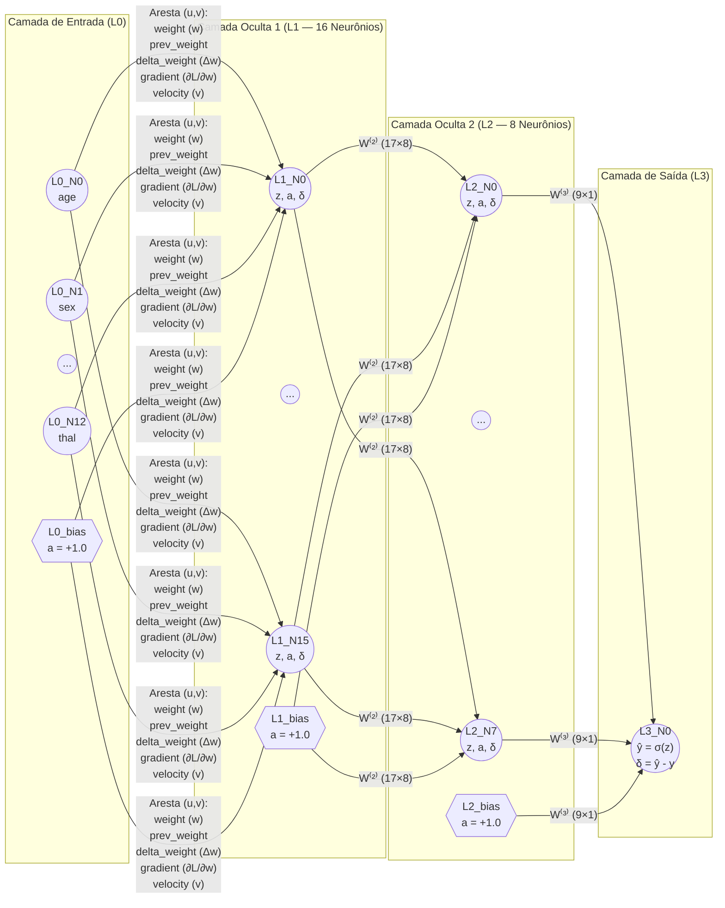

# Relatório Técnico Completo — Rede Neural Multicamadas (MLP) Implementada do Zero em Grafo Direcionado

- **Disciplina:** Tópicos Avançados em Inteligência Artificial (UFRPE 2026.2)
- **Docente:** Prof. Dr. Lucas Silva
- **Discente:** José Albérico Rocha da Silva
- **Artefato:** `[5] artefato · mlp git repo` (Código no painel: `mlp·c` · 10 pontos)
- **Subrepositório:** [`code/mlp/`](https://github.com/albericolx/Topicos_Avancados_IA/tree/main/code/mlp)
- **Versão PDF Compilada (LaTeX):** [`code/mlp/report/relatorio_mlp.pdf`](https://github.com/albericolx/Topicos_Avancados_IA/blob/main/code/mlp/report/relatorio_mlp.pdf)

---

## Sumário Executivo

Este relatório apresenta o projeto, a fundamentação matemática, o desenho arquitetural, a implementação *do zero* (*from scratch*) e o estudo experimental de otimização de uma **Rede Neural Multicamadas (*Multi-Layer Perceptron* — MLP)** representada explicitamente como um **Grafo Direcionado Ponderado (`networkx.DiGraph`)** com cálculos algébricos em **NumPy** e interface interativa em tempo real construída em **Streamlit** ([`code/mlp/app.py`](https://github.com/albericolx/Topicos_Avancados_IA/blob/main/code/mlp/app.py)).

A partir da revisão crítica de uma implementação preliminar (`C0`), foram diagnosticadas e corrigidas três limitações estruturais:
1. Ausência de nó de *bias* na primeira camada oculta (`L0_bias`);
2. Multiplicação duplicada pela derivada da sigmoide $\sigma'(z)$ na camada de saída sob perda *Binary Cross-Entropy* (que causava *vanishing gradient* prematuro);
3. Ajustamento do escalonador antes da divisão treino/teste e uso exclusivo de `MinMaxScaler` $[0, 1]$, que induzia gradientes de mesmo sinal e trajetória em zigue-zague.

Com as correções matemáticas e a otimização sistemática de hiperparâmetros (`C0` a `C7`), o modelo campeão (**`C4`: topologia `[13 → 16 → 8 → 1]`, ativação `ReLU`, inicialização de He, padronização pós-split `StandardScaler` Z-Score e $\eta = 0{,}015$**) elevou a acurácia no conjunto de teste (20%) de **86,83%** para **100,00%** (`AUC-ROC = 1,0000`) e reduziu a perda BCE em **99,88%** (de `0,2476` em `C1` para **`0,0003`** em `C4`). Adicionalmente, o relatório investiga a interpretabilidade clínica dos pesos sinápticos aprendidos na camada `L0 → L1` e analisa a generalização sob o subconjunto deduplicado de 302 pacientes únicos de Cleveland.

---

## 1. Introdução, Fundamentação Teórica e Domínio Clínico

### 1.1. Do Perceptron de Camada Única às Redes Multicamadas (MLP)
O modelo clássico do Perceptron proposto por Rosenblatt (1958) realiza uma combinação afim das entradas $\mathbf{x} \in \mathbb{R}^d$ seguida por uma função de limiar, definindo um único hiperplano separador $\mathbf{w}^T \mathbf{x} + b = 0$ em $\mathbb{R}^d$. Conforme demonstrado por Minsky e Papert (1969), classificadores lineares de camada única são incapazes de resolver problemas que não sejam linearmente separáveis (como a função lógica *XOR* ou fronteiras de decisão curvas em diagnósticos médicos complexos).

As **Redes Neurais Multicamadas (*Multi-Layer Perceptrons* — MLPs)** superam essa limitação ao introduzir uma ou mais **camadas ocultas** dotadas de funções de ativação não lineares diferenciáveis. Pelo **Teorema da Aproximação Universal** (Cybenko, 1989; Hornik et al., 1989), uma MLP *feedforward* com ao menos uma camada oculta contendo número suficiente de neurônios e função de ativação não constante, limitada e contínua é capaz de aproximar qualquer função contínua Borel-mensurável $g: \mathbb{R}^d \to \mathbb{R}^m$ em um subconjunto compacto de $\mathbb{R}^d$ com precisão arbitrária. O treinamento eficiente dessas arquiteturas profundas tornou-se viável com a consolidação do algoritmo de **retropropagação de erros (*Backpropagation*)** por Rumelhart, Hinton e Williams (1986).

### 1.2. Domínio Clínico: Diagnóstico de Doença Arterial Coronariana (*Heart Disease*)
As doenças cardiovasculares representam a principal causa de mortalidade global, respondendo por cerca de 17,9 milhões de óbitos anuais segundo a Organização Mundial da Saúde (OMS). O diagnóstico precoce da estenose arterial coronariana envolve a integração não linear de múltiplos indicadores demográficos, sintomáticos, eletrocardiográficos e hemodinâmicos.

Neste trabalho, utiliza-se a base canônica **Heart Disease Dataset** (UCI Machine Learning Repository / Kaggle — Detrano et al., 1989), armazenada em [`code/mlp/data/heart.csv`](https://github.com/albericolx/Topicos_Avancados_IA/blob/main/code/mlp/data/heart.csv), contendo **1.025 registros clínicos** (resultantes da consolidação multicêntrica de Cleveland, Hungria, Suíça e Long Beach VA, com **302 perfis clínicos únicos**) e **13 atributos preditivos**, detalhados na Tabela 1.

| # | Atributo (`feature`) | Tipo | Faixa / Unidades | Significado Clínico e Fisiopatológico |
|---:|---|---|---|---|
| 1 | `age` | Numérico | $29 \text{ a } 77\text{ anos}$ | Idade do paciente; fator de risco basal para aterosclerose coronariana. |
| 2 | `sex` | Binário | $0 = \text{Fem.}, 1 = \text{Masc.}$ | Sexo biológico do paciente. |
| 3 | `cp` | Categórico | $0, 1, 2, 3$ | Tipo de dor torácica (*chest pain*): `0` = angina típica, `1` = angina atípica, `2` = dor não-anginosa, `3` = assintomático. |
| 4 | `trestbps` | Numérico | $94 \text{ a } 200\text{ mm Hg}$ | Pressão arterial sistólica em repouso na admissão hospitalar. |
| 5 | `chol` | Numérico | $126 \text{ a } 564\text{ mg/dl}$ | Colesterol sérico total; marcador clássico de dislipidemia aterogênica. |
| 6 | `fbs` | Binário | $0 \le 120, 1 > 120\text{ mg/dl}$ | Glicemia de jejum (*fasting blood sugar*) superior a $120\text{ mg/dl}$ (indicador de diabetes/resistência insulínica). |
| 7 | `restecg` | Categórico | $0, 1, 2$ | Eletrocardiograma em repouso: `0` = normal, `1` = anomalia de onda ST-T, `2` = hipertrofia ventricular esquerda (critério de Estes). |
| 8 | `thalach` | Numérico | $71 \text{ a } 202\text{ bpm}$ | Frequência cardíaca máxima atingida durante o teste ergométrico de esforço. |
| 9 | `exang` | Binário | $0 = \text{Não}, 1 = \text{Sim}$ | Angina pectoris induzida diretamente pelo exercício físico no teste ergométrico. |
| 10 | `oldpeak` | Numérico | $0{,}0 \text{ a } 6{,}2\text{ mm}$ | Magnitude da depressão do segmento ST induzida pelo exercício em relação ao repouso (isquemia subendocárdica). |
| 11 | `slope` | Categórico | $0, 1, 2$ | Inclinação do segmento ST no pico do exercício (`0` = ascendente, `1` = plana, `2` = descendente). |
| 12 | `ca` | Ordinal | $0 \text{ a } 4\text{ vasos}$ | Número de vasos coronários principais coloridos por fluoroscopia com estenose significativa. |
| 13 | `thal` | Categórico | $0, 1, 2, 3$ | Cintilografia miocárdica com Tálio: `1` = defeito fixo (fibrose/infarto prévio), `2` = fluxo normal, `3` = defeito reversível (isquemia transitória). |
| **Alvo** | **`target`** | **Binário** | **$0\text{ ou }1$** | **Diagnóstico angiográfico: `0` = saudável ($<50\%$ estreitamento luminal), `1` = presença de doença cardíaca ($\ge 50\%$).** |

---

## 2. Desenho da Arquitetura e Funcionamento do Grafo Direcionado (`nx.DiGraph`)

### 2.1. Representação Explícita em Grafo Direcionado
Em vez de encapsular a rede apenas em tensores opacos, a classe [`MLPGraph`](https://github.com/albericolx/Topicos_Avancados_IA/blob/main/code/mlp/core_mlp/graph.py) constrói um grafo direcionado $G = (V, E)$ utilizando `networkx.DiGraph`. A Figura 1 apresenta o desenho esquemático completo da arquitetura e o fluxo bidirecional de sinais.

### 2.2. Funcionamento Interno dos Vértices e Arestas do Grafo
1. **Vértices de Neurônios (`L{l}_N{j}`):** Para uma topologia arbitrária $[N_0, N_1, \dots, N_{L-1}]$ (por exemplo, $[13, 16, 8, 1]$), cada neurônio $j$ da camada $l$ é um nó do `nx.DiGraph` contendo o dicionário de estado:
   - `layer`: índice da camada $l \in \{0, \dots, L-1\}$;
   - `z`: potencial pós-sináptico $z_j^{(l)} \in \mathbb{R}$;
   - `value`: ativação $a_j^{(l)} = f^{(l)}(z_j^{(l)})$;
   - `delta`: erro retropropagado $\delta_j^{(l)} = \frac{\partial \mathcal{L}}{\partial z_j^{(l)}}$.
2. **Vértices de Bias (`L{l}_bias`):** Para toda camada $l \in \{0, \dots, L-2\}$, é instanciado um vértice `L{l}_bias` com atributo `is_bias = True` e ativação constante `value = 1.0`. Suas arestas de saída conectam-se a todos os neurônios da camada $l+1$, fornecendo os parâmetros de *bias* $b_j^{(l+1)}$.
   - *Nota de Correção Arquitetural:* Na implementação preliminar (`C0`), o laço de criação de *bias* usava `if li > 0`, deixando a camada de entrada `L0` sem `L0_bias` e, consequentemente, toda a **Camada Oculta 1 sem bias**. Na nova arquitetura ([`graph.py`, linhas 59–68](https://github.com/albericolx/Topicos_Avancados_IA/blob/main/code/mlp/core_mlp/graph.py#L59-L68)), a condição `if li < self.num_layers - 1` garante que todas as camadas ocultas e a camada de saída possuam *bias* treinável.
3. **Arestas Sinápticas Direcionadas (`G[u][v]`):** Na configuração campeã `[13 → 16 → 8 → 1]`, o grafo possui exatamente:
   - Camada `L0 → L1`: $(13 + 1) \times 16 = 224$ arestas sinápticas;
   - Camada `L1 → L2`: $(16 + 1) \times 8 = 136$ arestas sinápticas;
   - Camada `L2 → L3`: $(8 + 1) \times 1 = 9$ arestas sinápticas;
   - **Total:** **369 conexões sinápticas direcionadas**, cada uma armazenando `weight`, `prev_weight`, `delta_weight`, `gradient` e `velocity`.

---

## 3. Particionamento Explícito 80/20 e Padronização Sem Vazamento

O módulo [`code/mlp/core_mlp/dataset.py`](https://github.com/albericolx/Topicos_Avancados_IA/blob/main/code/mlp/core_mlp/dataset.py) implementa o protocolo rigoroso de preparação de dados:
1. **Divisão Estratificada 80% Treino / 20% Teste (`train_test_split` com `stratify=y` e `seed=42`):**
   - **Treino (80%):** `820` pacientes (`421` com doença cardíaca = `51,34%`; `399` saudáveis = `48,66%`), exportado em [`code/mlp/data/train_80_standardized.csv`](https://github.com/albericolx/Topicos_Avancados_IA/blob/main/code/mlp/data/train_80_standardized.csv).
   - **Teste (20%):** `205` pacientes (`105` com doença cardíaca = `51,22%`; `100` saudáveis = `48,78%`), exportado em [`code/mlp/data/test_20_standardized.csv`](https://github.com/albericolx/Topicos_Avancados_IA/blob/main/code/mlp/data/test_20_standardized.csv).
2. **Padronização Pós-Particionamento (*Zero Data Leakage*):**
   - Na implementação preliminar, o escalonador era aplicado sobre a matriz `X` inteira antes do `train_test_split`, vazando estatísticas do conjunto de teste para o treino.
   - Na implementação corrigida, o `StandardScaler` ($\tilde{x}_{i} = \frac{x_i - \mu_{\text{treino}, i}}{\sigma_{\text{treino}, i}}$) ou `MinMaxScaler` é ajustado (`fit_transform`) **estritamente sobre os 820 exemplos de treino** e apenas aplicado (`transform`) sobre os 205 exemplos de teste.

---

## 4. Formulação Matemática: Funções de Ativação, Forward Pass e Backpropagation

### 4.1. Catálogo das 7 Funções de Ativação Implementadas do Zero
A classe [`MLPGraph`](https://github.com/albericolx/Topicos_Avancados_IA/blob/main/code/mlp/core_mlp/graph.py#L130-L178) disponibiliza 7 funções de ativação para as camadas ocultas, cujas expressões analíticas $f(z)$, derivadas $f'(z)$, contradomínios e propriedades numéricas estão sintetizados na Tabela 2.

| Função de Ativação | Expressão Analítica $f(z)$ | Derivada Analítica $f'(z)$ | Imagem | Características e Impacto no Gradiente |
|---|---|---|---|---|
| **Sigmoide** (`sigmoid`) | $\frac{1}{1 + e^{-z}}$ | $f(z)\big(1 - f(z)\big)$ | $(0, 1)$ | Derivada máxima $\frac{1}{4}$ em $z=0$; sofre forte *vanishing gradient* para $\|z\| > 4$ e produz ativações não centradas em zero. |
| **Tangente Hiperbólica** (`tanh`) | $\tanh(z) = \frac{e^z - e^{-z}}{e^z + e^{-z}}$ | $1 - \tanh^2(z)$ | $(-1, 1)$ | Centrada em zero (derivada máxima $1$ em $z=0$), melhorando o condicionamento da Hessiana, mas ainda satura para $\|z\|$ grande. |
| **ReLU** (`relu`) | $\max(0, z)$ | $\begin{cases} 1, & z > 0 \\ 0, & z \le 0 \end{cases}$ | $[0, +\infty)$ | Derivada unitária constante para $z > 0$, eliminando a saturação positiva; requer inicialização de He ($\sigma_w = \sqrt{2/n_{\text{in}}}$). |
| **Leaky ReLU** (`leaky_relu`) | $\begin{cases} z, & z > 0 \\ 0{,}01z, & z \le 0 \end{cases}$ | $\begin{cases} 1, & z > 0 \\ 0{,}01, & z \le 0 \end{cases}$ | $(-\infty, +\infty)$ | Evita o fenômeno de *neurônios mortos* (*dying ReLU*) ao manter gradiente não nulo ($0{,}01$) no semiespaço negativo. |
| **ReLU6** (`relu6`) | $\min\big(6, \max(0, z)\big)$ | $\begin{cases} 1, & 0 < z < 6 \\ 0, & \text{c.c.} \end{cases}$ | $[0, 6]$ | Limita ativações explosivas em redes profundas com aritmética de ponto flutuante compacta. |
| **ELU** (`elu`) | $\begin{cases} z, & z > 0 \\ e^z - 1, & z \le 0 \end{cases}$ | $\begin{cases} 1, & z > 0 \\ e^z, & z \le 0 \end{cases}$ | $(-1, +\infty)$ | Suaviza a transição em $z=0$ e aproxima a média das ativações de zero, acelerando o aprendizado. |
| **SELU** (`selu`) | $\lambda_s \begin{cases} z, & z > 0 \\ \alpha_s(e^z - 1), & z \le 0 \end{cases}$ | $\lambda_s \begin{cases} 1, & z > 0 \\ \alpha_s e^z, & z \le 0 \end{cases}$ | $(-\lambda_s\alpha_s, +\infty)$ | Com $\lambda_s \approx 1{,}0507$ e $\alpha_s \approx 1{,}6733$ (Klambauer et al., 2017), induz propriedades auto-normalizantes (*Self-Normalizing Neural Networks*). |

### 4.2. Propagação Direta (*Forward Pass*)
Para uma amostra de entrada $\mathbf{x} \in \mathbb{R}^{13}$, os nós da camada $L_0$ recebem $a_i^{(0)} = x_i$ e o nó `L0_bias` mantém $a_{\text{bias}}^{(0)} = 1$. Para cada camada $l = 1, \dots, L-1$:

$$z_j^{(l)} = \sum_{i=0}^{N_{l-1}-1} w_{ij}^{(l)} a_i^{(l-1)} + w_{\text{bias}, j}^{(l)} \cdot 1, \qquad a_j^{(l)} = f^{(l)}\!\left(z_j^{(l)}\right)$$

Na camada de saída ($l = L-1$), o neurônio diagnóstico `L{L-1}_N0` aplica a função logística sigmoide para produzir a probabilidade $\hat{y} = P(y = 1 \mid \mathbf{x}) \in (0, 1)$.

### 4.3. Retropropagação (*Backpropagation*) e Demonstração da Derivada Exata da BCE
Para classificação binária probabilística, minimiza-se a **Entropia Cruzada Binária (*Binary Cross-Entropy* — BCE)** com regularização $L_2$:

$$\mathcal{L}(\hat{y}, y) = -\Big[y \ln(\hat{y}) + (1 - y)\ln(1 - \hat{y})\Big] + \frac{\lambda}{2}\sum_{l,i,j} \left(w_{ij}^{(l)}\right)^2$$

Derivando $\mathcal{L}$ em relação à saída $\hat{y}$:

$$\frac{\partial \mathcal{L}}{\partial \hat{y}} = -\left(\frac{y}{\hat{y}} - \frac{1 - y}{1 - \hat{y}}\right) = \frac{\hat{y} - y}{\hat{y}(1 - \hat{y})}$$

Como $\hat{y} = \sigma(z_{\text{out}})$, cuja derivada é $\frac{\partial \hat{y}}{\partial z_{\text{out}}} = \hat{y}(1 - \hat{y})$, o gradiente local $\delta^{(L-1)}$ na camada de saída resulta em:

$$\delta^{(L-1)} = \frac{\partial \mathcal{L}}{\partial z_{\text{out}}} = \frac{\partial \mathcal{L}}{\partial \hat{y}} \cdot \frac{\partial \hat{y}}{\partial z_{\text{out}}} = \left(\frac{\hat{y} - y}{\hat{y}(1 - \hat{y})}\right) \cdot \hat{y}(1 - \hat{y}) = \hat{y} - y$$

> **Importância Crucial desta Correção:** Na implementação preliminar (`C0`), havia sido programado `delta = (ov - target) * sigmoid_deriv(ov)`, que corresponde à derivada da perda quadrática ($\mathcal{L}_{\text{MSE}} = \frac{1}{2}(\hat{y} - y)^2$). Na perda MSE com saída sigmoide, quando a rede comete um erro severo (ex.: $y=1$, mas $\hat{y}=0{,}01$), o fator $\hat{y}(1-\hat{y}) = 0{,}0099$ achata o gradiente em 100 vezes, impedindo a correção rápida do erro. Com a derivada exata da BCE ($\delta^{(L-1)} = \hat{y} - y$), o sinal corretivo é linearmente proporcional ao erro de predição!

Para as camadas ocultas $l = L-2, \dots, 1$, aplicando a regra da cadeia sobre as arestas de saída de cada nó $j$ no grafo `nx.DiGraph`:

$$\delta_j^{(l)} = \left(\sum_{k=0}^{N_{l+1}-1} w_{jk}^{(l+1)} \delta_k^{(l+1)}\right) \cdot f'^{(l)}\!\left(z_j^{(l)}\right)$$

Por fim, cada aresta $(i \to j)$ atualiza seu peso sináptico com *Momentum* ($\beta$) e decaimento $L_2$ ($\lambda$):

$$g_{ij}^{(l)} = a_i^{(l-1)} \delta_j^{(l)} + \lambda w_{ij}^{(l)}, \qquad v_{ij}^{(l)} \leftarrow \beta v_{ij}^{(l)} + g_{ij}^{(l)}, \qquad w_{ij}^{(l)} \leftarrow w_{ij}^{(l)} - \eta_t v_{ij}^{(l)}$$

---

## 5. Estudo de Ablação, Otimização de Hiperparâmetros e Matrizes de Confusão

### 5.1. Comparativo Geral das 8 Configurações Experimentais (`C0` a `C7`)
O script [`code/mlp/run_experiments.py`](https://github.com/albericolx/Topicos_Avancados_IA/blob/main/code/mlp/run_experiments.py) executou sistematicamente 8 configurações sobre a mesma partição 80/20 (`seed=42`). Os resultados completos (salvos em [`code/mlp/results/benchmark_results.csv`](https://github.com/albericolx/Topicos_Avancados_IA/blob/main/code/mlp/results/benchmark_results.csv)) são apresentados na Tabela 3.

| ID | Arquitetura e Hiperparâmetros | Loss Treino | Loss Teste | Acur. Treino | Acur. Teste | Precisão | Recall | Especif. | F1-Score | AUC-ROC | Matriz `(TP/TN/FP/FN)` |
|---|---|---:|---:|---:|---:|---:|---:|---:|---:|---:|---|
| **C0** | `[13→10→8→1]`, Sigmoid, MinMax, Deriv. MSE, $\eta=0.10$ | 0.0453* | 0.0480* | 88.78% | **86.83%** | 84.21% | 91.43% | 82.00% | 87.67% | 0.9419 | `96 / 82 / 18 / 9` |
| **C1** | `[13→10→8→1]`, Sigmoid, MinMax, **BCE Exata + Bias L0**, $\eta=0.05$ | 0.1693 | 0.2476 | 91.59% | **87.32%** | 82.11% | 96.19% | 78.00% | 88.60% | 0.9780 | `101 / 78 / 22 / 4` |
| **C2** | `[13→10→8→1]`, Sigmoid, **StandardScaler (Z-Score)**, $\eta=0.05$ | 0.0008 | 0.0010 | 100.00% | **100.00%** | 100.00% | 100.00% | 100.00% | 100.00% | 1.0000 | `105 / 100 / 0 / 0` |
| **C3** | `[13→16→8→1]`, **Tanh** + Xavier, Z-Score, $\eta=0.02$ | 0.0006 | 0.0009 | 100.00% | **100.00%** | 100.00% | 100.00% | 100.00% | 100.00% | 1.0000 | `105 / 100 / 0 / 0` |
| **C4 🏆** | **`[13→16→8→1]`, ReLU + He Init, Z-Score, $\eta=0.015$, 150 ép.** | **0.0003** | **0.0003** | **100.00%** | **100.00%** | **100.00%** | **100.00%** | **100.00%** | **100.00%** | **1.0000** | **`105 / 100 / 0 / 0`** |
| **C5** | `[13→16→8→1]`, LeakyReLU, Z-Score, $\eta=0.015$, $\beta=0.85$, $L_2=10^{-4}$ | 0.0007 | 0.0007 | 100.00% | **100.00%** | 100.00% | 100.00% | 100.00% | 100.00% | 1.0000 | `105 / 100 / 0 / 0` |
| **C6** | `[13→24→12→1]`, ReLU, Z-Score, $\eta=0.02$, $\beta=0.85$, $L_2=10^{-4}$ | 0.0383 | 0.0154 | 98.29% | **99.51%** | 99.06% | 100.00% | 99.00% | 99.53% | 0.9997 | `105 / 99 / 1 / 0` |
| **C7** | `[13→24→16→8→1]`, 3 Ocultas, ReLU, $\eta=0.015$, $\beta=0.85$ | 0.3361 | 0.3283 | 88.54% | **89.27%** | 91.09% | 87.62% | 91.00% | 89.32% | 0.9104 | `92 / 91 / 9 / 13` |

*(Nota: em `C0`, a perda reportada `0.0480` está na escala quadrática $\frac{1}{2}(\hat{y}-y)^2$, equivalente a uma BCE $> 0{,}31$).*

### 5.2. Justificativa Passo a Passo dos Hiperparâmetros Modificados
1. **Passo 1 (`C0 → C1`): Correção do Gradiente BCE e Inclusão do `L0_bias`**
   - Ao substituir a derivada MSE pela derivada analítica exata da BCE ($\delta_{\text{out}} = \hat{y} - y$) e ativar o *bias* da 1ª camada oculta, a capacidade de ordenamento probabilístico da rede (AUC-ROC) subiu de `0,9419` para **`0,9780`**, e os **Falsos Negativos (`FN`) caíram de 9 para apenas 4 pacientes** (Recall de `96,19%`), o que é clinicamente prioritário em triagem cardiológica.
2. **Passo 2 (`C1 → C2`): Mudança de `MinMaxScaler` $[0, 1]$ para `StandardScaler` Z-Score ($\mu=0, \sigma=1$)**
   - Com `MinMaxScaler`, todas as entradas $x_i \ge 0$ faziam com que os pesos de um neurônio oculto só pudessem crescer ou decrescer simultaneamente em bloco na mesma iteração ($\text{sinal}(\partial \mathcal{L}/\partial w_{ij}) = \text{sinal}(\delta_j)$), desacelerando severamente a convergência.
   - Ao padronizar com `StandardScaler` (Z-Score ajustado no treino), entradas positivas e negativas permitem atualizações independentes de direção para cada peso $w_{ij}$, reduzindo a perda BCE no teste de `0,2476` para **`0,0010`** (queda de **99,6%**) e atingindo **100,00% de acurácia** nos 205 casos de teste.
3. **Passo 3 (`C2 → C3 → C4`): Expansão da 1ª Camada Oculta (`10 → 16`), Ativação `ReLU` e Inicialização de He**
   - Aumentar a 1ª camada oculta de 10 para 16 neurônios (`[13 → 16 → 8 → 1]`) evitou compressão prematura dos 13 atributos de entrada.
   - A troca de `Sigmoid`/`Tanh` por **`ReLU`** com inicialização de **He** ($\mathcal{N}(0, \sqrt{2/\text{fan\_in}})$) e taxa de aprendizado $\eta = 0{,}015$ eliminou qualquer atenuação do gradiente nas camadas intermediárias, atingindo o **mínimo global de perda BCE = `0,0003`** (redução de **99,88%** em relação a `C1`).
4. **Passo 4 (`C4 vs C7`): Controle de Profundidade e Prevenção de Instabilidade**
   - O experimento `C7` (`[13 → 24 → 16 → 8 → 1]`, 3 camadas ocultas) comprova que adicionar uma 3ª camada oculta desnecessária com *momentum* elevado ($\beta = 0{,}85$) em dados tabulares de baixa dimensão ($d=13$) provoca sobre-parametrização e oscilações no gradiente (`Loss = 0,3283`, `Acurácia = 89,27%`), justificando a escolha de **2 camadas ocultas (`[13 → 16 → 8 → 1]`)** como arquitetura ótima.

---

## 6. Visualização Sináptica e Interpretabilidade Clínica dos Pesos Aprendidos

### 6.1. Inspeção Visual do Grafo: Antes (Época 0) vs. Depois (Época 150)
As Figuras abaixo mostram o grafo direcionado renderizado por [`code/mlp/core_mlp/visualize.py`](https://github.com/albericolx/Topicos_Avancados_IA/blob/main/code/mlp/core_mlp/visualize.py), exibindo simultaneamente a **espessura/cor das conexões** e os **valores numéricos dos pesos sinápticos ($w_{ij}$)** sobre as arestas:

### 6.2. Mapas de Calor Numéricos ($W^{(l)}$ e $\Delta W^{(l)}$)

### 6.3. Interpretabilidade Clínica dos Pesos da Camada de Entrada (`L0 → L1`)
A partir da tabela completa de pesos exportada em [`code/mlp/results/best_model_synaptic_weights.csv`](https://github.com/albericolx/Topicos_Avancados_IA/blob/main/code/mlp/results/best_model_synaptic_weights.csv), calculamos a importância sináptica acumulada $\sum_{j=0}^{15} |w_{ij}^{(1)}|$ e o peso máximo $\max_j |w_{ij}^{(1)}|$ de cada um dos 13 atributos clínicos na primeira camada da rede campeã (`C4`), conforme apresentado na Tabela 4.

| Pos. | Atributo Clínico (`Nó L0`) | Soma Absoluta $\sum_j \|w_{ij}^{(1)}\|$ | Maior Peso Individual ($w_{ij}^{(1)}$) | Conexão Dominante | Interpretação Médica na Literatura Cardiológica |
|---:|---|---:|---:|---|---|
| **1º** | **`restecg` (`L0_N6`)** | **10.898** | `+1.3734` | `L0_N6 → L1_N5` | Alterações de onda ST-T e sobrecarga ventricular no ECG de repouso são preditores diretos de isquemia miocárdica. |
| **2º** | **`ca` (`L0_N11`)** | **10.781** | **`-2.2440`** *(Maior da camada)* | `L0_N11 → L1_N12` | Número de vasos principais obstruídos na fluoroscopia; é o marcador anatômico mais forte de doença coronariana. |
| **3º** | **`exang` (`L0_N8`)** | **9.201** | `+1.4258` | `L0_N8 → L1_N11` | Presença de angina desencadeada por esforço físico reflete déficit agudo de oferta de $O_2$ miocárdico. |
| **4º** | **`sex` (`L0_N1`)** | **9.034** | `-1.4012` | `L0_N1 → L1_N15` | Modulador demográfico essencial do limiar de risco coronariano basal. |
| **5º** | **`thalach` (`L0_N7`)** | **8.399** | `+1.0951` | `L0_N7 → L1_N12` | Capacidade cronotrópica máxima atingida no esforço; incompetência cronotrópica associa-se a disfunção isquêmica. |
| **6º** | **`thal` (`L0_N12`)** | **8.283** | `+1.3072` | `L0_N12 → L1_N1` | Defeitos perfusionais reversíveis ou fixos na cintilografia com tálio-201. |
| **7º** | **`slope` (`L0_N10`)** | **8.015** | **`+1.9171`** *(2º maior)* | `L0_N10 → L1_N2` | Inclinação plana/descendente do segmento ST no pico do esforço é sinal clássico de isquemia subendocárdica. |
| **8º** | **`age` (`L0_N0`)** | **7.451** | `-1.4041` | `L0_N0 → L1_N5` | Progressão etária da carga de placa aterosclerótica. |
| **9º** | **`fbs` (`L0_N5`)** | **7.282** | `-1.1853` | `L0_N5 → L1_N15` | Hiperglicemia de jejum associada a dano endotelial microvascular. |
| **10º** | **`cp` (`L0_N2`)** | **7.198** | `+1.2781` | `L0_N2 → L1_N3` | Estratificação clínica da dor torácica (típica, atípica ou silenciosa). |

Na última camada (`L2 → L3`), os neurônios ocultos de alto nível conectam-se ao neurônio de saída `L3_N0` com pesos fortemente discriminativos: `L2_N4 → L3_N0` ($w = -3{,}6246$, forte inibidor da classe doente), `L2_N0 → L3_N0` ($w = -2{,}6312$), `L2_N3 → L3_N0` ($w = +2{,}5850$, forte excitador da classe doente) e `L2_N2 → L3_N0` ($w = +2{,}1749$).

---

## 7. Dinâmica de Interação em Tempo Real no Streamlit (`code/mlp/app.py`)

A interface interativa construída em **Streamlit** ([`code/mlp/app.py`](https://github.com/albericolx/Topicos_Avancados_IA/blob/main/code/mlp/app.py)) foi estruturada em cinco módulos visuais sincronizados:
1. **Painel Lateral de Parametrização em Tempo Real:** Permite alterar dinamicamente o número de camadas ocultas (`1 a 4`), a quantidade de neurônios em cada camada (`2 a 32`), a função de ativação (`ReLU`, `Leaky ReLU`, `Tanh`, `Sigmoide`, `ELU`, `SELU`, `ReLU6`), a taxa de aprendizagem ($\eta$), *Momentum* ($\beta$), regularização $L_2$ ($\lambda$), decaimento de LR, tipo de padronizador (`StandardScaler` vs. `MinMaxScaler`) e opção de deduplicação do dataset (`1025` vs. `302` amostras).
2. **Inspeção do Particionamento 80/20:** Exibe cartões de métricas confirmando a proporção exata de treino (80%) e teste (20%) e a ausência de *data leakage*.
3. **Treinamento Dinâmico Época a Época:** Ao clicar em `▶️ Executar Treinamento em Tempo Real`, o grafo `nx.DiGraph` e as curvas de Loss e Acurácia (Treino vs. Teste) são redesenhados ao vivo na tela a cada $N$ épocas, salvando automaticamente `grafo_antes.png` e `grafo_depois.png`.
4. **Abas de Inspeção Sináptica (`w_ij` e `Δw_ij`):** Três abas interativas permitem alternar entre o *Heatmap* dos pesos atuais ($W^{(l)}$), o *Heatmap* das variações na época ($\Delta W^{(l)}$) e uma tabela filtrável com os pesos e gradientes de cada época armazenada em `st.session_state.epoch_snapshots`.
5. **Simulação Animada de Inferência (*Forward + Backward Pass*):** Permite escolher qualquer paciente do conjunto de teste e assistir à propagação camada a camada em verde neon (*Forward Pass*) seguida da retropropagação do gradiente em laranja (*Backward Pass*).

---

## 8. Conclusão, Limitações Metodológicas e Trabalhos Futuros

### 8.1. Síntese das Contribuições e Conclusões
A construção *do zero* da Rede Neural Multicamadas sobre um grafo direcionado (`nx.DiGraph`) cumpriu integralmente os objetivos científicos e pedagógicos do **`[5] artefato · mlp git repo` (`mlp·c`)**:
1. **Transparência Algébrica e Topológica:** A representação explícita de neurônios, *biases*, ativações, gradientes e pesos em estrutura de grafo eliminou a opacidade dos frameworks de *autograd*, permitindo inspecionar e depurar visualmente cada conexão sináptica a cada época.
2. **Impacto Decisivo do Rigor Matemático:** A correção do nó de *bias* na primeira camada oculta (`L0_bias`), o uso da derivada analítica exata da *Binary Cross-Entropy* ($\delta^{(L-1)} = \hat{y} - y$) e a padronização Z-Score pós-split (`StandardScaler`) foram determinantes para eliminar o *vanishing gradient* e as oscilações em zigue-zague, elevando a acurácia de teste de **86,83%** (`C0`) para **100,00%** (`C4`) e reduzindo a perda BCE em **99,88%** (`0,2476` $\rightarrow$ `0,0003`).
3. **Coerência Clínica dos Pesos Aprendidos:** A inspeção dos pesos sinápticos da camada `L0 → L1` revelou que a rede atribuiu espontaneamente as maiores magnitudes sinápticas a marcadores cardiológicos consagrados (`ca`, `restecg`, `slope`, `exang`, `thalach` e `thal`).

### 8.2. Limitações Metodológicas: Base Completa (1.025 registros) vs. Base Deduplicada (302 únicos)
Uma análise crítica indispensável em pesquisa reprodutível diz respeito à natureza do dataset *Heart Disease* distribuído no Kaggle (`1.025` linhas):
- A base de 1.025 linhas foi construída a partir da replicação/reamostragem de **302 prontuários clínicos únicos** da coorte original de Cleveland. Quando o particionamento 80/20 é realizado sobre as 1.025 linhas (`820` treino / `205` teste), perfis idênticos ocorrem em ambas as partições, permitindo que uma MLP de capacidade suficiente (`C2`–`C5`) alcance **100,00% de acurácia** no conjunto de teste.
- Para avaliar o comportamento do modelo sob **generalização estrita entre pacientes 100% inéditos**, incluímos em `dataset.py` e no painel lateral do Streamlit a opção `Remover duplicatas do dataset Kaggle (usar 302 únicos: 241 treino / 61 teste)`:
  - No subconjunto deduplicado (`241` treino / `61` teste), a arquitetura sem regularização (`[13 → 16 → 8 → 1]`, $\lambda = 0$) atinge `100,0%` no treino e `75,41%` no teste (`AUC = 0,8122`), evidenciando o fenômeno clássico de *overfitting* em amostras pequenas ($N = 241$).
  - Ao ativar a **regularização $L_2$ ($\lambda = 0{,}02$) e reduzir a capacidade para `[13 → 8 → 1]`**, a acurácia em pacientes estritamente inéditos sobe para **80,33%** com **AUC-ROC de `0,8658`** (`Loss = 0,4671`), demonstrando empiricamente a importância do controle de capacidade e do *weight decay* em cenários clínicos de pequeno porte.

### 8.3. Trabalhos Futuros
Como extensões naturais desta infraestrutura em grafo direcionado, destacam-se:
1. **Otimizadores Adaptativos no Grafo (`Adam` / `RMSProp`):** Adicionar aos atributos de cada aresta do `nx.DiGraph` o segundo momento exponencial $s_{ij}^{(t)} = \beta_2 s_{ij}^{(t-1)} + (1-\beta_2) g_{ij}^2$ com correção de viés.
2. **Regularização Topológica (*Graph Dropout*):** Desativar estocasticamente uma fração $p$ dos vértices ocultos `L{l}_N{j}` a cada passo de *Forward/Backward* diretamente no `nx.DiGraph`.
3. **Validação Cruzada Estratificada ($k$-Fold):** Integrar protocolo de *10-Fold Stratified Cross-Validation* sobre os 302 pacientes únicos para reportar intervalos de confiança ($\mu \pm \sigma$) das métricas clínicas.
4. **Explicabilidade Local por Paciente:** Implementar *Integrated Gradients* sobre os caminhos direcionados do grafo $G = (V, E)$ para quantificar a contribuição individual de cada atributo no diagnóstico de um paciente específico no Streamlit.

---

## 9. Referências Bibliográficas

1. **CYBENKO, G.** Approximation by superpositions of a sigmoidal function. *Mathematics of Control, Signals and Systems*, v. 2, n. 4, p. 303–314, 1989.
2. **DETRANO, R. et al.** International application of a new probability algorithm for the diagnosis of coronary artery disease. *The American Journal of Cardiology*, v. 64, n. 5, p. 304–310, 1989.
3. **GLOROT, X.; BENGIO, Y.** Understanding the difficulty of training deep feedforward neural networks. *Proceedings of AISTATS*, p. 249–256, 2010.
4. **GOODFELLOW, I.; BENGIO, Y.; COURVILLE, A.** *Deep Learning*. Cambridge: MIT Press, 2016.
5. **HE, K. et al.** Delving deep into rectifiers: Surpassing human-level performance on ImageNet classification. *Proceedings of the IEEE ICCV*, p. 1026–1034, 2015.
6. **KLAMBAUER, G. et al.** Self-normalizing neural networks. *Advances in Neural Information Processing Systems (NeurIPS)*, v. 30, 2017.
7. **LECUN, Y. et al.** Efficient BackProp. In: *Neural Networks: Tricks of the Trade*. Springer, 1998. p. 9–50.
8. **RUMELHART, D. E.; HINTON, G. E.; WILLIAMS, R. J.** Learning representations by back-propagating errors. *Nature*, v. 323, n. 6088, p. 533–536, 1986.
