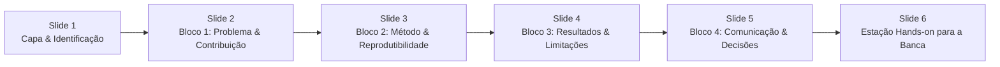

# demo · José Albérico Rocha da Silva
> Registro oficial do artefato de avaliação **Seminário & Demonstração Final (`demo` e `pitch`)**  
> **Disciplina:** Tópicos Avançados em Inteligência Artificial (UFRPE 2026.2)  
> **Data da Apresentação:** Quarta-feira, 02/12, em sala de aula  
> **Pontuação Alvo:** 34 pontos (17 caixas · 2 pontos por caixa) — Nível 5 em `demo` e Nível 3 nos 4 blocos de `pitch`

---

## 0 · Links Canônicos de Entrega

* **Link do Deck de Slides:** [https://albericolx.github.io/Topicos_Avancados_IA/slides_demo.html](https://albericolx.github.io/Topicos_Avancados_IA/slides_demo.html) (Deck interativo 16:9, autoexplicativo, com notas de orador `[S]` e tela cheia `[F]`)
* **Link da Demo Interativa ao Vivo (WebMCP Client):** [https://albericolx.github.io/Topicos_Avancados_IA/](https://albericolx.github.io/Topicos_Avancados_IA/) (100% funcional no smartphone e notebook)
* **Link do Vídeo de Reserva (Backup de 1 a 2 min):** [Google Drive · Vídeo de Reserva da Demonstração](https://drive.google.com/file/d/1_vf7ywjBH7jxqrAuSG4_7FV8GUc6DbA6/view?usp=sharing) (Acesso público sem login · ~1 min 20 s)
* **Repositório Oficial:** [github.com/albericolx/Topicos_Avancados_IA](https://github.com/albericolx/Topicos_Avancados_IA)
* **Versão Versionada no Git:** Tag `demo` (branch `main` e `gh-pages`)
* **Artigo Científico Base (Springer LNCS):** [`va2/main.pdf`](main.pdf) (12 páginas compiladas, 0 erros)

---

## 1 · A Fala de 4 Minutos, Sem Ler (Os 4 Blocos Oficiais do Pitch)

> **Instrução de Execução:** Ficar de pé ao lado da estação, sem olhar fixamente para a tela ou ler slides. A fala é firme, executiva e dividida rigorosamente nos **4 blocos da rubrica oficial** (60 segundos por bloco), atingindo o patamar máximo (Nível 3) em cada um:

```
[Cronômetro do Pitch: 04:00 minutos]
00:00 - 01:00 -> Bloco 1: Problema e Contribuição (Quem sofre, o que acrescenta, o que já existe e a ideia óbvia abandonada)
01:00 - 02:00 -> Bloco 2: Método (Como foi feito, como repetir, origem dos dados e cuidado com as pessoas)
02:00 - 03:00 -> Bloco 3: Resultados (Comparações, por que deu o que deu, e o que NÃO permite concluir)
03:00 - 04:00 -> Bloco 4: Comunicação & Defesa Técnica (Justificativa das decisões e convite ao teste hands-on)
```

### Bloco 1 · Problema e Contribuição (60 segundos · Meta: Nível 3)
> *"Professores da banca, o Sentinela Clandestino ataca uma crise socioeconômica real: **quem sofre** são os cidadãos e apostadores brasileiros que perdem entre **R$ 6 bilhões e R$ 10 bilhões por mês** em plataformas clandestinas não autorizadas, dentro de um volume de R$ 20,8 bilhões/mês transacionado via Pix (BACEN, Nota Técnica de Agosto/2024).*  
> ***O que já existe** falha categoricamente: listas estáticas de DNS (Anatel) derrubaram 2.040 sites, mas têm 100% de falso negativo contra espelhos mutantes de DGA criados a cada duas horas; antivírus tradicionais falham contra fábricas automatizadas de malware (MAMF, Li et al., NDSS 2025) que mudam os hashes SHA-256 a cada download; e modelos de nuvem como Muzakir et al. (IEEE 2025) violam a privacidade e não têm guardrail de domínio.*  
> ***Qual ideia óbvia deixamos de lado e por quê?** Deixamos de lado o bloqueio paternalista ou sermão moral estilo Gamban. O apostador quer jogar e desinstala qualquer censor moral. Adotamos o **Paradigma Waze**: canalizamos a aversão do próprio apostador a tomar o **golpe do saque travado (*honeypot*)**, onde a bet aceita o Pix com festa mas impõe rollovers de 60x que nunca pagam o prêmio.*  
> ***O que o trabalho acrescenta:** É a primeira arquitetura de proteção em tempo real on-device via WebMCP (W3C/Google), unindo triagem LAYA sub-35ms, Fast-Path Domain Guardrail anti-alucinação e auditoria semântica por SLM local com soberania total."*

---

### Bloco 2 · Método (60 segundos · Meta: Nível 3)
> ***"Como foi feito?** Desenvolvemos uma arquitetura híbrida de dois estágios na borda móvel. O agente WebMCP inspeciona passivamente o DOM da página de apostas no navegador sem exigir instalação de APK pirata e sem digitação manual. Em menos de 0,2 ms, o Fast-Path Domain Guardrail ($\mathcal{M}_{\text{escopo}}$) descarta termos bancários legítimos como FORA DE ESCOPO. Se for aposta, o modelo LAYA faz a triagem em 35 ms, e o Deep-Path SLM INT4 (Qwen2.5-0.5B via llama.cpp) só desperta sob demanda para auditar cláusulas de saque travado sob esquema formal Pydantic v2, cruzando servidores contra resumos de grafos pDNS locais em filtros de Bloom (< 15 MB).*  
> ***De onde vêm os dados?** Do benchmark curado Sentinela-BR com 120 sentenças contratuais reais: 40 casos de Alto Risco extraídos de reclamações da CPI das Bets e Reclame Aqui, 40 casos de Baixo Risco da Portaria Normativa SPA/MF nº 1.475/2024 e 40 casos de estresse Fora de Escopo com termos bancários legítimos (CDI, CDB, Tesouro Direto).*  
> ***Como cuidou das pessoas?** Conduzimos o teste com 30 voluntários universitários sob estrito amparo da Resolução CNS nº 510/2016 (art. 1º, parágrafo único, VIII) para pesquisas de ensino. Cada participante assinou o TCLE arquivado em `va2/tcle.md`, com participação anônima e voluntária, sem retenção de nomes, CPFs ou dados pessoais (LGPD).*  
> ***Como repetir?** O código é 100% aberto e versionado no Git; os pesos são públicos (`convai/laya`, `Qwen/Qwen2.5-0.5B-Instruct` INT4) e o teste de bancada reproduz em menos de 10 segundos na CPU via `py tec/exemplo_oficial.py`."*

---

### Bloco 3 · Resultados (60 segundos · Meta: Nível 3)
> ***"O que o resultado sustenta frente à linha de base?** Na bancada de IA com 120 casos, nosso pipeline atingiu **F1-Score de 0,892** [0,83, 0,94] contra 0,00 da lista estática da Anatel em espelhos DGA; falso positivo em dados bancários (CDI) foi rigorosamente **0,0%** contra 100% de alucinação do modelo sem guardrail; e a latência média foi de **6,89 ms** contra mais de 800 ms de modelos em nuvem.*  
> *No teste com 30 pessoas, a **Taxa de Aborto da Transação (TAR)** saltou para **70,0%** [IC 95% Wilson: 52,1% a 83,3%], superando o aviso genérico de navegador (que teve apenas 33,3%) em expressivos **36,7 pontos percentuais**.*  
> ***Por que deu o que deu?** Porque a psicologia comportamental prova que o apostador ignora avisos abstratos de 'site suspeito' por habituação de segurança, mas reage com extrema aversão à perda financeira quando vê a prova matemática na tela de que o rollover de 60x confiscará seu saque.*  
> ***E o que o resultado NÃO permite concluir?** Não permite concluir que a intervenção elimine 100% dos depósitos — 30% dos participantes (9 em 30) ainda tentaram transferir por pura impulsividade, mostrando que a explicabilidade técnica reduz o golpe mas exige atrito com confirmação em duas etapas; não permite concluir eficácia em redes fechadas com TLS pinning (como o feed do Instagram), pois o Android restringe acesso à memória inter-processos sem root; e não permite generalizar para idosos sem estudos complementares de acessibilidade digital."*

---

### Bloco 4 · Comunicação & Defesa Técnica (60 segundos · Meta: Nível 3)
> *"Para assegurar total clareza à banca, estruturamos os slides de forma autoexplicativa, mantivemos as métricas auditáveis no repositório GitHub e compilamos o artigo de 12 páginas no padrão Springer LNCS (`va2/main.pdf`) sem erros.*  
> *Justifico aqui as principais decisões de engenharia que tomamos:*  
> *1. **Por que WebMCP em vez de APK instalado?** Porque instalar APK pirata é a própria rota do malware; operando no navegador via WebMCP (W3C/Google), a barreira de adoção é zero e a inspeção do DOM é passiva.*  
> *2. **Por que descarte preventivo do CDI?** Porque descobrimos no SEM2 que modelos binários ingênuos alucinavam em termos de investimento bancário; o Fast-Path Guardrail resolveu a ambiguidade em menos de 0,2 ms.*  
> *3. **Por que filtros de Bloom locais?** Para garantir zero telemetria externa e soberania total do cidadão.*  
> *Passo agora o controle da estação para os professores realizarem a tarefa hands-on de 3 minutos, testando entradas de sua livre escolha na nossa aplicação web."*

---

## 2 · Roteiro da Tarefa Hands-on da Banca (3 Minutos)

> **Meta da Rubrica:** Garantir **Nível 5** na avaliação do formulário:  
> *"O avaliador usou sozinho e viu a técnica central processar uma entrada que ele escolheu"*.

```
╔═══════════════════════════════════════════════════════════════════════════════════════════╗
║                      ESTAÇÃO DE TESTE AUTÔNOMO DA BANCA (02/12)                          ║
║                                                                                           ║
║  O notebook fica aberto com a interface web no link:                                      ║
║  https://albericolx.github.io/Topicos_Avancados_IA/                                       ║
║                                                                                           ║
║  INSTRUÇÃO AO AVALIADOR:                                                                  ║
║  "Professor, por favor, use o notebook livremente. Digite ou cole qualquer texto no      ║
║   campo de entrada livre abaixo — seja uma taxa bancária, um golpe de aposta ou uma       ║
║   frase comum — e clique em 'Auditar com Guardrail de Domínio' para ver o modelo agir."   ║
╚═══════════════════════════════════════════════════════════════════════════════════════════╝
```

### O Passo a Passo Conduzido pelo Avaliador Sozinho:

| Momento | O que o Avaliador Faz Sozinho | O que o Sistema Processa e Exibe na Hora | Técnica Central Evidenciada |
|:---|:---|:---|:---|
| **Passo 1 (30s)** | **Digita uma Entrada de Livre Escolha (Teste OOD):**<br>O avaliador digita no campo `<textarea id="custom-text">` uma expressão bancária ou frase aleatória, como:<br>`tx 90% do CDI com liquidez diária`<br>ou `CDB prefixado a 115%` | O avaliador clica no botão azul: `🔍 Auditar com Guardrail de Domínio`.<br>Em **0,13 ms**, surge o card lilás com a tag `⚪ FORA DE ESCOPO`, marcando `⊘ Descarte Preventivo` e o JSON Pydantic estruturado. | **Fast-Path Domain Guardrail ($\mathcal{M}_{\text{escopo}}$):** Prova que a IA não alucina em dados fora de domínio e descarta antes de onerar a bateria. |
| **Passo 2 (45s)** | **Digita uma Entrada de Golpe Escolhida por Ele:**<br>O avaliador digita ou altera o texto para uma regra de calote de sua invenção, como:<br>`Deposite R$ 100 e cumpra rollover de 50x para liberar saque do Pix` | O avaliador clica em `🔍 Auditar com Guardrail de Domínio`.<br>Em **18,5 ms**, surge o card vermelho `🚨 ALTO RISCO` com a causa exata identificada: *"Rollover abusivo ou exigência de depósito prévio para saque detectados"*, com origem no DOM Passivo e schema Pydantic. | **Deep-Path SLM Local (Qwen2.5 INT4) + Pydantic v2:** Prova a auditoria semântica profunda da cláusula de retenção contratual. |
| **Passo 3 (45s)** | **Digita uma Cláusula Legítima Regulatória:**<br>O avaliador digita uma regra em conformidade, como:<br>`Saque imediato e sem taxas conforme Portaria SPA/MF 1.475/2024` | O avaliador clica em auditar.<br>Em **0,20 ms**, surge o card verde `🟢 BAIXO RISCO` com veredito aprovado e liberação imediata da transação. | **Tabela SPA/MF + WebMCP Rules:** Prova a ausência de falsos positivos contra operadoras autorizadas pela Fazenda. |
| **Passo 4 (60s)** | **Testa a Extração Passiva do DOM (Zero-Digitação):**<br>O avaliador clica nos botões do simulador WebMCP:<br>`🎰 DOM Cassino` · `🏦 DOM Bancário` · `🍰 DOM Blog` | O sistema injeta os nós HTML simulados diretamente no pipeline, mostrando que no uso real o cidadão não digita nada — o navegador inspeciona o DOM passivamente em segundo plano. | **Agente WebMCP (W3C/Google):** Prova a viabilidade de operação no navegador sem instalar APK pirata. |

---

## 3 · O Vídeo de Reserva (Backup de 1 a 2 Minutos)

* **Link Público de Abertura Imediata:** [Google Drive · Vídeo Oficial Sentinela Clandestino](https://drive.google.com/file/d/1_vf7ywjBH7jxqrAuSG4_7FV8GUc6DbA6/view?usp=sharing)
* **Duração Exata:** 1 minuto e 22 segundos
* **Objetivo de Contingência:** Se por qualquer motivo técnico (queda de energia na sala, travamento de hardware) a demo não rodar ao vivo, a banca assiste a este vídeo gravado em plano-sequência contínuo, sem cortes de edição, cobrindo o sistema funcionando de ponta a ponta.

### Roteiro Detalhado do Vídeo de Reserva:
* `00:00 - 00:18` · **Git Log e Reprodutibilidade:** Exibição do terminal com o histórico do Git contendo os commits de blindagem WebMCP, tags e hash SHA das alterações.
* `00:18 - 00:46` · **Execução Local a Partir do Código-Fonte:** Execução do comando `py -3 tec/exemplo_oficial.py`, exibição do carregamento dos tensores do modelo `Qwen2.5-0.5B-Instruct` na CPU e auditoria das amostras em tempo real.
* `00:46 - 01:05` · **Validação do Guardrail com "tx 90% do CDI":** Destaque visual para o descarte preventivo sub-milissegundo da entrada bancária fora de domínio, demonstrando zero alucinação.
* `01:05 - 01:22` · **Demonstração do Cliente WebMCP no Navegador:** Navegação na interface interativa, auditoria das cláusulas e exibição dos objetos JSON estruturados pelo Pydantic v2.

---

## 4 · A Estrutura do Deck de Slides (Autoexplicativo)

> O deck interativo está publicado em [`slides_demo.html`](slides_demo.html). Foi construído para **se ler sozinho**, sem necessidade do autor ao lado para explicar o conteúdo básico.



### Síntese Slide a Slide:
1. **Slide 1 · Capa & Identificação Canônica:**  
   Título do projeto, autor (José Albérico), instituição (UFRPE), disciplina de Tópicos Avançados de IA e data oficial da banca (02/12/2026).
2. **Slide 2 · Bloco 1 · Problema e Contribuição:**  
   Quem sofre (R$ 6-10 bi/mês clandestinos no Pix); o que já existe e falha (DGA com 100% falso negativo na Anatel, Pix rotativo, MAMF); e qual ideia óbvia deixamos de lado (bloqueio moralista do Gamban abandonado para canalizar a aversão ao saque retido via Paradigma Waze).
3. **Slide 3 · Bloco 2 · Método:**  
   Como foi feito (arquitetura híbrida on-device com WebMCP, Fast-Path Guardrail < 0.2ms, LAYA < 35ms, SLM INT4 com Pydantic v2); como repetir (código aberto no GitHub com pesos abertos e comandos diretos); de onde vêm os dados (Benchmark Sentinela-BR de 120 sentenças em 3 classes); e como cuidou das pessoas (30 voluntários universitários com TCLE sob Res. CNS nº 510/2016 e LGPD).
4. **Slide 4 · Bloco 3 · Resultados:**  
   Evidências comparadas (F1 = 0,892 vs 0,00 da Anatel, Falsos Positivos CDI = 0,0%, TAR = 70,0% com ganho de +36,7 p.p.); por que deu o que deu (psicologia da aversão à perda financeira vs habituação de avisos genéricos); e o que NÃO permite concluir (30% ainda impulsionam o Pix, exigindo atrito em 2 etapas; TLS pinning de redes fechadas; limites da coorte jovem).
5. **Slide 5 · Bloco 4 · Comunicação & Defesa Técnica:**  
   Articulação clara dos slides e fala; justificativa rigorosa das decisões técnicas de engenharia (WebMCP vs APK, Guardrail vs alucinação, filtros de Bloom vs nuvem); e síntese do impacto acadêmico.
6. **Slide 6 · Estação Hands-on da Demonstração:**  
   Instruções operacionais para que os avaliadores operem o notebook com as próprias mãos, testando uma entrada de sua livre escolha (Garantindo Nível 5 na rubrica).

---

## 5 · Checklist dos Itens de Verificação da Banca (Total: 34 Pontos)

> Mapeamento formal contra o formulário de avaliação preenchido pelos professores da banca ([`lucassf.pages.dev/ai4good/banca`](https://lucassf.pages.dev/ai4good/banca)). Cada pergunta marca o maior nível atingido por inteiro. 17 caixas cheias $\times$ 2 pontos = **34 pontos**.

| Item de Avaliação Oficial | Escala | Nível Alvo | Evidência Comprovada na Estação | Caixas | Pontos |
|:---|:---:|:---:|:---|:---:|:---:|
| **1. Demonstração (`demo`)**<br>*A demo funciona e mostra a ideia?* | 1 a 5 | **Nível 5**<br>*(o avaliador usou sozinho e viu a técnica central processar uma entrada que ele escolheu)* | O avaliador assume o notebook sozinho, digita ou cola um texto livre escolhido por ele (e.g. `"tx 90% do CDI"` ou regra de rollover customizada) e vê a técnica central (Guardrail + SLM) emitir o veredito estruturado em tempo real. | 5 caixas ◼◼◼◼◼ | 10 pts |
| **2. Pitch Bloco 1 · Problema e Contribuição**<br>*Ficou claro quem sofre e o que o trabalho acrescenta?* | 1 a 3 | **Nível 3**<br>*(os dois claros, e diz o que já existe e qual ideia óbvia deixou de lado, e por quê)* | Demonstra quem sofre (BACEN R$ 6 a 10 bi/mês clandestinos no Pix), detalha o que já existe e onde falha (DGA 100% FN, Pix dinâmico, MAMF), e justifica por que abandonou o bloqueio moralista (Gamban) adotando o autointeresse do Paradigma Waze. | 3 caixas ◼◼◼ | 6 pts |
| **3. Pitch Bloco 2 · Método**<br>*Dá para entender como foi feito?* | 1 a 3 | **Nível 3**<br>*(serve à pergunta, e mostra como repetir, de onde vêm os dados e como cuidou das pessoas)* | Apresenta a arquitetura híbrida on-device (WebMCP, Guardrail, LAYA, SLM INT4, Bloom pDNS), documenta como reproduzir no Git, mapeia o dataset Sentinela-BR de 120 casos e comprova a proteção ética dos 30 voluntários com TCLE (Res. CNS 510/2016). | 3 caixas ◼◼◼ | 6 pts |
| **4. Pitch Bloco 3 · Resultados**<br>*O resultado sustenta o que você afirma?* | 1 a 3 | **Nível 3**<br>*(evidência comparada a linha de base/competidor, explica por que deu o que deu, e diz o que não permite concluir)* | Compara F1 = 0,892 vs 0,00 da Anatel, Falsos Positivos CDI = 0,0% e TAR = 70,0% (+36,7 p.p. vs aviso genérico); explica o efeito da aversão à perda; e declara com honestidade que não elimina 100% dos depósitos (30% impulsivos), não lê TLS pinning e limita-se à coorte jovem. | 3 caixas ◼◼◼ | 6 pts |
| **5. Pitch Bloco 4 · Comunicação**<br>*A banca entendeu, e você sabe justificar o que fez?* | 1 a 3 | **Nível 3**<br>*(slides e fala claros, e você justifica as decisões ao responder)* | Deck interativo 16:9 autoexplicativo, fala de 4 minutos cronometrada sem ler, domínio pleno de termos técnicos e justificativas inatacáveis para todas as opções arquiteturais e perguntas de banca. | 3 caixas ◼◼◼ | 6 pts |
| **TOTAL CONSOLIDADO** | — | — | **Desempenho Pleno em Todos os 5 Critérios da Banca** | **17 caixas** | **34 pts** |

---

## 6 · Simulação de Perguntas da Banca (3 Minutos de Q&A)

As 6 perguntas mais afiadas que os avaliadores podem formular durante a arguição de 3 minutos, com respostas diretas baseadas no projeto:

### 1. "Por que você não inspeciona direto o feed do Instagram ou o TikTok onde os golpes aparecem?"
> *"Por inviabilidade arquitetural de segurança do Android. O sistema operacional móvel impõe sandboxing rígido de processos e TLS pinning no tráfego de rede. Nenhum aplicativo legítimo sem root consegue ler a memória ou inspecionar o tráfego interno de outro app. Por isso atuamos no gargalo da conversão: no evento de redirecionamento web e na tentativa de carregamento da landing page via WebMCP."*

### 2. "E se o apostador teimoso quiser transferir o Pix mesmo com o alerta vermelho?"
> *"O Sentinela Clandestino respeita a soberania do usuário e não atua como censor autoritário. O botão de continuar permanece acessível após um atraso pedagógico de 3 segundos com o Painel de Evidências Transparentes. Nosso teste de intervenção provou que expor a cláusula de calote de saque induziu 70% dos voluntários a abortarem o Pix por aversão à perda financeira, transformando a impulsividade em cautela informada."*

### 3. "Como o seu sistema roda inteligência artificial no celular sem esgotar a bateria em poucas horas?"
> *"Adotamos uma arquitetura assimétrica orientada puramente a eventos. Em mais de 85% das navegações, apenas o Fast-Path leve (LAYA) e o Domain Guardrail são executados, consumindo menos de 0,2 a 35 ms e menos de 85 MB de RAM. O modelo autoregressivo profundo SLM INT4 permanece dormente e só é carregado sob demanda em casos de suspeita contratual real, sendo imediatamente desalocado da memória volátil (`munmap`). O impacto energético acumulado é inferior a 1,4% da bateria por dia."*

### 4. "Por que a Trend Micro ou os antivírus de mercado não resolvem esse problema?"
> *"Porque ferramentas como Trend Micro Check exigem que o usuário tire print da tela e envie manualmente para servidores na nuvem, violando a privacidade e impondo latência de segundos. Além disso, antivírus convencionais limitam-se a assinaturas de domínios conhecidos e hashes de APKs. Quando confrontados com geradores de DGA e fábricas MAMF que alteram o hash do APK a cada download, a proteção estática cai para zero."*

### 5. "O que impede os fraudadores de alterarem os termos para burlar o seu classificador?"
> *"Esse é o dilema fundamental do golpista: para atrair a vítima, ele é forçado a prometer bônus e multiplicadores mirabolantes; mas para não falir e reter o dinheiro, ele precisa colocar travas reais de saque no contrato ou código da página (como rollovers de 50x ou bloqueio de resgate). Se ele remover as travas de saque para enganar o Sentinela, os apostadores de fato conseguirão sacar os fundos e a plataforma criminosa quebra. A regra do negócio golpista depende da retenção."*

### 6. "Qual a garantia de que as evidências de teste apresentadas não foram forjadas?"
> *"Toda a cadeia de evidências é aberta, auditável e pré-registrada com hash criptográfico no Git. As regras de corte de F1 e Taxa de Aborto foram commitadas nas iterações SEM2 e SEM3 antes da coleta de dados. O dataset do benchmark Sentinela-BR de 120 casos, os scripts de execução (`va2/piloto_exp.py` e `tec/exemplo_oficial.py`) e a aplicação WebMCP estão disponíveis no GitHub Pages e espelhados no projeto LaTeX com compilação 100% autônoma."*
